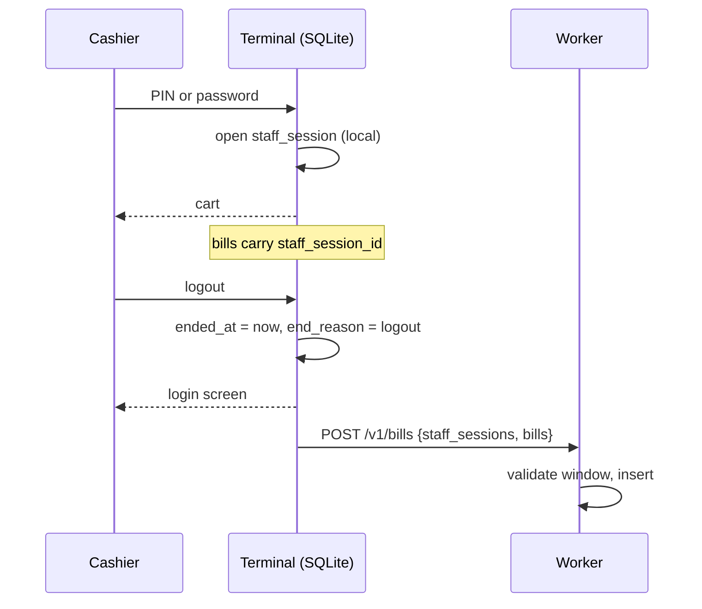

# API routes — one tenant deployment

Hono Worker, REST + JSON, `/v1`. One Worker and one D1 per franchisee. `tenant_id` and `app_id` are
Worker environment constants, never taken from a request body. All examples are for a single tenant
(`tnt_kukatpally`, `app pos-prod-kukatpally`).

Conventions: ids are lowercase UUIDv7 strings; money is integer paise; quantities are integer base units;
instants are Unix seconds (UTC); `business_date` is `YYYY-MM-DD`; booleans are JSON `true`/`false`.
Responses are `application/json; charset=utf-8` and `Cache-Control: no-store` unless stated. Every error
uses `{"error":{"code","message","retryable","details"},"request_id"}`. Unknown response fields MUST be
ignored by clients.

## 1. Auth planes

| Plane | Credential | Routes | Never reaches |
|---|---|---|---|
| Public | none | `GET /health` | any tenant data |
| Device | one-time code → device credential → 5 min JWT `typ=device`, `scope=sync`, `aud=app_id`, `tenant_id` | enrol, token, catalog, bills, void, heartbeat | `/v1/admin/*`, staff routes |
| Staff | device JWT **plus** a human password / one-time password | `/v1/staff/*`, `/v1/approvals` | admin web, another store's roster |
| Admin | `__Host-sid` session cookie, 12 h idle / 30 d absolute, CSRF header on writes | `/v1/admin/*` except `login` | bills, catalog, enrol, token |

Middleware order. Device: rate limit → Bearer parse → signature → `typ=="device"` → `aud==APP_ID` →
`tenant_id==TENANT_ID` → `scope` contains `sync` → device not revoked → attach
`{device_id, store_id, terminal_id}`. Admin: rate limit → Origin/Referer allowlist → cookie → session
lookup (`token_prefix` indexed, constant-time `token_hash`) → not expired/revoked → CSRF compare on
non-GET (signed token from the session, sent as `X-CSRF-Token`; no readable CSRF cookie) → role and
`user_stores` scope → attach `{user_id, role, stores, csrf}`. A cookie presented to a device route is
ignored; a device Bearer presented to `/v1/admin/*` fails `typ=="session"`. That is the whole
separation; there is no shared handler and no route that accepts both.

Store and terminal always come from the token. `store_id`, `terminal_id`, `tenant_id` in a body are
ignored; `store_id` in an admin query must be inside `user_stores` or the call is `403 store_forbidden`.
Every admin write takes an explicit field allowlist: no `password_hash`, `pin_hash`, `id`, `created_at`,
or `role` from a non-owner.

## 2. Route table

### Public

| Method | Path | Auth | Purpose | Idempotency | Success shape | Error codes |
|---|---|---|---|---|---|---|
| GET | `/health` | none | liveness, schema/terminal/catalog versions | read | `{status, app_id, tenant_id, schema_version, min_terminal_version, latest_terminal_version, catalog:{epoch,head,alloc_head,pruned_below,reset_to}, server_time}` | `503 db_unavailable`, `503 schema_mismatch`, `429 rate_limited` |

### Device / sync

| Method | Path | Auth | Purpose | Idempotency | Success shape | Error codes |
|---|---|---|---|---|---|---|
| POST | `/v1/enroll` | one-time code (no JWT) | bind a device to store+terminal, return the device credential | **no** — single-use code; lost response needs a new code | `{device_credential, device_id, tenant_id, app_id, store_id, terminal_id, store_name, lease_expires_at, catalog:{epoch,head,alloc_head,pruned_below,reset_to}, server_time}` | `400 invalid_request`, `404 code_not_found`, `409 code_used`, `409 wrong_tenant`, `409 wrong_app`, `410 code_expired`, `429 rate_limited` |
| POST | `/v1/token` | device credential + `install_id` | exchange the credential for a 5 min JWT; refresh lease | safe to repeat; each call mints a new `jti` | `{access_token, token_type:"Bearer", expires_in:300, expires_at, lease_expires_at, server_time, tenant_id, app_id, store_id, terminal_id, catalog:{epoch,head,alloc_head,pruned_below,reset_to}, rotate_to}` | `401 invalid_credential`, `401 device_moved`, `401 device_revoked`, `401 wrong_tenant`, `401 wrong_app`, `426 upgrade_required`, `429 rate_limited` |
| GET | `/v1/catalog` | device JWT | store-scoped catalog delta, or a paged snapshot after a reset | read; `since` + `epoch` make it replayable | delta `{mode, cursor_format, epoch, store_id, terminal_id, since, cursor, max_seen_seq, head, alloc_head, pruned_below, reset_to, has_more, server_time, changes[]}`; snapshot `{mode, snapshot_attempt_id, snapshot_page, snapshot_cursor, snapshot_complete, epoch, store_id, terminal_id, head, pruned_below, server_time, rows[]}` | `400 invalid_cursor`, `400 invalid_limit`, `400 cursor_format_unsupported`, `400 invalid_snapshot_page`, `410 stale_cursor`, `401 token_expired`, `429 rate_limited` |
| POST | `/v1/bills` | device JWT | push completed bills; per-bill accept/reject | **yes** on bill `id`; duplicate returns accepted; different content is `id_conflict` | `{server_time, accepted:[{id,invoice_no,duplicate}], rejected:[{id,code,message}], staff_sessions:[{id,duplicate}], shifts:[{id,duplicate}], flagged:{stale_price,price_mismatch,policy_violation,staff_inactive,unverified_staff,shift_unverified}, catalog:{epoch,head}}` | envelope: `400 invalid_request`, `413 batch_too_large`; per bill: `invalid_bill`, `id_conflict`, `duplicate_seq`, `display_no_conflict`, `invalid_totals`; always 200 if the envelope is valid |
| POST | `/v1/bills/:id/void` | device JWT | append a void record; bills stay immutable | **yes** — first void wins, later calls return the existing record | `{bill_id, voided:true, voided_at, voided_by, duplicate, server_time}` | `403 store_forbidden`, `404 bill_not_found`, `422 invalid_reason`, `429 rate_limited` |
| POST | `/v1/terminals/heartbeat` | device JWT | last-seen, app version, unsynced depth, lease refresh | upsert by device | `{server_time, min_terminal_version, latest_terminal_version, update_required, lease_expires_at, catalog:{epoch,head,alloc_head,pruned_below,reset_to}}` | `401 token_expired`, `426 upgrade_required`, `429 rate_limited` |

### Cashier / staff (device JWT + a human credential)

| Method | Path | Auth | Purpose | Idempotency | Success shape | Error codes |
|---|---|---|---|---|---|---|
| POST | `/v1/staff/activate` | device JWT + one-time password | first-run: replace the admin-issued one-time password, set a 6-digit PIN, open a staff session | **no** — the old password stops working | `{user, staff_assertion, staff_session_id, expires_at, shift_id}` | `401 invalid_credentials`, `403 store_forbidden`, `403 user_inactive`, `422 weak_credential`, `429 rate_limited` |
| POST | `/v1/staff/login` | device JWT + `user_id` + password | shift start online; opens one live staff session per terminal, creates the server shift row | safe to repeat; each login opens a new session (the previous one must have ended) | `{user, staff_assertion, staff_session_id, expires_at, shift_id, auth_method:"password", server_time}` | `401 invalid_credentials`, `403 store_forbidden`, `403 user_inactive`, `409 session_already_open`, `429 rate_limited` |
| POST | `/v1/staff/logout` | device JWT + `staff_session_id` | end the current cashier session online; normally local-first and pushed with bills | **yes** — closing an already-closed session returns the stored `ended_at` | `{staff_session_id, ended_at, duplicate}` | `403 store_forbidden`, `404 session_not_found`, `429 rate_limited` |
| POST | `/v1/approvals` | device JWT + manager email/password | mint a 12 h approval grant for overrides | **no** — multiple grants may coexist; the terminal rotates | `{grant_id, grant_token, expires_at, max_overrides, max_discount_pct}` | `401 invalid_credentials`, `403 not_approver`, `403 store_forbidden`, `429 rate_limited` |

STE PIN: verified locally against the cached `pin_hash`/`pin_salt`; no route. PIN bills carry
`auth_method:"pin_offline"`; a PIN is attribution, not authorisation.

### Admin web (session cookie; `owner` writes, `owner|staff` reads)

| Method | Path | Auth | Purpose | Idempotency | Success shape | Error codes |
|---|---|---|---|---|---|---|
| POST | `/v1/admin/login` | none | email+password → session cookie | **no** — each call creates a session | `{user, csrf_token, expires_at, server_time}` + `Set-Cookie: __Host-sid` | `401 invalid_credentials`, `403 forbidden_role`, `422 validation_failed`, `429 rate_limited` |
| POST | `/v1/admin/logout` | session + CSRF | revoke the current session | yes (204) | `204` | `401 session_expired`, `403 csrf_failed` |
| GET | `/v1/admin/me` | session | current user, stores, fresh CSRF token | read | `{user, stores, session:{expires_at,last_seen_at}, csrf_token}` | `401 session_expired` |
| POST | `/v1/admin/password` | session + CSRF | change own password; revoke other sessions | absolute values | `204` | `401 invalid_credentials`, `422 validation_failed`, `403 password_change_required` |
| POST | `/v1/admin/sessions/revoke-all` | session + CSRF | revoke every session for the user | yes (204) | `204` | `401 session_expired`, `403 csrf_failed` |
| GET | `/v1/admin/items` | session | search items by name/local name/alias/SKU/EAN | read | `{items[], next_cursor, has_more}` | `400 invalid_query`, `403 store_forbidden` |
| POST | `/v1/admin/items` | owner + CSRF | create item (optionally with client id) | **yes** on client `id`; same body returns the item, different body 409 | `{item, catalog:{epoch,head}}` | `409 item_exists`, `422 validation_failed` |
| GET | `/v1/admin/items/:id` | session | item + scoped prices + identifiers | read | `{item, prices[], identifiers[], catalog_seq}` | `404 not_found`, `403 store_forbidden` |
| PATCH | `/v1/admin/items/:id` | owner + CSRF | name, `name_local`, tax, HSN, MRP, flags, `active` | absolute values; optional `If-Match` | `{item, catalog:{epoch,head}}` | `404 not_found`, `409 immutable_field`, `409 edit_conflict`, `422 validation_failed` |
| DELETE | `/v1/admin/items/:id` | owner + CSRF | soft delete; deactivates identifiers | yes (already inactive returns 200) | `{item_id, active:false, catalog:{epoch,head}}` | `404 not_found`, `403 forbidden_role` |
| PUT | `/v1/admin/items/:id/prices` | owner + CSRF | replace one scope's tier set; new version | **no** — versioned; replay with old `base_version` is 409 | `{item_id, store_key, version, prices[], catalog:{epoch,head}}` | `404 not_found`, `409 version_conflict`, `422 validation_failed` |
| PUT | `/v1/admin/items/:id/identifiers` | owner + CSRF | replace one store's identifier set | **yes** — same set is a no-op | `{item_id, store_id, identifiers[], catalog:{epoch,head}}` | `404 not_found`, `409 identifier_conflict`, `422 validation_failed` |
| GET | `/v1/admin/items/:id/history` | session | price versions for the item | read | `{item_id, prices[], next_cursor, has_more}` | `404 not_found` |
| GET | `/v1/admin/reports/sales-by-item` | session | per-item qty/amount for a date range | read | `{range, rows[], totals, provisional_until, next_cursor, has_more}` | `400 invalid_range`, `403 store_forbidden`, `413 range_too_large`, `429 rate_limited` |
| GET | `/v1/admin/reports/day-summary` | session | totals per business date/store | read | `{range, rows[], totals, provisional_until, next_cursor, has_more}` | `400 invalid_range`, `403 store_forbidden`, `413 range_too_large` |
| GET | `/v1/admin/audit-events` | owner | override/void/flag/admin audit feed | read | `{events[], next_cursor, has_more}` | `400 invalid_query`, `403 forbidden_role` |
| GET | `/v1/admin/terminals` | session | terminals, devices, last seen, lease, heartbeat from KV | read | `{terminals[], next_cursor, has_more}` | `403 store_forbidden` |
| POST | `/v1/admin/terminals` | owner + CSRF | create terminal + register numbering policy + config | 409 on duplicate `(store_id,name)` | `{terminal, numbering_policy, catalog:{epoch,head}}` | `409 terminal_exists`, `422 validation_failed` |
| PATCH | `/v1/admin/terminals/:id` | owner + CSRF | rename/activate; deactivation revokes devices | absolute values | `{terminal, catalog:{epoch,head}}` | `404 not_found`, `409 terminal_active_devices` |
| POST | `/v1/admin/terminals/:id/revoke` | owner + CSRF | revoke a device (all active, or `device_id`) | **yes** — already revoked returns `revoked:0` | `{terminal_id, revoked, server_time}` | `404 not_found` |
| POST | `/v1/admin/terminals/:id/enrol-code` | owner + CSRF | mint a 15 min single-use code; invalidates prior unused codes | **no** — new code each call | `{code, expires_at, store_id, terminal_id}` | `404 not_found`, `409 terminal_inactive`, `429 rate_limited` |
| GET | `/v1/admin/stores` | session | stores in scope, no pagination (bounded ≤50) | read | `{stores[]}` | `403 store_forbidden` |
| GET | `/v1/admin/stores/:id` | session | store + settings + store numbering policy | read | `{store, settings, numbering_policy, catalog_seq}` | `404 not_found`, `403 store_forbidden` |
| PATCH | `/v1/admin/stores/:id` | owner + CSRF | name, business-day start, rounding, invoice prefix/padding | absolute values | `{store, settings, numbering_policy, catalog:{epoch,head}}` | `404 not_found`, `409 numbering_conflict`, `422 validation_failed` |
| GET | `/v1/admin/users` | owner | roster incl. cashiers, roles, store scope | read | `{users[], next_cursor, has_more}` | `403 forbidden_role` |
| POST | `/v1/admin/users` | owner + CSRF | create user; returns a one-time password shown once | 409 on duplicate email | `{user, activation:{kind:"one_time_password", value}}` | `409 email_exists`, `422 validation_failed` |
| PATCH | `/v1/admin/users/:id` | owner + CSRF | name, role, stores, active; deactivation revokes sessions | absolute values | `{user, catalog:{epoch,head}}` | `404 not_found`, `409 last_owner`, `422 validation_failed` |
| POST | `/v1/admin/users/:id/reset` | owner + CSRF | reset password, clear PIN, return a new one-time password | **no** — invalidates the old password | `{user_id, activation:{kind:"one_time_password", value}}` | `404 not_found`, `403 forbidden_role` |

## 3. The six load-bearing payloads

### 3.1 `POST /v1/enroll`

```http
POST /v1/enroll HTTP/1.1
Content-Type: application/json
X-Client-Version: 1.4.2

{"code":"A-7K2M-9QX4","install_id":"9f2c41d8a0b34e77b6e1c2d3f4a59601",
 "device_name":"Counter 2 — Windows","app_version":"1.4.2","tenant_id":"tnt_kukatpally"}
```

```json
{"device_credential":"v1_9tR2...43chars","device_id":"0192f3d1-8a5b-7c3d-9e1f-2a3b4c5d6e7f",
 "tenant_id":"tnt_kukatpally","app_id":"pos-prod-kukatpally",
 "store_id":"0192f3c0-0000-7000-8200-000000000001",
 "terminal_id":"0192f3c0-0000-7000-8200-000000000002",
 "store_name":"Kukatpally","lease_expires_at":1763712000,
 "catalog":{"epoch":1,"head":8412,"alloc_head":8412,"pruned_below":0,"reset_to":0},
 "server_time":1763107200}
```

The code is 40 bits, 15 min, single-use, stored only as an HMAC. The credential is 32 random bytes,
returned once, stored by the Worker as SHA-256 + a short lookup prefix; `install_id` is sent on every
token call and a mismatch is `401 device_moved`. The terminal pins `{device_credential, install_id,
tenant_id, app_id, api_base}` in the OS keychain and refuses to sync if the server disagrees. A body
`tenant_id` that differs from the environment is `409 wrong_tenant` and writes nothing.

### 3.2 `POST /v1/token`

```json
{"device_credential":"v1_9tR2...43chars","install_id":"9f2c41d8a0b34e77b6e1c2d3f4a59601","app_version":"1.4.2"}
```

```json
{"access_token":"eyJhbGciOiJIUzI1NiIs...","token_type":"Bearer","expires_in":300,
 "expires_at":1763107500,"lease_expires_at":1763712000,"server_time":1763107200,
 "tenant_id":"tnt_kukatpally","app_id":"pos-prod-kukatpally",
 "store_id":"0192f3c0-0000-7000-8200-000000000001",
 "terminal_id":"0192f3c0-0000-7000-8200-000000000002",
 "catalog":{"epoch":1,"head":8412,"alloc_head":8412,"pruned_below":0,"reset_to":0},"rotate_to":null}
```

Claims: `{typ:"device", sub:device_id, aud:app_id, tenant_id, store_id, terminal_id, scope:"sync",
iat, exp, jti}`. TTL 5 minutes; no refresh token — the device credential is the refresh mechanism.
`rotate_to` is a new credential when the current one is older than 90 days; the terminal MUST persist
it before its next call. Billing never calls this route; token expiry pauses sync only.

The `catalog` object in `/v1/enroll`, `/v1/token` and `/health` is **diagnostic** (`{epoch, head,
alloc_head, pruned_below, reset_to}`). A new or re-enrolled terminal MUST start at `since=0` or
`?snapshot=1`, never at the returned `head`; starting at `head` skips the initial catalog.

### 3.3 `GET /v1/catalog?since=8412&epoch=1&limit=500`

Delta response (store-scoped; documents are current state, not the state at `seq`):

```json
{"mode":"delta","cursor_format":2,"epoch":1,"store_id":"0192f3c0-...8201",
 "terminal_id":"0192f3c0-...8202","since":8412,"cursor":8420,"max_seen_seq":8420,
 "head":8431,"alloc_head":8431,"pruned_below":0,"reset_to":0,
 "has_more":true,"server_time":1763107200,
 "changes":[
  {"seq":8415,"entity":"item","entity_id":"0192f3c4-8a5b-7c3d-9e1f-2a3b4c5d6e7f",
   "op":"upsert","version":null,"document":{"id":"0192f3c4-...","name":"Tamarind",
   "name_local":"చింతపండు","dimension":"mass","pricing_mode":"fixed_only","base_unit":"g",
   "default_sales_unit":"kg","tax_rate_id":"...0002","hsn":"0810","price_includes_tax":true,
   "mrp_minor":5000,"allow_discount_pct":0,"restrict_price_edit":true,"prompt_qty":false,
   "scale_qty":false,"active":true}},
  {"seq":8420,"entity":"item_price","entity_id":"0192f3c4-...","op":"upsert","version":8,
   "document":{"item_id":"0192f3c4-...","version":8,"prices":[
    {"item_id":"0192f3c4-...","store_key":"","qty_base":1000,"version":8,"price_minor":4000,
     "mrp_minor":5000,"valid_from":1763000000,"valid_to":null},
    {"item_id":"0192f3c4-...","store_key":"","qty_base":500,"version":8,"price_minor":2500,
     "mrp_minor":3000,"valid_from":1763000000,"valid_to":null}]}}
 ]}
```

`entity` is one of `item`, `item_price`, `item_identifier`, `unit`, `tax_rate`, `user`, `store`,
`store_settings`, `numbering_policy`, `terminal_config`. `op` is `upsert` or `delete`. `store_key` is
`""` for the franchise default and the store id for an override; the terminal selects per
`(item, qty_base)`: store row wins, default is the fallback. Every price row carries `valid_from`,
`valid_to` and `version`.

Snapshot is paged, never one unbounded response:
`GET /v1/catalog?snapshot=1&epoch=1&snapshot_page=items&snapshot_cursor=...&limit=500`.
Pages cover `items`, `prices`, `identifiers`, `users`, `reference` (units/tax rates) and `store`
(store, settings, numbering policies, config); each page is ≤8 MB and returns
`{mode:"snapshot", snapshot_attempt_id, snapshot_page, snapshot_cursor, snapshot_complete, epoch, head,
pruned_below, store_id, terminal_id, server_time, rows:[...]}`. The first page freezes `epoch`, `head`
and `pruned_below` and the terminal supplies `snapshot_attempt_id`. Each later page's transaction
**re-reads the live `sync_epoch` and `pruned_below`** (and the `catalog_rebuild` generation if one is
open). If they differ from the frozen values, return `410 snapshot_invalidated` with the live values;
the terminal discards the shadow tables, keeps billing on the old catalog, and restarts. If they match,
echo the **frozen** `epoch`/`head`/`pruned_below`, not the live head, and return current-state rows. An
ordinary catalog edit between pages does not invalidate: pages are current-state and the delta from the
frozen head converges. `snapshot_attempt_id` names the terminal's attempt; `catalog_generation` names
the server-side `catalog_rebuild` generation — do not conflate them. The terminal clears its shadow
tables (or tags rows with the new `snapshot_attempt_id`) before page 1, so rows left by a failed attempt
cannot leak into the swap. It swaps all shadow tables plus
`cursor = {cursor_format:2, epoch, seq:head}` only when `snapshot_complete:true`. If a D1 bookmark is
used instead, every page reads at or after the frozen bookmark and the epoch/floor re-check is replaced
by the bookmark guarantee; that path must be stated explicitly, because its invalidation rule differs. A snapshot is the only correct bootstrap/recovery; deltas
are only for a terminal that already has the catalog. The initial tenant seed is a complete catalog
(units, tax rates, store, settings, numbering, config, every item/price/identifier), so a fresh
terminal's snapshot is never empty; an empty catalog is a provisioning failure, not a valid state.

### 3.4 `POST /v1/bills`

Up to 100 bills per request; each bill is processed in **its own `db.batch()`**, so one malformed bill
cannot roll back the rest. Envelope: `{staff_sessions[], shifts[], bills[]}`. `shifts[]` rows are
`{id, business_date, opened_by, opened_at, closed_by?, closed_at?}`; `store_id`/`terminal_id` come from
the JWT and body values are ignored. Sessions and shifts are applied before bills, sorted by
`started_at`/`opened_at`; duplicate ids are acked, not re-inserted. Pre-checks per bill: `id` exists → accept as duplicate when
`payload_sha256` matches, else `id_conflict`; `(store_id, terminal_id, local_seq)` exists with another
id → `duplicate_seq`.

```json
{"staff_sessions":[{"id":"0192f3c0-0000-7000-8600-000000000001",
  "user_id":"0192f3c0-0000-7000-8300-000000000001",
  "terminal_id":"0192f3c0-0000-7000-8200-000000000002","auth_method":"password",
  "staff_assertion":"eyJhbGciOiJIUzI1NiIs...",
  "started_at":1763103600,"ended_at":null,"end_reason":null}],
 "shifts":[{"id":"0192f3c0-0000-7000-8400-000000000001",
  "business_date":"2026-11-14","opened_by":"0192f3c0-0000-7000-8300-000000000001",
  "opened_at":1763103600,"closed_at":null,"closed_by":null}],
 "bills":[{"id":"0192f3d1-8a5b-7c3d-9e1f-2a3b4c5d6e7f",
 "business_date":"2026-11-14","local_seq":431,"display_no":"S1-T2-000431",
 "user_id":"0192f3c0-0000-7000-8300-000000000001","auth_method":"password",
 "shift_id":"0192f3c0-0000-7000-8400-000000000001",
 "staff_session_id":"0192f3c0-0000-7000-8600-000000000001",
 "subtotal_minor":6190,"tax_minor":310,"total_minor":6500,"rounding_minor":0,
 "created_at":1763107200,"payload_sha256":"b0e1...64hex",
 "lines":[{"line_no":1,"item_id":"0192f3c4-8a5b-7c3d-9e1f-2a3b4c5d6e7f",
  "item_name":"Tamarind","dimension":"mass","qty_base":1500,"price_version":8,
  "price_source":"tier","list_price_minor":6500,"price_minor":6500,"discount_minor":0,
  "price_breakdown":{"parts":[{"qty_base":1000,"price_minor":4000},
                              {"qty_base":500,"price_minor":2500}]},
  "taxable_minor":6190,"line_total_minor":6500,"tax_rate_bp":500,
  "price_includes_tax":true,"hsn":"0810","cgst_minor":155,"sgst_minor":155,"cess_minor":0}]}]}
```

```json
{"server_time":1763107300,
 "accepted":[{"id":"0192f3d1-...","invoice_no":"KUK/2026/000431","duplicate":false}],
 "rejected":[],
 "staff_sessions":[{"id":"0192f3c0-0000-7000-8600-000000000001","duplicate":false}],
 "shifts":[{"id":"0192f3c0-0000-7000-8400-000000000001","duplicate":false}],
 "flagged":{"stale_price":0,"price_mismatch":0,"policy_violation":0,"staff_inactive":0,
            "unverified_staff":0,"shift_unverified":0},
 "catalog":{"epoch":1,"head":8431}}
```

The Worker recomputes the applicable list price from its own `item_prices` at `created_at`, stores the
claim-vs-computed delta (`computed_list_price_minor`, `price_mismatch`) and sets `stale_price`,
`policy_violation` and `staff_inactive` from server math. Money is never rewritten and a completed sale
is never rejected for policy. `invoice_no` is server-assigned per store from `numbering_policy`; the
terminal treats it as opaque. `store_id`/`terminal_id`/`device_id` come from the JWT. A body line's
`total` invariants: `total_minor = subtotal_minor + tax_minor + rounding_minor` and
`line_total_minor = taxable_minor + cgst + sgst + cess`. `shift_id` is nullable (offline PIN shifts);
if present it must belong to the same store, terminal and user. Per-bill rejection codes are 200-level
facts, not envelope failures. `staff_sessions` are applied sorted by `started_at` in one transaction before any bill, and the response
acks each one (`staff_sessions:[{id,duplicate}]`). A password bill is **accepted and flagged**
`unverified_staff` when its `staff_session_id` is missing, its `created_at` is more than 5 minutes
outside the session window, or the session's `user_id`/`terminal_id`/`auth_method`/store do not match
the bill and JWT. A PIN shift opens a local `staff_sessions` row too; it is pushed with
`auth_method:"pin_offline"` and no `staff_assertion`, and the server verifies user/terminal/store/window
then flags `unverified_staff`. A password session carries the 12 h `staff_assertion` in its first push
row; the assertion has `sid` (the `staff_session_id`) and `iat` claims. The Worker verifies it **once**:
signature, `jti`, user/terminal, `sid == staff_session_id`, `started_at - 300 <= iat <= started_at + 300`,
and `exp >= started_at` — expiry is checked against the session start, not `now`, so a shift longer than the
assertion stays valid. It stores `assertion_verified_at` and does not re-verify later bills. A failed or
expired assertion at first push accepts the session and bills with `unverified_staff`; it never rejects
or parks a completed sale; the flag is for owner review. An unknown `shift_id` is stored as `bills.shift_id = NULL` **and** its original value is kept in
`bills.unverified_shift_id`, with flag `shift_unverified`; silent NULL is forbidden. An offline shift
may be pushed in `shifts[]` before the bills and is acked in `shifts:[{id,duplicate}]`. An already-closed session is a no-op (`session_already_closed` in the session ack),
because logout is local-first and the server learns the end time on push.

### 3.5 `POST /v1/admin/login`

```json
{"email":"owner@srilakshmistores.in","password":"correct horse battery staple"}
```

```http
HTTP/1.1 200 OK
Set-Cookie: __Host-sid=v1_9tR2...; Path=/; Secure; HttpOnly; SameSite=Lax; Max-Age=2592000
Cache-Control: no-store
```

```json
{"user":{"id":"0192f3c0-0000-7000-8500-000000000001","name":"Ravi","role":"owner",
 "must_change_password":false,"stores":[{"id":"0192f3c0-0000-7000-8200-000000000001","name":"Kukatpally"}]},
 "csrf_token":"v1_csrf_7f3c...","expires_at":1763114400,"server_time":1763107200}
```

Password check is PBKDF2-SHA256 600k via WebCrypto. Unknown email and wrong password return the same
401 after a dummy hash. The CSRF token is signed and bound to the session, returned in the body and on
`GET /v1/admin/me`; it is not a readable cookie. Session cookie is `__Host-sid` (Secure, HttpOnly,
SameSite=Lax, no Domain). `must_change_password:true` gates every admin route except `/me`, `/password`
and `/logout` with `403 password_change_required`.

### 3.6 `GET /v1/admin/reports/sales-by-item?from=2026-11-01&to=2026-11-30&store_id=...`

```json
{"range":{"from":"2026-11-01","to":"2026-11-30","store_ids":["0192f3c0-...8201"]},
 "rows":[{"item_id":"0192f3c4-...","item_name":"Tamarind",
          "qty_base":15000,"amount_minor":65000,"avg_price_minor":4333}],
 "totals":{"amount_minor":65000,"qty_base":15000,"bill_count":42,"voided_bills":1},
 "provisional_until":1763107000,"next_cursor":null,"has_more":false}
```

`from`/`to` are inclusive business dates; maximum 92 days (`413 range_too_large`). A single-day range
aggregates `bill_lines`; a multi-day range reads the `sales_daily` rollup (one row per store/date/item),
upserted with each bill and decremented on void. Both exclude `voided=1` and never recompute from
`item_prices`. `store_id` may repeat; omitted means every store in the caller's scope. `format=csv` is
allowed on the same route, has no pagination and escapes leading `= + - @` with a single quote.
`provisional_until` is the newest `received_at` seen, so an owner can tell "closed" from "a terminal has
not synced".

## 4. Catalog checkpoint contract

`since` is the last `catalog_changes.seq` the terminal applied. The cursor is a triple
`{cursor_format, epoch, seq}`; old timestamp/version cursors are not seq-compatible.

- `epoch` is `schema_meta.sync_epoch`, bumped on every Time Travel restore, database re-create or
  destructive migration — **not** on routine compaction. It is the durable reset signal: any epoch
  mismatch is `410`, regardless of `head`, so a reset is sticky even if a crash loses the terminal's
  in-flight reset. `sync_epoch` is an INTEGER: bump it to the pre-restore maximum (captured before the
  restore) + 1; never `restored_epoch + 1`, which can collide with an epoch a terminal already has.
- `pruned_below` is the **lowest `seq` still retained** (0 when nothing is pruned).
  `reset_to = max(0, pruned_below - 1)` is the cursor to resume from after a reset; `since = reset_to`
  pulls the first retained row, `since = reset_to - 1` is `410`.
- `head` is the highest **committed** change, `COALESCE(MAX(seq),0) FROM catalog_changes`, not
  `catalog_seq.last_seq` (the allocator can be one rolled-back allocation ahead). The response also
  carries `alloc_head` for diagnostics.
- A request MUST send `since`, `epoch` and `cursor_format=2`. The response carries the same epoch,
  `cursor` (last **raw** seq in the page, including rows dropped by store filtering), `max_seen_seq`,
  `head`, `alloc_head`, `pruned_below`, `reset_to`, `has_more`, `store_id`, `terminal_id` and
  `server_time`.

Floor, head and page MUST come from one consistent read. D1 `db.batch()` runs its statements in one
transaction, so the Worker reads `catalog_seq`, `schema_meta.sync_epoch`, the lookahead page and the
committed head in one batch; a compaction cannot delete a range between the floor check and the page.
Pin catalog reads to the primary (or a session at least as new as the terminal's cursor); a lagging
replica's floor or head causes false `410`s and can serve a page behind the cursor.

Store projection is explicit, because `catalog_changes` stores no old store. Every terminal reads the
same raw change rows; the Worker projects each document per token:

- `item`, `unit`, `tax_rate`: upsert to every store.
- `item_price`: send the item's full price set filtered to `store_key IN ('', token.store)`; the
  terminal replaces its local price rows for that item, so a removed/closed override disappears
  without a tombstone.
- `item_identifier`: `row.store_id == token.store` → upsert; otherwise → `op:"delete"` for that
  identifier id. Every terminal sees the change, so the old store is told to remove the alias and the
  new store upserts it. The admin write allocates the old store's delete `seq` before the new store's
  upsert, so seq-ordered apply cannot hit the terminal's unique active-alias index.
- `user`: assigned to `token.store` → upsert the roster row; otherwise → `op:"delete"` (every terminal
  sees it, so a user moved out of a store leaves that roster).
- `store`, `store_settings`, `numbering_policy`: only the token's store is upserted; other stores are
  dropped (there is no local row).
- `terminal_config`: only the token's terminal is upserted; other terminals are dropped.

A page is one range scan with a lookahead row; documents are loaded at current state. A row changed
twice in one page may show its newer state early; the later `seq` replays it. `item_price` changes
carry the **full current price set for that item**, all scopes and versions, so a closed row's
`valid_to` is not missed; the terminal selects the open row per `(item, qty_base)` with **store row
wins, default falls back**, never `MAX(version)` across scopes. `cursor` advances over dropped rows; it
is the last raw seq, not the last kept row.

Exact SQL shape the terminal's checkpoint needs:

```sql
-- Server: ALL of this is one db.batch(), one read transaction, primary only.
-- 1. generation + floor + allocator
SELECT sync_epoch FROM schema_meta WHERE id = 1;
SELECT last_seq, pruned_below FROM catalog_seq WHERE id = 1;

-- 2. page with one lookahead row: has_more comes from the raw 501st row, not changes.length
SELECT seq, entity, entity_id, op, version, changed_at
FROM catalog_changes
WHERE seq > ?1
ORDER BY seq
LIMIT ?2 + 1;

-- 3. highest committed change (not the allocator)
SELECT COALESCE(MAX(seq), 0) AS head FROM catalog_changes;
```

If the lookahead row exists, return `limit` rows and `has_more=true`; if the page was entirely
filtered out, return `changes:[]`, `cursor` = the last raw seq read, `has_more` from the lookahead;
the terminal must still commit that cursor. A page is also byte-bounded: stop before 8 MB and return
`has_more=true` even if fewer than `limit` rows were read.

```sql
-- Terminal: read the checkpoint on startup.
SELECT value FROM sync_state WHERE key = 'catalog_cursor';

-- Terminal: inside BEGIN IMMEDIATE, after every row in the page applied, and only then:
INSERT INTO sync_state (key, value) VALUES ('catalog_cursor', ?1)
ON CONFLICT(key) DO UPDATE SET value = excluded.value;
-- COMMIT. A crash before COMMIT leaves the old cursor; the page is replayed, upserts are idempotent.
```

Gap and reset detection. Do **not** test `seq = since + 1`: sequences are sparse (rolled-back
allocations, deletions). A terminal checks: raw seqs strictly increase; `max_seen_seq == cursor`
(including rows dropped by store filtering); the last **kept** change's seq is `<= cursor`; and
`has_more=false` implies `cursor == head` where `head` is the committed max, not the allocator. Any
violation: retry once, then reset. A reset is any `410`: `since < reset_to` (`stale_cursor`),
`since > head` (`cursor_ahead`), or `epoch != sync_epoch` (`epoch_mismatch`). The epoch check is
sticky and independent of head; a post-restore epoch bump is mandatory.

On `410` the terminal MUST NOT clear its live catalog before the replacement is in hand. It fetches
`GET /v1/catalog?snapshot=1` into shadow tables (`items_new`, `prices_new`, `identifiers_new`,
`units_new`, `tax_rates_new`, `users_new`, `store_new`, `store_settings_new`,
`numbering_policies_new`, `terminal_config_new`), then swaps all of them and writes
`catalog_cursor = {cursor_format:2, epoch, seq:head}` in one `BEGIN IMMEDIATE` transaction. If the
fetch or power fails, the old catalog still bills. It never touches `bills`, `outbox`, `local_seq`,
display counters or the invoice series. If the snapshot fails twice, keep billing on the old catalog
and surface a sync warning.

`409` is identity only — `wrong_tenant` or `wrong_app`: quarantine the outbox (do not push it to a
re-enrolled tenant), stop all sync, show the blocking "this register belongs to another business"
dialog, and re-enrol; never auto-reset on 409. A terminal re-enrolled to a **different store** in the
same tenant is caught by the `store_id` in every catalog response: on a pinned-store mismatch it takes
the same staged-snapshot reset and updates the pin. Every catalog response also carries `terminal_id`
and `server_time`; the terminal persists the clock offset even on 410/409. A `410` response includes
`{code, details:{reason, epoch, head, alloc_head, pruned_below, reset_to}}`.

State machine: `Idle → Syncing → Idle` on a complete pass; `401 token_expired` → refresh and retry;
`403`/`device_revoked` → a distinct `ReauthNeeded`/`Revoked` state that stops billing and offers
export, never a 401 retry loop; `410` → `CatalogReset` (staged snapshot, bills unchanged); `409` →
`IdentityConflict` (outbox quarantined, re-enrol); network/5xx/429 → `Backoff` with jitter. A
`cursor_format` other than 2 is `400 cursor_format_unsupported`; the terminal falls back to a snapshot,
never silently treats an old timestamp/version as a seq.

## 5. Pagination rules

Common list convention: `limit` (default 50, cap 200 unless stated), opaque `cursor` (omit for the
first page), response `next_cursor` (null when exhausted) and `has_more`. Cursors are keyset, not
offsets, and are bound to the route and filter set: reusing one with different filters is
`400 cursor_filter_mismatch`; malformed is `400 invalid_cursor`. Requests above the cap are
`400 invalid_limit`, not silently clamped.

| Route | Order | Cursor key | Default / cap |
|---|---|---|---|
| `/v1/catalog` delta | `seq ASC` | `since` + `epoch` + `cursor_format=2` (special, not opaque) | 200 / 500 changes or 8 MB |
| `/v1/admin/items` | `id ASC` (UUIDv7 = creation order; stable under edits) | last `id` | 50 / 200 |
| `/v1/admin/items/:id/history` | `valid_from DESC, version DESC, store_key ASC` | `(valid_from, version, store_key)` | 50 / 200 |
| `/v1/admin/reports/sales-by-item` | `amount_minor DESC, item_id ASC` | `(amount_minor, item_id)` | 100 / 500 |
| `/v1/admin/reports/day-summary` | `business_date ASC, store_id ASC` | `(business_date, store_id)` | 100 / 500 |
| `/v1/admin/audit-events` | `at DESC, id DESC` | `(at, id)` | 50 / 200 |
| `/v1/admin/terminals` | `id ASC` | last `id` | 50 / 200 |
| `/v1/admin/users` | `id ASC` | last `id` | 50 / 200 |
| `/v1/admin/stores` | `name ASC` | none (bounded ≤50, complete list) | — |
| CSV report export | `amount_minor DESC, item_id ASC` | none; one response | cap 50,000 rows / 50 MB |

A filtered page can be empty and still have `has_more=true` (all raw rows belonged to another store);
the client must commit `cursor` and request the next page, not treat the empty page as the end.
`has_more` always comes from the raw lookahead row, never `changes.length`.

Reports are computed from immutable bill/line rows. A void recorded while a multi-page report is being
read can change a later page; run month-end exports after terminals have synced and `provisional_until`
has stopped moving.

## 6. Error taxonomy

| Code | HTTP | Raised on | Meaning | Terminal action |
|---|---|---|---|---|
| `invalid_request` | 400 | all | malformed JSON/shape | no retry; log and alert |
| `invalid_cursor` | 400 | list/catalog | cursor malformed or for another route | restart from first page |
| `invalid_limit` | 400 | list/catalog | `limit` outside 1..cap | clamp and retry once |
| `cursor_filter_mismatch` | 400 | list | cursor reused with different filters | restart from first page |
| `invalid_epoch` | 400 | catalog | delta request omitted `epoch` | send the stored epoch |
| `invalid_range` | 400 | reports | bad date or `from > to` | no retry |
| `invalid_query` | 400 | admin lists | search term too short/invalid | no retry |
| `missing_token` | 401 | device | no Bearer | no retry; client bug |
| `invalid_token` | 401 | device | bad signature/claims | refresh token; if it persists, re-enrol |
| `token_expired` | 401 | device | JWT past `exp` | refresh via `/v1/token`, retry |
| `wrong_plane` | 401 | all | device token on admin route or session on device route | no retry; client bug |
| `wrong_app` | 401 | device/admin | `aud`/host does not match the pinned app | stop sync, blocking dialog, re-enrol |
| `wrong_tenant` | 401 (JWT) / 409 (enrol) | device | token/body tenant disagrees with the Worker constant | stop; blocking dialog; re-enrol |
| `device_moved` | 401 | token | `install_id` mismatch (cloned disk) | wipe credential, keep data, re-enrol |
| `device_revoked` | 401 | device | device revoked | stop sync **and billing**, show revoked, export path |
| `invalid_credential` | 401 | token | unknown credential hash | re-enrol |
| `invalid_credentials` | 401 | admin/staff/approvals | wrong password (uniform) | no auto-retry; rate limited |
| `session_expired` | 401 | admin | session idle/absolute expiry or revoked | re-login |
| `csrf_failed` | 403 | admin writes | missing/mismatched `X-CSRF-Token` or Origin | refetch `/me`; no retry |
| `forbidden_role` | 403 | admin | role cannot perform this action | no retry |
| `store_forbidden` | 403 | admin/staff | store outside `user_stores` | no retry |
| `not_approver` | 403 | approvals | user is not an active owner | no retry |
| `password_change_required` | 403 | admin | `must_change_password` | call `/v1/admin/password` |
| `code_not_found` | 404 | enrol | code hash unknown | check the typed code; no auto-retry |
| `code_used` | 409 | enrol | code already consumed | mint a new code |
| `code_expired` | 410 | enrol | 15 min TTL passed | mint a new code |
| `approval_pending` | 403 | token | two-step approval not yet granted (deployment option) | poll token after `retry_after_s` |
| `upgrade_required` | 426 | device | app version below `min_terminal_version` | pause sync, prompt update; billing continues |
| `rate_limited` | 429 | all | class limit hit | honour `Retry-After`, backoff + jitter |
| `stale_cursor` | 410 | catalog | `since < reset_to`, or `epoch != sync_epoch` | staged snapshot reset; bills/outbox untouched |
| `cursor_ahead` | 410 | catalog | `since > head` (committed max) | staged snapshot reset |
| `cursor_format_unsupported` | 400 | catalog | client cursor is not `cursor_format=2` (old timestamp/version) | take a snapshot; never coerce |
| `snapshot_invalidated` | 410 | catalog snapshot | live epoch/floor moved during the snapshot | discard staging, keep old catalog, restart |
| `batch_too_large` | 413 | bills | >100 bills or >1000 lines | split, retry |
| `range_too_large` | 413 | reports | >92 days or export cap | narrow range |
| `payload_too_large` | 413 | writes | body over 1 MB | split |
| `report_too_large` | 413 | reports CSV | >50k rows / 50 MB | narrow range |
| `validation_failed` | 422 | admin writes | field-level failure in `details.fields` | fix; no retry |
| `item_exists` | 409 | item create | id already used with different content | GET and reconcile |
| `identifier_conflict` | 409 | identifiers | alias active on another item | resolve owner; no retry |
| `version_conflict` | 409 | prices | `base_version` is stale | re-read, re-edit |
| `edit_conflict` | 409 | item PATCH | `If-Match` stale | re-read, re-edit |
| `immutable_field` | 409 | item PATCH | `dimension`/`pricing_mode`/`base_unit` after first sale | create a new item |
| `numbering_conflict` | 409 | store PATCH | new prefix/padding collides with an invoice_no | choose another prefix |
| `email_exists` | 409 | users | duplicate email in tenant | use another email |
| `last_owner` | 409 | users | would leave no active owner | promote another owner first |
| `terminal_exists` | 409 | terminals | duplicate name in store | rename |
| `terminal_inactive` | 409 | enrol-code | terminal deactivated | reactivate first |
| `not_found` | 404 | admin | id outside tenant | no retry |
| `bill_not_found` | 404 | void | bill not in this store | no retry |
| `session_already_open` | 409 | staff login | another cashier session is live on the terminal | end it first; no auto-switch |
| `session_not_found` | 404 | staff logout | session id not in this store/terminal | no retry; local close is authoritative |
| `staff_window_mismatch` | 200 (flag) | bills | `created_at` >5 min outside the session window or session identity mismatch | **accept**, set `unverified_staff`; never park a completed sale |
| `password_bill_needs_session` | 200 (flag) | bills | `auth_method:"password"` with no session | **accept**, set `unverified_staff` |
| `shift_unverified` | 200 (flag) | bills | unknown `shift_id` | accept; `shift_id=NULL`, original kept in `unverified_shift_id` |
| `session_already_closed` | 200 (session ack) | bills | close pushed twice | no-op; first `ended_at` wins |
| `id_conflict` | 200 (item) | bills | same id, different `payload_sha256` | park; never overwrite |
| `duplicate_seq` | 200 (item) | bills | same `(store,terminal,local_seq)`, different id | park; possible clone |
| `display_no_conflict` | 200 (item) | bills | same display no, different id | park; check terminal numbering |
| `invalid_totals` | 200 (item) | bills | header/line arithmetic fails | park |
| `stale_price` | 200 (flag) | bills | line `price_version` differs from server price at `created_at` | none; surface as diagnostic |
| `price_mismatch` | 200 (flag) | bills | claimed list price differs from server-computed | none; audit |
| `policy_violation` | 200 (flag) | bills/void | override/void beyond ceiling or grant caps | **accept**, persist, surface in audit; never reject |
| `staff_inactive` | 200 (flag) | bills | cashier inactive at receive time | none; bill keeps user id |
| `db_unavailable` | 503 | all | D1 unavailable | backoff + jitter |
| `schema_mismatch` | 503 | all | DB schema older/newer than the Worker requires | stop; deploy/rollback |
| `internal_error` | 500 | all | unexpected | backoff; alert |

## 7. Rate limits

Cloudflare's Rate Limiting binding is per-colo and approximate; it is abuse control, not a correctness
boundary. Key by `ip:<ip>` before auth, then `dev:<device_id>` or `sess:<session_id>` after. Response
`429` carries `Retry-After: <seconds>` and `{"error":{"code":"rate_limited","retry_after_s":N}}`.

| Class | Limit | On 429 |
|---|---|---|
| `/health` | 60/min/IP | client backs off |
| `/v1/enroll` | 10/min/IP + 5/min/code | stop; owner mints a new code |
| `/v1/token` | 20/min/device credential | refresh later; billing unaffected |
| `/v1/catalog` | 30/min/device | keep cursor, retry with backoff |
| `/v1/bills` | 60/min/device; ≤100 bills/request | keep outbox, retry same batch; never park |
| `/v1/bills/:id/void` | 30/min/device | retry with backoff |
| `/v1/terminals/heartbeat` | 12/min/device | skip to next interval |
| `/v1/staff/activate`, `/v1/staff/login` | 10/min/device + 5/min/user | show wait; do not try other users |
| `/v1/staff/logout` | 30/min/device | local close is authoritative; retry later |
| `/v1/approvals` | 20/hour/device + 5/min/manager | no grant; fall back to ceiling |
| `/v1/admin/login` | 10/min/IP + 5/min/email | show wait; no auto-retry |
| `/v1/admin/*` reads | 120/min/session | toast; honour `Retry-After` |
| `/v1/admin/*` writes | 30/min/session | disable the button for `Retry-After` |
| reports | 10/min/session; CSV 2/min | narrow the range / wait |

Device backoff: `delay = min(max(Retry-After, 5s) * 2^attempt, 15 min) + jitter(0..30s)`; reset attempts
on success. A 429 never drops an outbox row and never pauses billing.

## 8. Routes we deliberately do not have

| Absent | Why |
|---|---|
| `/v1/payments`, `/v1/tenders`, `/v1/refunds`, `/v1/returns` | v1 has no payments; corrections are void records |
| `/v1/reports/*` on the device plane | reports read cross-store money; admin-only |
| `GET /v1/config` | `terminal_config`/`store_settings` ride the catalog delta; one source of truth |
| `POST /v1/catalog/refresh`, `/v1/catalog/full` | `?snapshot=1` on the one catalog route is the only full read |
| `POST /v1/token/refresh` | the device credential is the refresh mechanism; no refresh token |
| `POST /v1/admin/enroll`, `/v1/admin/devices` | a session can never mint a device credential; only a code can |
| `POST /v1/admin/bills`, `PATCH/DELETE /v1/bills/:id` | bills originate at the terminal and are immutable |
| `DELETE /v1/admin/items/:id` (hard) | history and bill lines reference the item; soft delete only |
| `DELETE /v1/admin/users/:id`, `/terminals/:id` | deactivate/revoke; bills keep the ids |
| `POST /v1/admin/stores` | store creation seeds numbering/settings; it is a provisioning step |
| `POST /v1/admin/prices/bulk` | per-item versioning avoids partial-failure semantics; loop the route |
| `GET /v1/staff/roster`, `POST /v1/staff/pin` | roster rides the catalog; PIN is local-only |
| `POST /v1/terminals/:id/revoke` (device-callable) | revocation is an owner action |
| `POST /v1/admin/mfa/*` | owner TOTP is a launch gate, not in v1; login has one factor |
| `/v1/admin/reports/builder`, arbitrary group-by | fixed cuts only (day, month, per item) |
| webhooks, SSE, WebSocket, GraphQL, gRPC | terminals poll with a checkpoint; no server push |

## 9. Decisions and brief ambiguities

1. Reports are admin-only (`/v1/admin/reports/*`); the summary's `/v1/reports` is superseded.
2. `policy_violation`, `stale_price`, `price_mismatch` and `staff_inactive` are flags, never rejections.
   The server verifies from its own price table and keeps the charged amount.
3. Staff sessions are server-verifiable when the shift began online: `/v1/staff/login` opens a
   `staff_sessions` row, bills carry `staff_session_id`, and the Worker rejects a password bill outside
   its session window. Offline PIN bills are `unverified_staff` and remain device-asserted. A PIN is
   attribution, not authorisation.
4. `business_date` is validated against the date derived from `created_at` (plus the store's business-day
   offset), and `created_at` is bounded against `received_at` (no future bills). A literal “±1 day of
   the server's date” check would reject legitimate offline pushes; this is the offline-safe reading.
   `provisional_until` exposes late sync.
5. Tax is inclusive: `line_total_minor` is what the customer pays; `taxable_minor` + GST components
   equal it. If the brief intended exclusive tax, money and report totals need a schema change.
6. Invoice numbers are server-assigned per store from `numbering_policy`; the terminal treats
   `invoice_no` as opaque and keeps `display_no` locally.
7. `store_key=""` is the franchise default; a non-empty value is a store override. Store row wins per
   `(item, qty_base)`, default is the fallback.
8. The catalog `epoch` is `schema_meta.sync_epoch` (TRIAGE B2), and the cursor is
   `{cursor_format:2, epoch, seq}`. Both must be in the schema/client before this contract is
   enforceable; a missing/old cursor format takes a snapshot, never a coerced seq.
9. Bill push is one `db.batch()` per bill, with `payload_sha256` for replay detection. A 100-bill request
   is 100 independent batches, not one poison-pill transaction.
10. Floor, committed head and page are read in one D1 read transaction, pinned to the primary. The
    response `cursor` is the last raw seq (including store-filtered rows); `has_more` comes from a raw
    lookahead, and an empty filtered page still advances the cursor.
11. A `410` reset is staged: the snapshot lands in shadow tables and is swapped in with the cursor in one
    transaction. The live catalog keeps billing until the swap; bills, outbox and numbering counters are
    never touched. A store change on re-enrol is detected by the response `store_id` and takes the same
    staged reset.
12. `item_price` and `item_identifier` changes send the full per-item set (all scopes/versions, including
    `op:"delete"` rows), so a removed alias or a store-override close cannot be missed. Price precedence
    is per tier: store row wins, default falls back.

## Cashier sessions on a shared terminal

A register is shared: several cashiers in a day, and one cashier may log out and back in. "Who is at the
register" is a **session**, not a device property, so the model separates three things:

| Concept | Table | Lifetime |
|---|---|---|
| Shift | `shifts` | a business period on a register, optional |
| Session | `staff_sessions` | one cashier authenticated at one terminal, one live session per terminal |
| Bill | `bills.staff_session_id` | must fall inside its session's window |

Rules, enforced by triggers on both D1 and the terminal:

- One live session per terminal (`uq_staff_sessions_live`). A second cashier must end the first session —
  switch user is a logout followed by a login, not two carts. A stale open local session is closed at
  startup with `end_reason='crash'` before a new login.
- A bill whose `created_at` falls **more than 5 minutes** outside its session window, or whose session
  belongs to another user/terminal/store/auth method, is **accepted and flagged** `unverified_staff`
  (machine code `staff_window_mismatch`). A bill created *before* a logout stays valid. A completed
  sale is never rejected or parked for a clock/session mismatch.
- A `password` bill with no session is accepted and flagged `password_bill_needs_session`. A PIN shift
  also opens a local session: its row is pushed with `auth_method:"pin_offline"` and no assertion, and
  its bills are accepted with `unverified_staff`; the one-live-session rule still applies.
- A session closes once (`session_already_closed` is a no-op in the session ack); the first `ended_at`
  wins. Session rows are applied sorted by `started_at` before any bill, in one transaction, and the
  push response acks each session (`staff_sessions:[{id,duplicate}]`).
- `auth_method` is stored on the session row and must match the bill. A password session carries the
  server-issued `staff_assertion` with `sid` and `iat`; it is verified once at first push
  (`sid == staff_session_id`, `started_at - 300 <= iat <= started_at + 300`, `exp >= started_at`;
  expiry is against the session start, not `now`). A PIN session has no assertion.

### Logout is local-first

`POST /v1/staff/logout` exists, but it is **not** how the terminal ends a session. The terminal ends the
session in SQLite immediately, then queues the session row for the next push. Consequences:

- Offline logout works: the cashier is gone from the register even with no network.
- The server learns the end time on the next sync; the assertion token is revoked at that point.
- A bill pushed after the logout but created before it is still valid, because validity is the window, not
  the push order.
- `end_reason` distinguishes `logout`, `switch_user`, `idle`, `shift_close`, `revoked`, `crash`.

`POST /v1/staff/logout` is used when the terminal is online and the owner wants the revocation to take effect
within seconds rather than at the next sync. It is idempotent: closing an already-closed session returns
`200` with the stored `ended_at`. The terminal supplies `started_at`/`ended_at` in terminal-clock time;
the server bounds them against `server_time` (≤5 min in the future, ≤24 h in the past) and stores
`received_at` separately. Session windows and `bills.created_at` therefore share one clock; a clock
jump is a flag, not a rejection.

### Sequence


