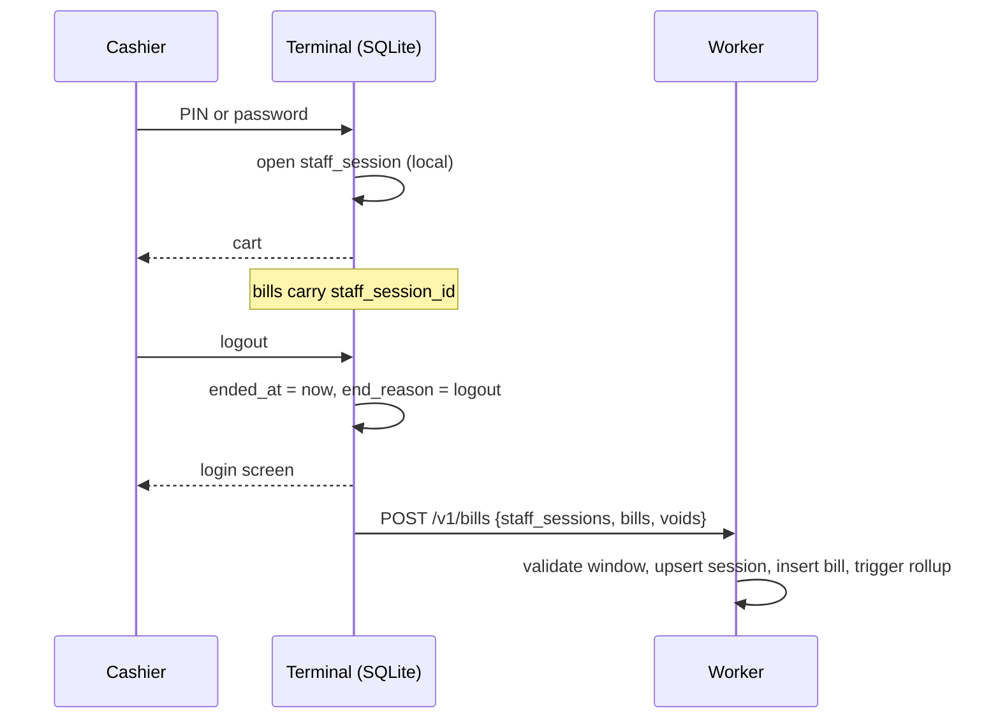

# API routes — one Worker, every tenant

Hono Worker, REST + JSON, `/v1`. One Worker serves every tenant and routes by Host; each enterprise has
its own D1 behind a binding (`DECISIONS.md` D20, D21). `tenant_id` comes from the Host and `app_id` from
that tenant's row, never from a request body. All examples are for `tnt_kukatpally` on
`pos-kukatpally.example`.

Conventions: ids are lowercase UUIDv7 strings; money is integer paise; quantities are integer base units;
instants are Unix seconds (UTC); `business_date` is `YYYY-MM-DD`; booleans are JSON `true`/`false`.
Responses are `application/json; charset=utf-8` and `Cache-Control: no-store` unless stated. Every error
uses `{"error":{"code","message","retryable","details"},"request_id"}`. Unknown response fields MUST be
ignored by clients.

## 1. Auth planes

| Plane | Credential | Routes | Never reaches |
|---|---|---|---|
| Public | none | `GET /health` | any tenant data |
| Device | one-time code → pending device → device credential → 5 min JWT `typ=device`, `scope=sync`, `aud=tenant.app_id`, `tenant_id` | enrol, token, catalog, bills, void, heartbeat | `/v1/admin/*`, staff routes |
| Staff | device JWT **plus** a human password / one-time password | `/v1/staff/*`, `/v1/approvals` | admin web, another store's roster |
| Admin | Better Auth session cookie, 12 h sliding idle / 30 d absolute, CSRF header on writes | `/v1/admin/*` except `/v1/admin/auth/*` | bills, catalog, enrol, token |

Tenant resolution runs before any handler, on every plane (T2):

1. `tenant = HOSTS[Host]`, compiled from `infra/tenants.json` at deploy time. Unknown Host is
   `421 unknown_host`; nothing is read.
2. `db = env[tenant.binding]`. One D1 per enterprise, so the binding is the tenant switch.
3. `schema_meta.tenant_id == tenant.id`, cached per isolate per binding. A mismatch is
   `503 tenant_mismatch`, never a fallback to another database.
4. Device JWT key: the header `kid` selects `HKDF-SHA256(ikm=MASTER_KEY_<kid>, salt="traasu",
   info="device-jwt/v1/" + tenant.id)`. Keys are derived for the routed tenant only, never from a claim
   in the token. Then `claim.tenant_id == tenant.id`, `claim.aud == tenant.app_id`, `typ`, `scope`, and
   the `devices` row for `sub` must exist and be unrevoked; a missing row is `401 invalid_token`.
5. Admin: the Better Auth instance is built **per request** with `database: db`, `baseURL` and
   `trustedOrigins` set to `https://<Host>`. A module-level cached instance wrote tenant B's owner and
   session into tenant A's D1 when reproduced, so caching it is forbidden. The same HKDF scheme with a
   different `info` label signs staff assertions and approval grants.

Device middleware: rate limit → Bearer parse → signature with the routed tenant's key → `typ=="device"`
→ `aud==tenant.app_id` → `tenant_id==tenant.id` → `scope` contains `sync` → device row exists, is
approved and unrevoked → attach `{device_id, store_id, terminal_id}`. Admin middleware, on every
`/v1/admin/*` route except the Better Auth handlers under `/v1/admin/auth/*`: rate limit →
Origin/Referer allowlist → Better Auth session cookie → `auth_session` row not expired and
`created_at` inside 30 days (the absolute cap is ours; Better Auth enforces the 12 h sliding idle) →
CSRF compare on non-GET (signed token from the session, sent as `X-CSRF-Token`; no readable CSRF
cookie) → role and `user_stores` scope → attach `{user_id, role, stores, csrf}`. Better Auth enforces
its own origin check on the auth paths. A cookie presented to a device route is ignored; a device
Bearer presented to `/v1/admin/*` fails the session lookup. That is the whole separation; there is no
shared handler and no route that accepts both.

The master key protects every tenant: a leak compromises all of them (`DECISIONS.md` D21). Rotate by
adding `MASTER_KEY_<newkid>`, signing with the new key, verifying both for 12 h (the longest-lived
token, grants and assertions), then removing the old key.

Store and terminal always come from the token. `store_id`, `terminal_id`, `tenant_id` in a body are
ignored except where §3.1 defines them, and a body `tenant_id` that differs from the routed tenant is
`409 wrong_tenant` with nothing written. `store_id` in an admin query must be inside `user_stores` or
the call is `403 store_forbidden`. Every admin write takes an explicit field allowlist: no
`password_hash`, `pin_hash`, `id`, `created_at`, or `role` from a non-owner.

## 2. Route table

### Public

| Method | Path | Auth | Purpose | Idempotency | Success shape | Error codes |
|---|---|---|---|---|---|---|
| GET | `/health` | none | liveness, routed tenant, schema/terminal/catalog versions | read | `{status, app_id, tenant_id, schema_version, min_terminal_version, latest_terminal_version, catalog:{epoch,head,alloc_head,pruned_below,reset_to}, server_time}` | `421 unknown_host`, `503 tenant_mismatch`, `503 db_unavailable`, `503 schema_mismatch`, `429 rate_limited` |

### Device / sync

| Method | Path | Auth | Purpose | Idempotency | Success shape | Error codes |
|---|---|---|---|---|---|---|
| POST | `/v1/enroll` | one-time code + `install_id` (no JWT) | bind a device to store+terminal as **pending**, return the device credential | **no** — single-use code; lost response needs a new code | `{device_credential, device_id, status:"pending", tenant_id, app_id, store_id, terminal_id, store_name, server_time}` | `400 invalid_request`, `404 code_not_found`, `409 code_used`, `409 wrong_tenant`, `409 wrong_app`, `410 code_expired`, `421 unknown_host`, `429 rate_limited` |
| POST | `/v1/token` | device credential + `install_id` | exchange an approved device credential for a 5 min JWT; refresh lease | safe to repeat; each call mints a new `jti` | `{access_token, token_type:"Bearer", expires_in:300, expires_at, lease_expires_at, server_time, tenant_id, app_id, store_id, terminal_id, catalog:{epoch,head,alloc_head,pruned_below,reset_to}, rotate_to}` | `401 invalid_credential`, `401 device_moved`, `401 device_revoked`, `401 wrong_tenant`, `401 wrong_app`, `403 approval_pending`, `426 upgrade_required`, `429 rate_limited` |
| GET | `/v1/catalog` | device JWT | store-scoped catalog delta, or a paged snapshot after a reset | read; `since` + `epoch` make it replayable | delta `{mode, cursor_format, epoch, store_id, terminal_id, since, cursor, max_seen_seq, head, alloc_head, pruned_below, reset_to, has_more, server_time, changes[]}`; snapshot `{mode, snapshot_attempt_id, snapshot_page, snapshot_cursor, snapshot_complete, epoch, store_id, terminal_id, head, pruned_below, server_time, rows[]}` | `400 invalid_cursor`, `400 invalid_limit`, `400 cursor_format_unsupported`, `400 invalid_snapshot_page`, `410 stale_cursor`, `401 token_expired`, `429 rate_limited` |
| GET | `/v1/stock` | device JWT | store-scoped batch on-hand changed after `since` (D27) | read; `since` + `epoch` make it replayable | `{epoch, store_id, since, cursor, has_more, server_time, rows:[{batch_id, on_hand_qty_base, seq}]}` | `400 invalid_cursor`, `410 stale_cursor` (epoch changed: full stock refresh), `401 token_expired`, `429 rate_limited` |
| POST | `/v1/bills` | device JWT | push completed bills, voids, staff sessions and shifts; per-bill accept/reject | **yes** on bill and void `id`; duplicate returns accepted; different content is `id_conflict` | `{server_time, accepted:[{id,invoice_no,duplicate}], rejected:[{id,code,message}], voids:[{id,duplicate}], staff_sessions:[{id,duplicate}], shifts:[{id,duplicate}], flagged:{stale_price,price_mismatch,policy_violation,staff_inactive,unverified_staff,shift_unverified}, catalog:{epoch,head}}` | envelope: `400 invalid_request`, `413 batch_too_large`; per bill and per void: `invalid_bill`, `id_conflict`, `duplicate_seq`, `display_no_conflict`, `invalid_totals`, `bill_not_found`, `bill_archived`; always 200 if the envelope is valid |
| POST | `/v1/bills/:id/void` | device JWT | append one `bill_voids` row; a trigger flips the bill's voided flag and decrements `sales_daily`; the bill stays immutable | **yes** — first void wins, later calls return the existing record | `{bill_id, voided:true, voided_at, voided_by, duplicate, server_time}` | `401 token_expired`, `403 store_forbidden`, `404 bill_not_found`, `409 bill_archived`, `422 invalid_reason`, `429 rate_limited` |
| POST | `/v1/terminals/heartbeat` | device JWT | last-seen, app version, unsynced depth, lease refresh | upsert by device | `{server_time, min_terminal_version, latest_terminal_version, update_required, lease_expires_at, catalog:{epoch,head,alloc_head,pruned_below,reset_to}}` | `401 token_expired`, `426 upgrade_required`, `429 rate_limited` |

### Cashier / staff (device JWT + a human credential)

| Method | Path | Auth | Purpose | Idempotency | Success shape | Error codes |
|---|---|---|---|---|---|---|
| POST | `/v1/staff/activate` | device JWT + one-time password | first-run: replace the admin-issued one-time password, set a 6-digit PIN, open a staff session | **no** — the old password stops working | `{user, staff_assertion, staff_session_id, expires_at, shift_id}` | `401 invalid_credentials`, `403 store_forbidden`, `403 user_inactive`, `422 weak_credential`, `429 rate_limited` |
| POST | `/v1/staff/login` | device JWT + `user_id` + password | shift start online; opens one live staff session per terminal, creates the server shift row | safe to repeat; each login opens a new session (the previous one must have ended) | `{user, staff_assertion, staff_session_id, expires_at, shift_id, auth_method:"password", server_time}` | `401 invalid_credentials`, `403 store_forbidden`, `403 user_inactive`, `409 session_already_open`, `429 rate_limited` |
| POST | `/v1/staff/logout` | device JWT + `staff_session_id` | end the current cashier session online; normally local-first and pushed with bills | **yes** — closing an already-closed session returns the stored `ended_at` | `{staff_session_id, ended_at, duplicate}` | `403 store_forbidden`, `404 session_not_found`, `429 rate_limited` |
| POST | `/v1/approvals` | device JWT + manager email/password | mint a 12 h approval grant for overrides | **no** — multiple grants may coexist; the terminal rotates | `{grant_id, grant_token, expires_at, max_overrides, max_discount_pct}` | `401 invalid_credentials`, `403 not_approver`, `403 store_forbidden`, `403 user_inactive`, `429 rate_limited` |

STE PIN: verified locally against the cached `pin_hash`/`pin_salt`; no route. PIN bills carry
`auth_method:"pin_offline"`; a PIN is attribution, not authorisation.

### Admin web (Better Auth session cookie; `owner` writes, `owner|staff` reads)

Better Auth is mounted at `/v1/admin/auth/*` (D17 revised). Every route in this table that starts
`/v1/admin/auth/` is Better Auth's own handler: it owns `auth_user`, `auth_session`, `auth_account`,
`auth_verification`, `auth_two_factor` and `auth_rate_limit`, and returns its own response shapes. Our
middleware adds the 30-day absolute cap, the role and `user_stores` checks, the CSRF header, and the
`users.auth_user_id` link. A session whose `auth_user_id` has no `users` row, or a user with
`active=0`, is `403 forbidden_role`. Cashiers have no `auth_user_id`, which is what keeps them out of
the admin web.

| Method | Path | Auth | Purpose | Idempotency | Success shape | Error codes |
|---|---|---|---|---|---|---|
| POST | `/v1/admin/auth/sign-in/email` | none | email+password → session cookie; a 2FA-enabled user gets `twoFactorRedirect` | **no** — each call creates a session | Better Auth `{token, user}` + `Set-Cookie: __Host-sid` | `401 invalid_credentials`, `403 forbidden_role`, `429 rate_limited` |
| POST | `/v1/admin/auth/sign-out` | session + CSRF | revoke the current session | yes (204) | `204` | `401 session_expired`, `403 csrf_failed` |
| POST | `/v1/admin/auth/sign-in/social` | none | Google sign-in; `provider:"google"` | **no** | redirect to Google | `403 forbidden_role` on an email with no `users.auth_user_id` |
| GET | `/v1/admin/auth/callback/google` | none | Better Auth OAuth callback; sets the session | replay-safe by Better Auth state | redirect + `Set-Cookie: __Host-sid` | `401 invalid_credentials`, `403 forbidden_role` |
| POST | `/v1/admin/auth/change-password` | session + CSRF | change own password with `revokeOtherSessions:true` | absolute values | `200` | `400 invalid_password`, `401 invalid_credentials`, `422 validation_failed` |
| POST | `/v1/admin/auth/revoke-sessions` | session + CSRF | revoke every session for the user | yes | `200 {status:true}` | `401 session_expired`, `403 csrf_failed` |
| POST | `/v1/admin/auth/two-factor/enable` | session + CSRF | TOTP enrolment; returns the URI and backup codes | **no** | `{totpURI, backupCodes}` | `401 session_expired`, `422 validation_failed` |
| POST | `/v1/admin/auth/two-factor/verify-totp` | none (sign-in challenge) | complete a login with a TOTP or backup code | no | session + cookie | `401 invalid_credentials`, `429 rate_limited` |
| POST | `/v1/admin/auth/two-factor/disable` | session + CSRF | turn 2FA off | yes (204) | `204` | `401 session_expired`, `403 csrf_failed` |
| GET | `/v1/admin/me` | session | current user, stores, fresh CSRF token, session bounds | read | `{user, stores, session:{expires_at,last_seen_at,created_at,absolute_expires_at}, csrf_token}` | `401 session_expired` |
| GET | `/v1/admin/items` | session | search items by name/local name/alias/SKU/EAN | read | `{items[], next_cursor, has_more}` | `400 invalid_query`, `403 store_forbidden` |
| POST | `/v1/admin/items` | owner + CSRF | create item (optionally with client id) | **yes** on client `id`; same body returns the item, different body 409 | `{item, catalog:{epoch,head}}` | `409 item_exists`, `422 validation_failed` |
| GET | `/v1/admin/items/:id` | session | item + scoped prices + identifiers | read | `{item, prices[], identifiers[], catalog_seq}` | `404 not_found`, `403 store_forbidden` |
| PATCH | `/v1/admin/items/:id` | owner + CSRF | name, `name_local`, tax, HSN, MRP, flags, `active` | absolute values; optional `If-Match` | `{item, catalog:{epoch,head}}` | `404 not_found`, `409 immutable_field`, `409 edit_conflict`, `422 validation_failed` |
| DELETE | `/v1/admin/items/:id` | owner + CSRF | soft delete; deactivates identifiers | yes (already inactive returns 200) | `{item_id, active:false, catalog:{epoch,head}}` | `404 not_found`, `403 forbidden_role` |
| PUT | `/v1/admin/items/:id/prices` | owner + CSRF | replace the tier set of one scope, or of one batch (`store_key`, `batch_id`); new version. An empty `prices[]` closes that set | **no** — versioned; replay with old `base_version` is 409 | `{item_id, store_key, batch_id, version, prices[], catalog:{epoch,head}}` | `404 not_found`, `409 version_conflict`, `422 validation_failed` |
| PUT | `/v1/admin/items/:id/identifiers` | owner + CSRF | replace one store's identifier set | **yes** — same set is a no-op | `{item_id, store_id, identifiers[], catalog:{epoch,head}}` | `404 not_found`, `409 identifier_conflict`, `422 validation_failed` |
| GET | `/v1/admin/items/:id/history` | session | price versions for the item | read | `{item_id, prices[], next_cursor, has_more}` | `404 not_found` |
| GET | `/v1/admin/items/:id/batches` | session | the item's batches in a store, with on-hand, MRP, expiry, open prices (D27) | read | `{item_id, store_id, batches[], next_cursor, has_more}` | `403 store_forbidden`, `404 not_found` |
| GET | `/v1/admin/books` | session | the store's books (stock locations) with priority; priority 1 is the main book (D28) | read | `{store_id, books[]}` | `403 store_forbidden` |
| POST | `/v1/admin/books` | owner + CSRF | create a book (`store_id`, `name`, `priority`) | **yes** on client `id` | `{book, catalog:{epoch,head}}` | `409 book_name_exists`, `409 priority_taken`, `422 validation_failed` |
| PATCH | `/v1/admin/books/:id` | owner + CSRF | rename, deactivate/reactivate, or reorder (`priority`); a reorder swaps through a free priority in one `db.batch()` | absolute values; `If-Match` on version | `{books[], catalog:{epoch,head}}` | `404 not_found`, `409 edit_conflict`, `422 validation_failed` |
| POST | `/v1/admin/stock-receipts` | owner + CSRF | purchase entry into one book: `{store_id, book_id, reference, lines:[{item_id, qty_base, batch:{batch_no?, mrp_minor, expiry_date?, prices[], is_primary?}}]}`. **Every line creates a new batch** (D28); a blank `batch_no` is generated from the entry. Writes the receipt, the batches, their prices and one `receipt` movement per line in one `db.batch()` | **yes** on client `id` | `{receipt, book:{id,name}, lines:[{batch, on_hand_qty_base}], catalog:{epoch,head}}` | `404 not_found`, `409 batch_no_exists`, `422 validation_failed` |
| PATCH | `/v1/admin/batches/:id` | owner + CSRF | edit `batch_no`, `mrp_minor`, `expiry_date`, `is_primary` (clears the book's previous primary in the same `db.batch()`), or retire/unretire; bumps the batch `version`. `book_id` cannot change. | absolute values; `If-Match` on version | `{batch, catalog:{epoch,head}}` | `404 not_found`, `409 edit_conflict`, `422 validation_failed` |
| POST | `/v1/admin/batches/:id/adjustments` | owner + CSRF | change quantity by a signed `qty_delta_base`, or set a counted `qty_base` (the Worker writes the difference); `reason` and `note` required | **yes** on client `id` | `{batch_id, movement, on_hand_qty_base}` | `404 not_found`, `422 validation_failed` |
| GET | `/v1/admin/reports/sales-by-item` | session | per-item qty/amount for a date range | read | `{range, rows[], totals, provisional_until, next_cursor, has_more}` | `400 invalid_range`, `403 store_forbidden`, `413 range_too_large`, `429 rate_limited` |
| GET | `/v1/admin/reports/day-summary` | session | totals per business date/store | read | `{range, rows[], totals, provisional_until, next_cursor, has_more}` | `400 invalid_range`, `403 store_forbidden`, `413 range_too_large` |
| GET | `/v1/admin/audit-events` | owner | override/void/flag/admin audit feed | read | `{events[], next_cursor, has_more}` | `400 invalid_query`, `403 forbidden_role` |
| GET | `/v1/admin/terminals` | session | terminals, devices, last seen, lease, latest heartbeat | read | `{terminals[], devices[], next_cursor, has_more}` | `403 store_forbidden` |
| POST | `/v1/admin/terminals` | owner + CSRF | create terminal + register numbering policy + config | 409 on duplicate `(store_id,name)` | `{terminal, numbering_policy, catalog:{epoch,head}}` | `409 terminal_exists`, `422 validation_failed` |
| PATCH | `/v1/admin/terminals/:id` | owner + CSRF | rename/activate; deactivation revokes devices | absolute values | `{terminal, catalog:{epoch,head}}` | `404 not_found`, `409 terminal_active_devices` |
| POST | `/v1/admin/terminals/:id/revoke` | owner + CSRF | revoke a device (all active, or `device_id`) | **yes** — already revoked returns `revoked:0` | `{terminal_id, revoked, server_time}` | `404 not_found` |
| POST | `/v1/admin/terminals/:id/enrol-code` | owner + CSRF | mint a 15 min single-use code; invalidates prior unused codes | **no** — new code each call | `{code, expires_at, store_id, terminal_id}` | `404 not_found`, `409 terminal_inactive`, `429 rate_limited` |
| POST | `/v1/admin/devices/:id/approve` | owner + CSRF | approve a pending device so `/v1/token` starts issuing JWTs | **yes** — already approved returns the same body with `duplicate:true` | `{device_id, status:"active", store_id, terminal_id, duplicate, server_time}` | `404 not_found`, `409 device_revoked`, `403 forbidden_role` |
| GET | `/v1/admin/stores` | session | stores in scope, no pagination (bounded ≤50) | read | `{stores[]}` | `403 store_forbidden` |
| GET | `/v1/admin/stores/:id` | session | store + settings + store numbering policy | read | `{store, settings, numbering_policy, catalog_seq}` | `404 not_found`, `403 store_forbidden` |
| PATCH | `/v1/admin/stores/:id` | owner + CSRF | name, business-day start, rounding, invoice prefix/padding | absolute values | `{store, settings, numbering_policy, catalog:{epoch,head}}` | `404 not_found`, `409 numbering_conflict`, `422 validation_failed` |
| GET | `/v1/admin/users` | owner | roster incl. cashiers, roles, store scope | read | `{users[], next_cursor, has_more}` | `403 forbidden_role` |
| POST | `/v1/admin/users` | owner + CSRF | create user; writes `users` and, for owner/staff, an `auth_user` via Better Auth's server API; returns a one-time password shown once | 409 on duplicate email | `{user, activation:{kind:"one_time_password", value}}` | `409 email_exists`, `422 validation_failed` |
| PATCH | `/v1/admin/users/:id` | owner + CSRF | name, role, stores, active; deactivation revokes sessions | absolute values | `{user, catalog:{epoch,head}}` | `404 not_found`, `409 last_owner`, `422 validation_failed` |
| POST | `/v1/admin/users/:id/reset` | owner + CSRF | reset password, clear PIN, return a new one-time password | **no** — invalidates the old password | `{user_id, activation:{kind:"one_time_password", value}}` | `404 not_found`, `403 forbidden_role` |

## 3. The six load-bearing payloads

### 3.1 `POST /v1/enroll`

```http
POST /v1/enroll HTTP/1.1
Host: pos-kukatpally.example
Content-Type: application/json
X-Client-Version: 1.4.2

{"code":"A-7K2M-9QX4","install_id":"9f2c41d8a0b34e77b6e1c2d3f4a59601",
 "device_name":"Counter 2 (Windows)","app_version":"1.4.2","tenant_id":"tnt_kukatpally"}
```

```json
{"device_credential":"v1_9tR2...43chars","device_id":"0192f3d1-8a5b-7c3d-9e1f-2a3b4c5d6e7f",
 "status":"pending","tenant_id":"tnt_kukatpally","app_id":"pos-prod-kukatpally",
 "store_id":"0192f3c0-0000-7000-8200-000000000001",
 "terminal_id":"0192f3c0-0000-7000-8200-000000000002",
 "store_name":"Kukatpally","server_time":1763107200}
```

The code is 40 bits, 15 min, single-use, stored only as an HMAC. The credential is 32 random bytes,
returned once, stored by the Worker as SHA-256 + a short lookup prefix; `install_id` is sent on every
token call and a mismatch is `401 device_moved`. The terminal pins `{device_credential, install_id,
tenant_id, app_id, api_base}` in the OS keychain and refuses to sync if the server disagrees.

Enrolment is two-step (D5, T13). The device row lands `pending`: it holds no lease and gets no
catalog, and `/v1/token` answers `403 approval_pending` until an owner approves it with
`POST /v1/admin/devices/:id/approve`. A code stolen from a drawer therefore yields a credential that
cannot fetch a single row. The terminal shows "waiting for owner approval" and retries `/v1/token` on
the `retry_after_s` interval. A body `tenant_id` that differs from the Host's tenant is
`409 wrong_tenant` and writes nothing.

### 3.2 `POST /v1/token`

```json
{"device_credential":"v1_9tR2...43chars","install_id":"9f2c41d8a0b34e77b6e1c2d3f4a59601","app_version":"1.4.2"}
```

```json
{"access_token":"eyJhbGciOiJIUzI1NiIs...","token_type":"Bearer","expires_in":300,
 "expires_at":1763107500,"lease_expires_at":1763712000,"server_time":1763107200,
 "tenant_id":"tnt_kukatpally","app_id":"pos-prod-kukatpally",
 "store_id":"0192f3c0-0000-7000-8200-000000000001",
 "terminal_id":"0192f3c0-0000-7000-8200-000000000002",
 "catalog":{"epoch":1,"head":8412,"alloc_head":8412,"pruned_below":0,"reset_to":0},"rotate_to":null}
```

Claims: `{typ:"device", sub:device_id, aud:"pos-prod-kukatpally", tenant_id:"tnt_kukatpally",
store_id, terminal_id, scope:"sync", iat, exp, jti}`. The signing key comes from the `kid` header and
the routed tenant only (§1). TTL 5 minutes everywhere; there is no refresh token, the device credential
is the refresh mechanism. `rotate_to` is a new credential when the current one is older than 90 days;
the terminal MUST persist it before its next call. Billing never calls this route; token expiry pauses
sync only. A `403 approval_pending` response carries `retry_after_s` and no token.

The `catalog` object in `/v1/token` and `/health` is **diagnostic** (`{epoch, head, alloc_head,
pruned_below, reset_to}`). A new or re-enrolled terminal MUST start at `since=0` or `?snapshot=1`,
never at the returned `head`; starting at `head` skips the initial catalog.

### 3.3 `GET /v1/catalog?since=8412&epoch=1&limit=500`

Delta response (store-scoped; documents are current state, not the state at `seq`):

```json
{"mode":"delta","cursor_format":2,"epoch":1,"store_id":"0192f3c0-...8201",
 "terminal_id":"0192f3c0-...8202","since":8412,"cursor":8420,"max_seen_seq":8420,
 "head":8431,"alloc_head":8431,"pruned_below":0,"reset_to":0,
 "has_more":true,"server_time":1763107200,
 "changes":[
  {"seq":8415,"entity":"item","entity_id":"0192f3c4-8a5b-7c3d-9e1f-2a3b4c5d6e7f",
   "op":"upsert","version":3,"document":{"id":"0192f3c4-...","version":3,"name":"Tamarind",
   "name_local":"చింతపండు","dimension":"mass","pricing_mode":"fixed_only","base_unit":"g",
   "default_sales_unit":"kg","tax_rate_id":"...0002","hsn":"0810","price_includes_tax":true,
   "mrp_minor":5000,"allow_discount_pct":0,"restrict_price_edit":true,"prompt_qty":false,
   "scale_qty":false,"active":true}},
  {"seq":8420,"entity":"item_price","entity_id":"0192f3c4-...","op":"upsert","version":8,
   "document":{"item_id":"0192f3c4-...","version":8,"prices":[
    {"item_id":"0192f3c4-...","store_key":"","qty_base":1000,"version":8,"price_minor":4000,
     "mrp_minor":5000,"valid_from":1763000000,"valid_to":null},
    {"item_id":"0192f3c4-...","store_key":"","qty_base":500,"version":8,"price_minor":2500,
     "mrp_minor":3000,"valid_from":1763000000,"valid_to":null}]}}
 ]}
```

`entity` is one of `item`, `item_price`, `item_identifier`, `unit`, `tax_rate`, `user`, `store`,
`store_settings`, `numbering_policy`, `terminal_config`. `op` is `upsert` or `delete`. `store_key` is
`""` for the franchise default and the store id for an override; the terminal selects per
`(item, qty_base)`: store row wins, default is the fallback. Every price row carries `valid_from`,
`valid_to` and `version`.

A price row is a **pack price**: `price_minor` is what `qty_base` base units cost at that tier. The rows
above say 1,000 g sells for 4,000 and 500 g for 2,500. A bill line is different: its `price_minor` and
`list_price_minor` are rates per `price_basis_qty_base` (D23), and its `price_breakdown.parts` copy the
tier rows it used, so the parts sum to the line's `list_amount_minor`.

**Batches and books (D27, D28).** For an item with `uses_batches`, stock arrives in batches: soap received
in April at MRP ₹100 and in May at MRP ₹200 are two `item_batch` documents, each with its own price set
(`item_price` rows carrying `batch_id`), MRP, optional `expiry_date`, `is_primary`, and the `book_id` of the
stock location it lives in. `book` documents carry name and priority. At scan the register lists the store's
batches that are neither retired nor expired, in active books: every batch with stock above zero plus the
newest batch always. One batch bills directly. Two or more get a default preselected: a stocked batch in the
lowest-priority book, its primary first, then the newest; if nothing has stock, the newest batch. If the
listed batches differ in MRP or in selling price for the scanned quantity, the register prompts the cashier
with each MRP, book and batch number before adding the line; if they all match, it bills the default
silently. The cashier can change the batch on the line before completing the bill. Expired batches show
struck out and cannot be picked. On-hand comes
from `GET /v1/stock` minus this register's unsynced sales; it is an estimate and never blocks a sale, and a
quantity above a batch's on-hand shows a warning.

Snapshot is paged, never one unbounded response:
`GET /v1/catalog?snapshot=1&epoch=1&snapshot_page=items&snapshot_cursor=...&limit=500`.
Pages cover `items`, `prices`, `identifiers`, `users`, `reference` (units/tax rates) and `store`
(store, settings, numbering policies, config); each page is ≤8 MB and returns
`{mode:"snapshot", snapshot_attempt_id, snapshot_page, snapshot_cursor, snapshot_complete, epoch, head,
pruned_below, store_id, terminal_id, server_time, rows:[...]}`. The first page freezes `epoch`, `head`
and `pruned_below` and the terminal supplies `snapshot_attempt_id`. Each later page's transaction
**re-reads the live `sync_epoch` and `pruned_below`** (and the `catalog_rebuild` generation if one is
open). If they differ from the frozen values, return `410 snapshot_invalidated` with the live values;
the terminal discards the shadow tables, keeps billing on the old catalog, and restarts. If they match,
echo the **frozen** `epoch`/`head`/`pruned_below`, not the live head, and return current-state rows. An
ordinary catalog edit between pages does not invalidate: pages are current-state and the delta from the
frozen head converges. `snapshot_attempt_id` names the terminal's attempt; `catalog_generation` names
the server-side `catalog_rebuild` generation — do not conflate them. The terminal clears its shadow
tables (or tags rows with the new `snapshot_attempt_id`) before page 1, so rows left by a failed attempt
cannot leak into the swap. It swaps all shadow tables plus
`cursor = {cursor_format:2, epoch, seq:head}` only when `snapshot_complete:true`. If a D1 bookmark is
used instead, every page reads at or after the frozen bookmark and the epoch/floor re-check is replaced
by the bookmark guarantee; that path must be stated explicitly, because its invalidation rule differs. A snapshot is the only correct bootstrap/recovery; deltas
are only for a terminal that already has the catalog. The initial tenant seed is a complete catalog
(units, tax rates, store, settings, numbering, config, every item/price/identifier), so a fresh
terminal's snapshot is never empty; an empty catalog is a provisioning failure, not a valid state.

### 3.4 `POST /v1/bills`

Up to 100 bills per request. Each bill is its own `db.batch()`, so one malformed bill cannot roll back
the rest, and a batch counts as **one** D1 API call no matter how many statements it holds. The
measured invocation cap is 1,000 D1 calls: 1,000 single queries pass, 1,001 fails "Too many API
requests by single Worker invocation", 100 batches of 14 statements pass and 1 batch of 5,000
statements passes. One request therefore budgets 100 bill batches plus the pre-check and ack batches,
far inside 1,000. Statements are never issued one at a time in a loop.

Envelope: `{staff_sessions[], shifts[], bills[], voids[]}`. Apply order:

1. `staff_sessions[]`, upserted in `started_at` order (T6, below).
2. `shifts[]`, by `opened_at`.
3. `bills[]`.
4. `voids[]`, so a void finds a bill pushed in the same request.

Batch order inside one bill (T4):

```text
PRAGMA defer_foreign_keys = on
INSERT INTO bill_lines   ... ON CONFLICT(bill_id, line_no) DO NOTHING
INSERT INTO inventory_movements ...
INSERT INTO bills        ... ON CONFLICT(id) DO NOTHING
```

The header goes last so the AFTER INSERT trigger on `bills` sees the lines and writes `sales_daily`
from them. `DO NOTHING` fires no trigger, so a replay or a concurrent duplicate cannot double-count the
rollup; the Worker never writes `sales_daily` itself. The `header ON CONFLICT DO NOTHING` is also what
makes a duplicate bill free.

`shifts[]` rows are `{id, business_date, opened_by, opened_at, closed_by?, closed_at?}`; `store_id`
and `terminal_id` come from the JWT and body values are ignored. Pre-checks per bill: `id` exists →
accept as duplicate when `payload_sha256` matches, else `id_conflict`; `(store_id, terminal_id,
local_seq)` exists with another id → `duplicate_seq`.

```json
{"staff_sessions":[{"id":"0192f3c0-0000-7000-8600-000000000001",
  "user_id":"0192f3c0-0000-7000-8300-000000000001",
  "terminal_id":"0192f3c0-0000-7000-8200-000000000002","auth_method":"password",
  "staff_assertion":"eyJhbGciOiJIUzI1NiIs...",
  "started_at":1763103600,"ended_at":null,"end_reason":null}],
 "shifts":[{"id":"0192f3c0-0000-7000-8400-000000000001",
  "business_date":"2026-11-14","opened_by":"0192f3c0-0000-7000-8300-000000000001",
  "opened_at":1763103600,"closed_at":null,"closed_by":null}],
 "bills":[{"id":"0192f3d1-8a5b-7c3d-9e1f-2a3b4c5d6e7f",
 "business_date":"2026-11-14","business_day_start_minutes":540,
 "local_seq":431,"display_no":"S1-T2-000431",
 "user_id":"0192f3c0-0000-7000-8300-000000000001","auth_method":"password",
 "shift_id":"0192f3c0-0000-7000-8400-000000000001",
 "staff_session_id":"0192f3c0-0000-7000-8600-000000000001",
 "subtotal_minor":6190,"tax_minor":310,"total_minor":6500,"rounding_minor":0,
 "created_at":1763107200,"payload_sha256":"b0e1...64hex",
 "lines":[{"line_no":1,"item_id":"0192f3c4-8a5b-7c3d-9e1f-2a3b4c5d6e7f",
  "item_name":"Tamarind","dimension":"mass","qty_base":1500,"item_version":3,
  "price_version":8,"price_store_id":null,"batch_id":null,"batch_no":null,"mrp_minor":null,
  "price_source":"tier","approval_grant_id":null,
  "price_basis_qty_base":1000,"list_price_minor":4000,"price_minor":4000,
  "list_amount_minor":6500,"discount_minor":0,
  "price_breakdown":{"parts":[{"qty_base":1000,"price_minor":4000},
                              {"qty_base":500,"price_minor":2500}]},
  "taxable_minor":6190,"line_total_minor":6500,"tax_rate_bp":500,
  "price_includes_tax":true,"hsn":"0810",
  "cgst_minor":155,"sgst_minor":155,"igst_minor":0,"cess_minor":0}]}],
 "voids":[]}
```

Every identity in this example, so a reader can check the wire rules against one bill:

| Quantity | Value |
|---|---|
| qty | 1,500 g, basis 1,000 g |
| tier parts (pack prices from the catalog) | 1,000 g for 4,000 + 500 g for 2,500 |
| `list_price_minor` | 4,000 per 1,000 g: the rate of the base tier, not the line amount |
| `list_amount_minor` | 6,500 = Σ `parts[].price_minor` |
| `discount_minor` | 0 |
| `line_total_minor` | 6,500 = `list_amount_minor - discount_minor` |
| tax | 310 = round(6,500 × 500 / 10,500), the tax-inclusive rule |
| `taxable_minor` | 6,190 |
| `cgst_minor`, `sgst_minor` | 155, 155 (`floor(tax/2)`, remainder to sgst) |
| `igst_minor`, `cess_minor` | 0, 0 |
| line check | 6,190 + 155 + 155 + 0 + 0 = 6,500 |
| header | subtotal 6,190, tax 310, rounding 0, total 6,500 |

```json
{"server_time":1763107300,
 "accepted":[{"id":"0192f3d1-...","invoice_no":"KUK/2026/000431","duplicate":false}],
 "rejected":[],
 "voids":[],
 "staff_sessions":[{"id":"0192f3c0-0000-7000-8600-000000000001","duplicate":false}],
 "shifts":[{"id":"0192f3c0-0000-7000-8400-000000000001","duplicate":false}],
 "flagged":{"stale_price":0,"price_mismatch":0,"policy_violation":0,"staff_inactive":0,
            "unverified_staff":0,"shift_unverified":0},
 "catalog":{"epoch":1,"head":8431}}
```

Money rules, enforced by the Worker and by the terminal's own triggers (D23):

- line: `line_total_minor = taxable_minor + cgst_minor + sgst_minor + cess_minor + igst_minor`, and
  `line_total_minor = list_amount_minor - discount_minor`. There is no bypass: `list_amount_minor` is
  required on the wire.
- `price_minor` and `list_price_minor` on a line are rates per `price_basis_qty_base` base units;
  `price_basis_qty_base` is mandatory on the wire, and neither is ever the line amount. A tiered line
  decomposes into `price_breakdown.parts`, each a catalog tier row (`qty_base`, pack `price_minor`), and
  `list_amount_minor = Σ parts[].price_minor`. The line's `list_price_minor` is the base tier's price
  scaled to the basis.
- intra-state: `cgst = floor(tax/2)`, `sgst = tax - cgst`. An IGST line has `cgst = sgst = 0` and
  `igst = tax`.
- header: `subtotal_minor = Σ taxable_minor`, `tax_minor = Σ (cgst + sgst + cess + igst)`,
  `total_minor = Σ line_total_minor + rounding_minor`, and at least one line. Tax is per line and
  inclusive; a per-rate invoice summary is derived from the lines, never computed a second way.

The register's local catalog is the source of truth for the sale (D26). Each line freezes `item_version`,
`price_version`, `price_store_id` (`null` = franchise default) and, for a batched item, `batch_id`, `batch_no` and `mrp_minor` when it is added to the cart, with the
copied item fields and money. A catalog update that arrives while a cart is open never reprices lines
already in it; only lines added afterwards use the new catalog. `item` change rows and documents carry
`version`, and the register applies an item only when that version is not older than the one it holds.

The Worker finds each line's tier set by key (`item_id`, scope from `price_store_id`, `price_version`),
not by clock. Open at `created_at`: no flag. Closed before `created_at`: `stale_price` (the register had
not synced yet). Unknown version, or a claimed list price that differs from that version's rows:
`price_mismatch`. `computed_list_price_minor` records what the server's catalog charged at `created_at`.
It also sets `policy_violation` and `staff_inactive` from server math. Money is never rewritten and a completed sale
is never rejected for policy. `invoice_no` is server-assigned per store from `numbering_policy`; the
terminal treats it as opaque. `store_id`/`terminal_id`/`device_id` come from the JWT.
`business_day_start_minutes` is copied from `store_settings` at sale time (D42), so a later change to
the store's business-day start cannot move an old bill to another date. `shift_id` is nullable
(offline PIN shifts); if present it must belong to the same store, terminal and user. Per-bill and
per-void rejection codes are 200-level facts, not envelope failures.

`staff_sessions[]` are upserted, not inserted (T6):

```sql
INSERT INTO staff_sessions (...) VALUES (...)
ON CONFLICT(id) DO UPDATE SET ended_at = excluded.ended_at,
  end_reason = excluded.end_reason, ended_by = excluded.ended_by
WHERE staff_sessions.ended_at IS NULL;
```

Applied in `started_at` order before any bill, acked as `staff_sessions:[{id,duplicate}]`. The upsert
is what lets the close arrive in a later push than the open, and the `WHERE` is what makes the first
`ended_at` win. An already-closed session is a no-op (`session_already_closed` in the ack), because
logout is local-first and the server learns the end time on push.

A password bill is **accepted and flagged** `unverified_staff` when its `staff_session_id` is missing,
its `created_at` is more than 5 minutes outside the session window, or the session's
`user_id`/`terminal_id`/`auth_method`/store do not match the bill and JWT. Nothing is rejected or
parked for a window, session or clock mismatch; the two ABORT triggers that used to enforce this are
gone from the shared DDL, because the same DDL runs on the terminal and a cashier's clock step must not
stop a sale. A PIN shift opens a local `staff_sessions` row too; it is pushed with
`auth_method:"pin_offline"` and no `staff_assertion`, and the server verifies user/terminal/store/window
then flags `unverified_staff`. A password session carries the 12 h `staff_assertion` in its first push
row; the assertion has `sid` (the `staff_session_id`) and `iat` claims. The Worker verifies it **once**:
signature, `jti`, user/terminal, `sid == staff_session_id`, `started_at - 300 <= iat <= started_at + 300`,
and `exp >= started_at`; expiry is checked against the session start, not `now`, so a shift longer than
the assertion stays valid. It stores `assertion_verified_at` and does not re-verify later bills. A
failed or expired assertion at first push accepts the session and its bills with `unverified_staff`; it
never rejects or parks a completed sale; the flag is for owner review. An unknown `shift_id` is stored
as `bills.shift_id = NULL` **and** its original value is kept in `bills.unverified_shift_id`, with flag
`shift_unverified`; silent NULL is forbidden. An offline shift may be pushed in `shifts[]` before the
bills and is acked in `shifts:[{id,duplicate}]`.

`voids[]` rows are `{id, bill_id, user_id, reason, created_at}`; `store_id` and `terminal_id` come from
the JWT. The rows are applied after the bills in the same request. `bill_voids` is the record: an AFTER
INSERT trigger flips `bills.voided`, `bills.voided_at`, `bills.voided_by` and `bills.void_reason`, and
decrements `sales_daily` (T7). Un-void is impossible, by trigger. A void whose `bill_id` has no `bills`
row is rejected `bill_not_found` when `schema_meta.archive_before` is 0, and `bill_archived` when
archival is configured, because then the bill was received and has since moved to R2. Both are parked
by the terminal and never dropped: the sale happened and the record must outlive the retention window.
A `policy_violation` on a void is a flag, not a rejection.

`approval_grant_id` on a line names the grant that authorised an override (D33). The Worker checks that
the grant is unexpired, scoped to the store and user, and that this use keeps the count at or below
`max_overrides`; a line over the cap is still accepted and flagged `policy_violation`, because the
customer has paid.

### 3.5 `POST /v1/admin/auth/sign-in/email`

```json
{"email":"owner@srilakshmistores.in","password":"correct horse battery staple"}
```

```http
HTTP/1.1 200 OK
Set-Cookie: __Host-sid=9tR2...; Path=/; Secure; HttpOnly; SameSite=Lax; Max-Age=43200
Cache-Control: no-store
```

```json
{"token":"9tR2...","user":{"id":"kR2m...","email":"owner@srilakshmistores.in","name":"Ravi",
 "twoFactorEnabled":false}}
```

The handler is Better Auth's, mounted at `/v1/admin/auth/*` with its `twoFactor()` plugin and the
`database` rate limiter. On 1.7.23 the mounted paths that carry this contract are `POST
/sign-in/email`, `POST /sign-out`, `GET /get-session`, `POST /change-password`, `POST /revoke-sessions`,
the `two-factor/*` set and `sign-in/social`. `sign-up/email` is closed: a domain user is created by the
owner through `POST /v1/admin/users`, which writes the `users` row and, for `owner`/`staff`, an
`auth_user` through Better Auth's server API, linked by `users.auth_user_id`. Cashiers get no
`auth_user`, which is what keeps them out of the admin web.

Better Auth's tables are `auth_user`, `auth_session`, `auth_account`, `auth_verification`,
`auth_two_factor`, `auth_rate_limit`; dates are ISO-8601 TEXT and ids are Better Auth's 32-character
strings (D17 revised). Our `/v1/admin/me` reads `get-session` and then resolves `users.auth_user_id` to
`{user_id, role, stores}`; an authenticated `auth_user` with no linked domain user, or a linked user
with `active=0`, is `403 forbidden_role` and gets no admin data.

The instance is built per request with this tenant's `db`, `baseURL` and `trustedOrigins`; a cached
instance wrote one tenant's owner and session into another tenant's D1 when reproduced, so module-scope
caching is forbidden. Password hashing is Better Auth's scrypt, not PBKDF2. `expiresIn` is 12 h with
`updateAge` 1 h (sliding idle); our middleware enforces the 30-day absolute cap from
`auth_session.created_at` and rejects the session with `401 session_expired` past it, whatever Better
Auth's own expiry says.

`GET /v1/admin/me` stays ours and returns the domain user plus a fresh CSRF token:

```json
{"user":{"id":"0192f3c0-0000-7000-8500-000000000001","name":"Ravi","role":"owner",
 "must_change_password":false,"stores":[{"id":"0192f3c0-0000-7000-8200-000000000001","name":"Kukatpally"}]},
 "session":{"created_at":1763107200,"expires_at":1763114400,
            "absolute_expires_at":1765700000,"last_seen_at":1763107200},
 "csrf_token":"v1_csrf_7f3c...","server_time":1763107200}
```

The CSRF token is signed and bound to the session, returned by `/me` and required as `X-CSRF-Token` on
every non-GET; it is not a readable cookie. Better Auth's session cookie is configured as `__Host-sid`
(Secure, HttpOnly, SameSite=Lax, Path=/, no Domain), which keeps the client contract and the `__Host-`
prefix rules intact; its lifetime is the 12 h sliding window. Unknown email and wrong password return the
same 401 after a dummy hash. `must_change_password:true` gates every admin route except `/v1/admin/me`,
`/v1/admin/auth/change-password` and `/v1/admin/auth/sign-out` with `403 password_change_required`.

Two-factor is the Better Auth plugin: TOTP enrolment via `two-factor/enable`, verification via
`two-factor/verify-totp`, and a sign-in for an enrolled user returns `twoFactorRedirect:true` instead
of a session. Google sign-in is `sign-in/social` with `provider:"google"`; the callback creates an
`auth_user` only if the email already links to a domain `users` row through `auth_user_id`. No domain
user is ever provisioned from an OAuth callback. `/v1/approvals` verifies the manager's password
through Better Auth's own password verifier rather than a second hash, so a manager has one password
on both planes.

### 3.6 `GET /v1/admin/reports/sales-by-item?from=2026-11-01&to=2026-11-30&store_id=...`

```json
{"range":{"from":"2026-11-01","to":"2026-11-30","store_ids":["0192f3c0-...8201"]},
 "rows":[{"item_id":"0192f3c4-...","item_name":"Tamarind",
          "qty_base":15000,"amount_minor":65000,"avg_price_minor":4333}],
 "totals":{"amount_minor":65000,"qty_base":15000,"bill_count":42,"voided_bills":1},
 "provisional_until":1763107000,"next_cursor":null,"has_more":false}
```

`from`/`to` are inclusive business dates; maximum 92 days (`413 range_too_large`). A single-day range
aggregates `bill_lines`; a multi-day range reads the `sales_daily` rollup (one row per
store/date/item). The rollup is maintained by the AFTER INSERT triggers on `bills` and `bill_voids`, so
a void leaves `sales_daily` already reduced and the report does not filter `voided=1` when it reads the
rollup. The `bill_lines` path filters `voided = 0`. Neither path recomputes from `item_prices`.

Archived months do not blank the report: `sales_daily` is kept when bills are exported and deleted
(T8, D22), so a range that reaches before `schema_meta.archive_before` still answers from the rollup.
`item_name` is a lookup against `items`, which is never archived, so the rollup path still names each
row. `voided_bills` needs bill rows, so a range that crosses the archive boundary returns
`voided_bills:null` instead of a partial count. A single-day request for an archived date answers from
`sales_daily` rather than `bill_lines`, since those lines are in R2.

`store_id` may repeat; omitted means every store in the caller's scope. `format=csv` is allowed on the
same route, has no pagination and escapes leading `= + - @` with a single quote. `provisional_until` is
the newest `received_at` seen, so an owner can tell "closed" from "a terminal has not synced".

## 4. Catalog checkpoint contract

`since` is the last `catalog_changes.seq` the terminal applied. The cursor is a triple
`{cursor_format, epoch, seq}`; old timestamp/version cursors are not seq-compatible.

- `epoch` is `schema_meta.sync_epoch`, bumped on every Time Travel restore, database re-create or
  destructive migration, **not** on routine compaction. It is the durable reset signal: any epoch
  mismatch is `410`, regardless of `head`, so a reset is sticky even if a crash loses the terminal's
  in-flight reset. `sync_epoch` is an INTEGER: bump it to the pre-restore maximum (captured before the
  restore) + 1; never `restored_epoch + 1`, which can collide with an epoch a terminal already has.
- A restore is more than a cursor reset (T9). After Time Travel, bump `sync_epoch` and have every
  terminal re-push bills, voids and sessions with `created_at >= restore_point - 1 h`. The push is
  idempotent by `id` and `payload_sha256`, so the one-hour overlap costs a replay and catches the rows
  D1 lost after the restore point. A terminal sees the new epoch in the catalog response and does the
  snapshot and the re-push in the same pass; it keeps at least 30 days of synced bills, the Time Travel
  window, so the re-push can always be built.
- `pruned_below` is the **lowest `seq` still retained** (0 when nothing is pruned).
  `reset_to = max(0, pruned_below - 1)` is the cursor to resume from after a reset; `since = reset_to`
  pulls the first retained row, `since = reset_to - 1` is `410`. The cron advances the floor to
  `MIN(devices.last_catalog_seq)` over active devices minus a safety margin; `last_catalog_seq` is
  recorded from each successful pull (T12, `docs/migrations/0008-audit-fixes.sql`). A device that never
  pulls holds the floor down, which is why revoked devices are excluded and a stale one shows up on the
  terminals page.
- `head` is the highest **committed** change, `COALESCE(MAX(seq),0) FROM catalog_changes`, not
  `catalog_seq.last_seq` (the allocator can be one rolled-back allocation ahead). The response also
  carries `alloc_head` for diagnostics.
- A request MUST send `since`, `epoch` and `cursor_format=2`. The response carries the same epoch,
  `cursor` (last **raw** seq in the page, including rows dropped by store filtering), `max_seen_seq`,
  `head`, `alloc_head`, `pruned_below`, `reset_to`, `has_more`, `store_id`, `terminal_id` and
  `server_time`.

Floor, head and page MUST come from one consistent read. D1 `db.batch()` runs its statements in one
transaction, so the Worker reads `catalog_seq`, `schema_meta.sync_epoch`, the lookahead page and the
committed head in one batch; a compaction cannot delete a range between the floor check and the page.
Pin catalog reads to the primary (or a session at least as new as the terminal's cursor); a lagging
replica's floor or head causes false `410`s and can serve a page behind the cursor.

Store projection is explicit, because `catalog_changes` stores no old store. Every terminal reads the
same raw change rows; the Worker projects each document per token:

- `item`, `unit`, `tax_rate`: upsert to every store.
- `item_price`: send the item's full price set filtered to `store_key IN ('', token.store)`; the
  terminal replaces its local price rows for that item, so a removed/closed override disappears
  without a tombstone.
- `item_identifier`: `row.store_id == token.store` → upsert; otherwise → `op:"delete"` for that
  identifier id. Every terminal sees the change, so the old store is told to remove the alias and the
  new store upserts it. The admin write allocates the old store's delete `seq` before the new store's
  upsert, so seq-ordered apply cannot hit the terminal's unique active-alias index.
- `user`: assigned to `token.store` → upsert the roster row; otherwise → `op:"delete"` (every terminal
  sees it, so a user moved out of a store leaves that roster).
- `store`, `store_settings`, `numbering_policy`: only the token's store is upserted; other stores are
  dropped (there is no local row).
- `terminal_config`: only the token's terminal is upserted; other terminals are dropped.

A page is one range scan with a lookahead row; documents are loaded at current state. A row changed
twice in one page may show its newer state early; the later `seq` replays it. `item_price` changes
carry the **full current price set for that item**, all scopes and versions, so a closed row's
`valid_to` is not missed; the terminal selects the open row per `(item, qty_base)` with **store row
wins, default falls back**, never `MAX(version)` across scopes. `cursor` advances over dropped rows; it
is the last raw seq, not the last kept row.

Exact SQL shape the terminal's checkpoint needs:

```sql
-- Server: ALL of this is one db.batch(), one read transaction, primary only.
-- 1. generation + floor + allocator
SELECT sync_epoch FROM schema_meta WHERE id = 1;
SELECT last_seq, pruned_below FROM catalog_seq WHERE id = 1;

-- 2. page with one lookahead row: has_more comes from the raw 501st row, not changes.length
SELECT seq, entity, entity_id, op, version, changed_at
FROM catalog_changes
WHERE seq > ?1
ORDER BY seq
LIMIT ?2 + 1;

-- 3. highest committed change (not the allocator)
SELECT COALESCE(MAX(seq), 0) AS head FROM catalog_changes;
```

If the lookahead row exists, return `limit` rows and `has_more=true`; if the page was entirely
filtered out, return `changes:[]`, `cursor` = the last raw seq read, `has_more` from the lookahead;
the terminal must still commit that cursor. A page is also byte-bounded: stop before 8 MB and return
`has_more=true` even if fewer than `limit` rows were read.

```sql
-- Terminal: read the checkpoint on startup.
SELECT value FROM sync_state WHERE key = 'catalog_cursor';

-- Terminal: inside BEGIN IMMEDIATE, after every row in the page applied, and only then:
INSERT INTO sync_state (key, value) VALUES ('catalog_cursor', ?1)
ON CONFLICT(key) DO UPDATE SET value = excluded.value;
-- COMMIT. A crash before COMMIT leaves the old cursor; the page is replayed, upserts are idempotent.
```

Gap and reset detection. Do **not** test `seq = since + 1`: sequences are sparse (rolled-back
allocations, deletions). A terminal checks: raw seqs strictly increase; `max_seen_seq == cursor`
(including rows dropped by store filtering); the last **kept** change's seq is `<= cursor`; and
`has_more=false` implies `cursor == head` where `head` is the committed max, not the allocator. Any
violation: retry once, then reset. A reset is any `410`: `since < reset_to` (`stale_cursor`),
`since > head` (`cursor_ahead`), or `epoch != sync_epoch` (`epoch_mismatch`). The epoch check is
sticky and independent of head; a post-restore epoch bump is mandatory.

On `410` the terminal MUST NOT clear its live catalog before the replacement is in hand. It fetches
`GET /v1/catalog?snapshot=1` into shadow tables (`items_new`, `prices_new`, `identifiers_new`,
`units_new`, `tax_rates_new`, `users_new`, `store_new`, `store_settings_new`,
`numbering_policies_new`, `terminal_config_new`), then swaps all of them and writes
`catalog_cursor = {cursor_format:2, epoch, seq:head}` in one `BEGIN IMMEDIATE` transaction. If the
fetch or power fails, the old catalog still bills. It never touches `bills`, `outbox`, `local_seq`,
display counters or the invoice series. If the snapshot fails twice, keep billing on the old catalog
and surface a sync warning.

`409` is identity only — `wrong_tenant` or `wrong_app`: quarantine the outbox (do not push it to a
re-enrolled tenant), stop all sync, show the blocking "this register belongs to another business"
dialog, and re-enrol; never auto-reset on 409. A terminal re-enrolled to a **different store** in the
same tenant is caught by the `store_id` in every catalog response: on a pinned-store mismatch it takes
the same staged-snapshot reset and updates the pin. Every catalog response also carries `terminal_id`
and `server_time`; the terminal persists the clock offset even on 410/409. A `410` response includes
`{code, details:{reason, epoch, head, alloc_head, pruned_below, reset_to}}`.

State machine: `Idle → Syncing → Idle` on a complete pass; `401 token_expired` → refresh and retry;
`401 device_revoked` → a distinct `Revoked` state that stops billing and offers export, never a 401
retry loop; `403 approval_pending` → `WaitingApproval`, poll only; `410` → `CatalogReset` (staged
snapshot, bills unchanged); `409` → `IdentityConflict` (outbox quarantined, re-enrol); `421
unknown_host` → `DeployMismatch`, stop and show the stored `api_base` next to the expected host,
because the terminal points at a host this Worker does not serve; `503 tenant_mismatch` → stop and
alert, never retry with data; network/5xx/429 → `Backoff` with jitter. A `cursor_format` other than 2
is `400 cursor_format_unsupported`; the terminal falls back to a snapshot, never silently treats an old
timestamp/version as a seq.

## 5. Pagination rules

Common list convention: `limit` (default 50, cap 200 unless stated), opaque `cursor` (omit for the
first page), response `next_cursor` (null when exhausted) and `has_more`. Cursors are keyset, not
offsets, and are bound to the route and filter set: reusing one with different filters is
`400 cursor_filter_mismatch`; malformed is `400 invalid_cursor`. Requests above the cap are
`400 invalid_limit`, not silently clamped.

| Route | Order | Cursor key | Default / cap |
|---|---|---|---|
| `/v1/catalog` delta | `seq ASC` | `since` + `epoch` + `cursor_format=2` (special, not opaque) | 200 / 500 changes or 8 MB |
| `/v1/admin/items` | `id ASC` (UUIDv7 = creation order; stable under edits) | last `id` | 50 / 200 |
| `/v1/admin/items/:id/history` | `valid_from DESC, version DESC, store_key ASC` | `(valid_from, version, store_key)` | 50 / 200 |
| `/v1/admin/reports/sales-by-item` | `amount_minor DESC, item_id ASC` | `(amount_minor, item_id)` | 100 / 500 |
| `/v1/admin/reports/day-summary` | `business_date ASC, store_id ASC` | `(business_date, store_id)` | 100 / 500 |
| `/v1/admin/audit-events` | `at DESC, id DESC` | `(at, id)` | 50 / 200 |
| `/v1/admin/terminals` | `id ASC` | last `id` | 50 / 200 |
| `/v1/admin/users` | `id ASC` | last `id` | 50 / 200 |
| `/v1/admin/stores` | `name ASC` | none (bounded ≤50, complete list) | — |
| CSV report export | `amount_minor DESC, item_id ASC` | none; one response | cap 50,000 rows / 50 MB |

A filtered page can be empty and still have `has_more=true` (all raw rows belonged to another store);
the client must commit `cursor` and request the next page, not treat the empty page as the end.
`has_more` always comes from the raw lookahead row, never `changes.length`.

Reports read immutable rows: `bill_lines` for a single day, `sales_daily` for a multi-day range. A void
recorded while a multi-page report is being read can change a later page; run month-end exports after
terminals have synced and `provisional_until` has stopped moving. Archived months keep answering from
`sales_daily`, so pagination over old ranges never depends on rows that R2 now holds.

## 6. Error taxonomy

| Code | HTTP | Raised on | Meaning | Terminal action |
|---|---|---|---|---|
| `invalid_request` | 400 | all | malformed JSON/shape | no retry; log and alert |
| `invalid_cursor` | 400 | list/catalog | cursor malformed or for another route | restart from first page |
| `invalid_limit` | 400 | list/catalog | `limit` outside 1..cap | clamp and retry once |
| `cursor_filter_mismatch` | 400 | list | cursor reused with different filters | restart from first page |
| `invalid_epoch` | 400 | catalog | delta request omitted `epoch` | send the stored epoch |
| `invalid_range` | 400 | reports | bad date or `from > to` | no retry |
| `invalid_query` | 400 | admin lists | search term too short/invalid | no retry |
| `unknown_host` | 421 | all | Host is not in `HOSTS`; no tenant could be resolved | no retry; the terminal's stored `api_base` is wrong |
| `missing_token` | 401 | device | no Bearer | no retry; client bug |
| `invalid_token` | 401 | device | bad signature/claims, or no `devices` row for `sub` | refresh token; if it persists, re-enrol |
| `token_expired` | 401 | device | JWT past `exp` | refresh via `/v1/token`, retry |
| `wrong_plane` | 401 | all | device token on admin route or session on device route | no retry; client bug |
| `wrong_app` | 401 | device/admin | `aud` or Host does not match the tenant's `app_id` | stop sync, blocking dialog, re-enrol |
| `wrong_tenant` | 401 (JWT) / 409 (enrol) | device | token or body tenant disagrees with the Host's tenant | stop; blocking dialog; re-enrol |
| `device_moved` | 401 | token | `install_id` mismatch (cloned disk) | wipe credential, keep data, re-enrol |
| `device_revoked` | 401 (device) / 409 (admin) | device/admin | device revoked, or approving an already revoked device | stop sync **and billing**, show revoked, export path |
| `invalid_credential` | 401 | token | unknown credential hash | re-enrol |
| `invalid_credentials` | 401 | admin/staff/approvals | wrong password (uniform; approvals uses Better Auth's verifier) | no auto-retry; rate limited |
| `session_expired` | 401 | admin | 12 h idle lapse, 30 d absolute cap, or revoked `auth_session` | re-login |
| `csrf_failed` | 403 | admin writes | missing/mismatched `X-CSRF-Token` or Origin | refetch `/me`; no retry |
| `forbidden_role` | 403 | admin | role cannot perform this action, or the authenticated `auth_user` has no linked `users` row | no retry |
| `store_forbidden` | 403 | admin/staff | store outside `user_stores` | no retry |
| `not_approver` | 403 | approvals | user is not an active owner | no retry |
| `password_change_required` | 403 | admin | `must_change_password` | call `/v1/admin/auth/change-password` |
| `code_not_found` | 404 | enrol | code hash unknown | check the typed code; no auto-retry |
| `code_used` | 409 | enrol | code already consumed | mint a new code |
| `code_expired` | 410 | enrol | 15 min TTL passed | mint a new code |
| `approval_pending` | 403 | token | device enrolled but not yet approved by the owner | poll `/v1/token` after `retry_after_s`; show "waiting for approval" |
| `upgrade_required` | 426 | device | app version below `min_terminal_version` | pause sync, prompt update; billing continues |
| `rate_limited` | 429 | all | class limit hit | honour `Retry-After`, backoff + jitter |
| `stale_cursor` | 410 | catalog | `since < reset_to`, or `epoch != sync_epoch` | staged snapshot reset; bills/outbox untouched |
| `cursor_ahead` | 410 | catalog | `since > head` (committed max) | staged snapshot reset |
| `cursor_format_unsupported` | 400 | catalog | client cursor is not `cursor_format=2` (old timestamp/version) | take a snapshot; never coerce |
| `snapshot_invalidated` | 410 | catalog snapshot | live epoch/floor moved during the snapshot | discard staging, keep old catalog, restart |
| `batch_too_large` | 413 | bills | >100 bills or >1000 lines | split, retry |
| `range_too_large` | 413 | reports | >92 days or export cap | narrow range |
| `payload_too_large` | 413 | writes | body over 1 MB | split |
| `report_too_large` | 413 | reports CSV | >50k rows / 50 MB | narrow range |
| `validation_failed` | 422 | admin writes | field-level failure in `details.fields` | fix; no retry |
| `invalid_password` | 400 | admin auth | new password rejected by Better Auth's policy | pick another; no retry |
| `item_exists` | 409 | item create | id already used with different content | GET and reconcile |
| `identifier_conflict` | 409 | identifiers | alias active on another item | resolve owner; no retry |
| `version_conflict` | 409 | prices | `base_version` is stale | re-read, re-edit |
| `edit_conflict` | 409 | item PATCH | `If-Match` stale | re-read, re-edit |
| `immutable_field` | 409 | item PATCH | `dimension`/`pricing_mode`/`base_unit` after first sale | create a new item |
| `numbering_conflict` | 409 | store PATCH | new prefix/padding collides with an invoice_no | choose another prefix |
| `email_exists` | 409 | users | duplicate email in tenant | use another email |
| `last_owner` | 409 | users | would leave no active owner | promote another owner first |
| `terminal_exists` | 409 | terminals | duplicate name in store | rename |
| `terminal_inactive` | 409 | enrol-code | terminal deactivated | reactivate first |
| `not_found` | 404 | admin | id outside tenant | no retry |
| `bill_not_found` | 404 | void | bill not in this store and nothing archived | park; never drop |
| `bill_archived` | 200 (item) / 409 (void route) | bills/void | void for a bill older than `schema_meta.archive_before`, already exported to R2 | park; the record lives in the archive |
| `session_already_open` | 409 | staff login | another cashier session is live on the terminal | end it first; no auto-switch |
| `session_not_found` | 404 | staff logout | session id not in this store/terminal | no retry; local close is authoritative |
| `staff_window_mismatch` | 200 (flag) | bills | `created_at` >5 min outside the session window or session identity mismatch | **accept**, set `unverified_staff`; never park a completed sale |
| `password_bill_needs_session` | 200 (flag) | bills | `auth_method:"password"` with no session | **accept**, set `unverified_staff` |
| `shift_unverified` | 200 (flag) | bills | unknown `shift_id` | accept; `shift_id=NULL`, original kept in `unverified_shift_id` |
| `session_already_closed` | 200 (session ack) | bills | close pushed twice | no-op; first `ended_at` wins |
| `id_conflict` | 200 (item) | bills | same id, different `payload_sha256` | park; never overwrite |
| `duplicate_seq` | 200 (item) | bills | same `(store,terminal,local_seq)`, different id | park; possible clone |
| `display_no_conflict` | 200 (item) | bills | same display no, different id | park; check terminal numbering |
| `invalid_totals` | 200 (item) | bills | header/line arithmetic fails | park |
| `stale_price` | 200 (flag) | bills | line `price_version` differs from server price at `created_at` | none; surface as diagnostic |
| `price_mismatch` | 200 (flag) | bills | claimed list price differs from server-computed | none; audit |
| `policy_violation` | 200 (flag) | bills/void | override/void beyond ceiling or grant caps | **accept**, persist, surface in audit; never reject |
| `staff_inactive` | 200 (flag) | bills | cashier inactive at receive time | none; bill keeps user id |
| `db_unavailable` | 503 | all | D1 unavailable | backoff + jitter |
| `tenant_mismatch` | 503 | all | `schema_meta.tenant_id` disagrees with the Host's tenant, so the binding points at the wrong database | stop; nothing is read or written; alert and fix the binding |
| `schema_mismatch` | 503 | all | DB schema older/newer than the Worker requires | stop; deploy/rollback |
| `internal_error` | 500 | all | unexpected | backoff; alert |

## 7. Rate limits

Cloudflare's Rate Limiting binding is per-colo and approximate; it is abuse control, not a correctness
boundary. Key by `ip:<ip>` before auth, then `dev:<device_id>` or `sess:<session_id>` after. Response
`429` carries `Retry-After: <seconds>` and `{"error":{"code":"rate_limited","retry_after_s":N}}`.

| Class | Limit | On 429 |
|---|---|---|
| `/health` | 60/min/IP | client backs off |
| `/v1/enroll` | 10/min/IP + 5/min/code | stop; owner mints a new code |
| `/v1/token` | 20/min/device credential | refresh later; billing unaffected |
| `/v1/catalog` | 30/min/device | keep cursor, retry with backoff |
| `/v1/bills` | 60/min/device; ≤100 bills/request | keep outbox, retry same batch; never park |
| `/v1/bills/:id/void` | 30/min/device | retry with backoff |
| `/v1/terminals/heartbeat` | 12/min/device | skip to next interval |
| `/v1/staff/activate`, `/v1/staff/login` | 10/min/device + 5/min/user | show wait; do not try other users |
| `/v1/staff/logout` | 30/min/device | local close is authoritative; retry later |
| `/v1/approvals` | 20/hour/device + 5/min/manager | no grant; fall back to ceiling |
| `/v1/admin/auth/sign-in/*` | 10/min/IP + 5/min/email | show wait; no auto-retry |
| `/v1/admin/auth/*` other | 120/min/session | toast; honour `Retry-After` |
| `/v1/admin/*` reads | 120/min/session | toast; honour `Retry-After` |
| `/v1/admin/*` writes | 30/min/session | disable the button for `Retry-After` |
| reports | 10/min/session; CSV 2/min | narrow the range / wait |

Better Auth's database-backed rate limiter (`auth_rate_limit`) adds per-path limits inside the same
D1; ours are the outer bound. Both count, so login throttling holds across isolates.

Device backoff: `delay = min(max(Retry-After, 5s) * 2^attempt, 15 min) + jitter(0..30s)`; reset attempts
on success. A 429 never drops an outbox row and never pauses billing.

## 8. Routes we deliberately do not have

| Absent | Why |
|---|---|
| `/v1/payments`, `/v1/tenders`, `/v1/refunds`, `/v1/returns` | v1 has no payments; corrections are void records |
| `/v1/reports/*` on the device plane | reports read cross-store money; admin-only |
| `GET /v1/config` | `terminal_config`/`store_settings` ride the catalog delta; one source of truth |
| `POST /v1/catalog/refresh`, `/v1/catalog/full` | `?snapshot=1` on the one catalog route is the only full read |
| `POST /v1/token/refresh` | the device credential is the refresh mechanism; no refresh token |
| `POST /v1/admin/enroll`, `POST /v1/admin/devices` | a session can never mint a device credential; only a code can. `POST /v1/admin/devices/:id/approve` changes a pending device's state and returns no credential |
| `POST /v1/admin/bills`, `PATCH/DELETE /v1/bills/:id` | bills originate at the terminal and are immutable |
| `POST /v1/bills/:id/unvoid`, `PATCH /v1/bill_voids/:id` | a void is a fact; the trigger forbids reversing it |
| `DELETE /v1/admin/items/:id` (hard) | history and bill lines reference the item; soft delete only |
| `DELETE /v1/admin/users/:id`, `/terminals/:id` | deactivate/revoke; bills keep the ids |
| `DELETE /v1/admin/devices/:id`, `/v1/admin/shifts/:id`, `/v1/admin/staff-sessions/:id` | a bill references them; the BEFORE DELETE triggers in `0008-audit-fixes.sql` refuse the delete (D30), and revocation covers the device case |
| `POST /v1/admin/stores` | store creation seeds numbering/settings; it is a provisioning step |
| `POST /v1/admin/prices/bulk` | per-item versioning avoids partial-failure semantics; loop the route |
| `GET /v1/staff/roster`, `POST /v1/staff/pin` | roster rides the catalog; PIN is local-only |
| `POST /v1/terminals/:id/revoke` (device-callable) | revocation is an owner action |
| `/v1/admin/login`, `/logout`, `/password`, `/sessions/*` | Better Auth owns them at `/v1/admin/auth/*`; there is one admin auth implementation |
| `POST /v1/admin/auth/sign-up/email` | public registration is closed; the owner creates users, and `POST /v1/admin/users` writes the `auth_user` through Better Auth's server API |
| `/v1/admin/auth/admin/*` | the Better Auth `admin` plugin is dropped; roles and store scope are ours |
| `/v1/admin/reports/builder`, arbitrary group-by | fixed cuts only (day, month, per item) |
| webhooks, SSE, WebSocket, GraphQL, gRPC | terminals poll with a checkpoint; no server push |

## 9. Decisions and brief ambiguities

1. Reports are admin-only (`/v1/admin/reports/*`); the summary's `/v1/reports` is superseded.
2. `policy_violation`, `stale_price`, `price_mismatch` and `staff_inactive` are flags, never rejections.
   The server verifies from its own price table and keeps the charged amount.
3. Staff sessions are server-verifiable when the shift began online: `/v1/staff/login` opens a
   `staff_sessions` row and bills carry `staff_session_id`. A password bill outside its session window
   is **accepted and flagged** `unverified_staff`, never rejected: the shared DDL runs on the terminal
   too, and a two-second clock step back after login must not abort a sale (measured on the terminal
   driver). Offline PIN bills are `unverified_staff` as well and remain device-asserted. A PIN is
   attribution, not authorisation.
4. `business_date` is validated against the date derived from `created_at` and the bill's own
   `business_day_start_minutes`, which is copied from `store_settings` at sale time (D42), and
   `created_at` is bounded against `received_at` (no future bills). A literal "±1 day of the server's
   date" check would reject legitimate offline pushes; this is the offline-safe reading.
   `provisional_until` exposes late sync.
5. Tax is inclusive: `line_total_minor` is what the customer pays; `taxable_minor` plus the GST
   components equal it, and the discount identity holds on the same field (D23, §3.4). If the brief
   intended exclusive tax, money and report totals need a schema change.
6. Invoice numbers are server-assigned per store from `numbering_policy`; the terminal treats
   `invoice_no` as opaque and keeps `display_no` locally.
7. `store_key=""` is the franchise default; a non-empty value is a store override. Store row wins per
   `(item, qty_base)`, default is the fallback.
8. The catalog `epoch` is `schema_meta.sync_epoch` (TRIAGE B2), and the cursor is
   `{cursor_format:2, epoch, seq}`. Both must be in the schema/client before this contract is
   enforceable; a missing/old cursor format takes a snapshot, never a coerced seq.
9. Bill push is one `db.batch()` per bill, with `payload_sha256` for replay detection. A 100-bill
   request is 100 independent batches, not one poison-pill transaction. The batch order is lines,
   movements, header last, with `PRAGMA defer_foreign_keys = on` first, so the header trigger can write
   `sales_daily` from lines that already exist (T4). Batches count as one D1 API call each, which is
   what keeps a request inside the measured 1,000-call invocation cap.
10. Floor, committed head and page are read in one D1 read transaction, pinned to the primary. The
    response `cursor` is the last raw seq (including store-filtered rows); `has_more` comes from a raw
    lookahead, and an empty filtered page still advances the cursor.
11. A `410` reset is staged: the snapshot lands in shadow tables and is swapped in with the cursor in one
    transaction. The live catalog keeps billing until the swap; bills, outbox and numbering counters are
    never touched. A store change on re-enrol is detected by the response `store_id` and takes the same
    staged reset.
12. `item_price` and `item_identifier` changes send the full per-item set (all scopes/versions, including
    `op:"delete"` rows), so a removed alias or a store-override close cannot be missed. Price precedence
    is per tier: store row wins, default falls back.
13. A void rides the push as `voids[]` and the dedicated route exists for an online correction. Both end
    in one `bill_voids` insert; the trigger owns the bill flag and the `sales_daily` decrement, so a
    second code path cannot skew the rollup (T7).
14. One Worker serves all tenants: `421 unknown_host` and `503 tenant_mismatch` are pre-handler failures,
    not route behaviour, so no handler sees a request whose tenant was not resolved (T2).
15. Enrolment is two-step: the credential exists before the owner approves, and it opens no data until
    `POST /v1/admin/devices/:id/approve` (T13). Revocation takes effect within 5 minutes, the JWT TTL,
    and immediately at the next `/v1/token`, which checks `devices.revoked_at` in D1 (D6).
16. Archival (D22, T8) deletes bills and lines after an R2 export; `sales_daily` stays, so reports and
    month-end exports do not depend on rows that left D1. A late void for an archived bill is parked
    `bill_archived`, and the response code tells the owner where the bill went.

## Cashier sessions on a shared terminal

A register is shared: several cashiers in a day, and one cashier may log out and back in. "Who is at the
register" is a **session**, not a device property, so the model separates three things:

| Concept | Table | Lifetime |
|---|---|---|
| Shift | `shifts` | a business period on a register, optional |
| Session | `staff_sessions` | one cashier authenticated at one terminal, one live session per terminal |
| Bill | `bills.staff_session_id` | must fall inside its session's window |

Rules, enforced by the Worker and by the terminal's own checks; the shared DDL keeps the unique index
but not the window ABORTs:

- One live session per terminal (`uq_staff_sessions_live`). A second cashier must end the first session;
  switch user is a logout followed by a login, not two carts. A stale open local session is closed at
  startup with `end_reason='crash'` before a new login.
- A bill whose `created_at` falls **more than 5 minutes** outside its session window, or whose session
  belongs to another user/terminal/store/auth method, is **accepted and flagged** `unverified_staff`
  (machine code `staff_window_mismatch`). A bill created *before* a logout stays valid. A completed
  sale is never rejected or parked for a clock/session mismatch, and window checks use session order,
  not wall clock, so a clock step cannot invalidate a shift.
- A `password` bill with no session is accepted and flagged `password_bill_needs_session`. A PIN shift
  also opens a local session: its row is pushed with `auth_method:"pin_offline"` and no assertion, and
  its bills are accepted with `unverified_staff`; the one-live-session rule still applies.
- A session closes once (`session_already_closed` is a no-op in the session ack); the first `ended_at`
  wins, because the upsert carries `WHERE staff_sessions.ended_at IS NULL`. Session rows are applied in
  `started_at` order before any bill and the push response acks each session
  (`staff_sessions:[{id,duplicate}]`).
- `auth_method` is stored on the session row and must match the bill. A password session carries the
  server-issued `staff_assertion` with `sid` and `iat`; it is verified once at first push
  (`sid == staff_session_id`, `started_at - 300 <= iat <= started_at + 300`, `exp >= started_at`;
  expiry is against the session start, not `now`). A PIN session has no assertion.

### Logout is local-first

`POST /v1/staff/logout` exists, but it is **not** how the terminal ends a session. The terminal ends the
session in SQLite immediately, then queues the session row for the next push. Consequences:

- Offline logout works: the cashier is gone from the register even with no network.
- The server learns the end time on the next sync; the assertion token is revoked at that point.
- A bill pushed after the logout but created before it is still valid, because validity is the window, not
  the push order.
- `end_reason` distinguishes `logout`, `switch_user`, `idle`, `shift_close`, `revoked`, `crash`.

`POST /v1/staff/logout` is used when the terminal is online and the owner wants the revocation to take effect
within seconds rather than at the next sync. It is idempotent: closing an already-closed session returns
`200` with the stored `ended_at`. The terminal supplies `started_at`/`ended_at` in terminal-clock time;
the server bounds them against `server_time` (≤5 min in the future, ≤24 h in the past) and stores
`received_at` separately. Session windows and `bills.created_at` therefore share one clock; a clock
jump is a flag, not a rejection.

### Sequence


