# D1 schema — one tenant deployment

Companion to `docs/d1-schema.sql`. That file is the authority; this one explains why it looks
the way it does. One tenant means one franchisee, one Worker, one D1 database: no `tenant_id`
column anywhere, because the database *is* the tenant.

Tenant isolation is the database boundary, not a predicate and not a column. One franchisee, one
database, so there is no `tenant_id` to forget in a `WHERE` clause. `tenant_id` appears once, in
`schema_meta`, as provenance for whoever reads the file; requests are checked against the
Worker's environment constant instead. That is why a roster query is `user_stores JOIN users`
with no tenant filter — there is nothing else in the file to filter. Adding a `tenant_id` column
"for safety" would give the look of row-level isolation while every query still depends on one
database per franchisee, which is the worst of both models.

The same DDL is applied to the terminal's local SQLite. That is why a few columns exist whose
writer is one side only — `synced_at`, `invoice_no`, `received_at`, and the server-computed
diagnostics on `bill_lines` — they are described where they appear.

## Storage rules

| Kind | Storage | Why |
|---|---|---|
| ids | `TEXT`, lowercase UUIDv7, 8-4-4-4-12 hex with dashes | Minted on terminals while offline; UUIDv7 sorts by time, so `TEXT` ordering is creation ordering |
| money | `INTEGER` paise | 0.1 + 0.2 is not 0.3; paise are exact and sum exactly |
| quantities | `INTEGER` base units (g, ml, pcs) | Same reason; conversion happens for display, never for storage |
| timestamps | `INTEGER` Unix epoch seconds, UTC | No timezone text to parse, no locale, cheap to compare and index |
| business date | `TEXT` `YYYY-MM-DD` | A date is a label, not an instant; lexicographic order is date order |
| booleans | `INTEGER` 0/1 with a `CHECK` | SQLite has no boolean type; a `CHECK` keeps stray values out |
| JSON | `TEXT` with `CHECK (json_valid(...))` | Payloads are written and read whole; nothing filters inside them |

Every table is `STRICT`, so storing `40.5` in `price_minor` is an error rather than a silent
coercion. That is the mechanical guarantee behind "no floats for money".

## Entity diagram

```mermaid
erDiagram
    catalog_seq ||--o{ catalog_changes : "allocates"

    stores ||--|| store_settings : "configured by"
    stores ||--o{ terminals : "has"
    stores ||--o{ user_stores : "scopes"
    stores ||--o{ devices : "enrols"
    stores ||--o{ enrol_codes : "binds"
    stores ||--o{ numbering_policy : "numbers"
    stores ||--o{ item_prices : "overrides"
    stores ||--o{ item_identifiers : "scopes"
    stores ||--o{ shifts : "opens"
    stores ||--o{ bills : "owns"

    terminals ||--|| terminal_config : "pulls"
    terminals ||--o{ devices : "installs"
    terminals ||--o{ numbering_policy : "counts"
    terminals ||--o{ approval_grants : "authorises"
    terminals ||--o{ shifts : "hosts"
    terminals ||--o{ bills : "creates"

    units ||--o{ items : "base unit"
    units ||--o{ items : "sales unit"
    tax_rates ||--o{ items : "taxes"

    items ||--o{ item_prices : "priced by"
    items ||--o{ item_identifiers : "identified by"
    items ||--o{ bill_lines : "sold as"
    items ||--o{ inventory_movements : "moves"

    users ||--o{ user_stores : "assigned"
    users ||--o{ sessions : "logs in"
    users ||--o{ devices : "enrols"
    users ||--o{ enrol_codes : "mints"
    users ||--o{ approval_grants : "holds"
    users ||--o{ item_prices : "prices"
    users ||--o{ shifts : "opens"
    users ||--o{ bills : "bills"
    users ||--o{ bill_lines : "overrides"
    users ||--o{ audit_events : "acts"

    devices ||--o{ bills : "records"
    devices ||--o{ enrol_codes : "consumed by"
    devices ||--o{ audit_events : "acts"

    shifts ||--o{ bills : "groups"
    bills ||--o{ bill_lines : "contains"
    bills ||--o{ inventory_movements : "posts"
    bill_lines ||--o{ inventory_movements : "one per line"

    schema_meta {
        int id PK
        int schema_version
        text tenant_id
        text app_id
    }
    catalog_seq {
        int id PK
        int last_seq
        int pruned_below
    }
    catalog_changes {
        int seq PK
        text entity
        text entity_id
        text op
        int version
        int changed_at
    }
    units {
        text unit PK
        text unit_group
        int precision
        int factor_to_base
    }
    tax_rates {
        text id PK
        text name
        int rate_bp
        int active
    }
    stores {
        text id PK
        text name
        text name_local
        int active
    }
    store_settings {
        text store_id PK
        int business_day_start_minutes
        text rounding_mode
    }
    terminals {
        text id PK
        text store_id FK
        text name
        int active
    }
    numbering_policy {
        text id PK
        text store_id FK
        text scope
        text terminal_id FK
        int next_value
    }
    terminal_config {
        text terminal_id PK
        int version
        text config_json
    }
    users {
        text id PK
        text email
        text role
        text password_hash
        text pin_hash
        int active
    }
    user_stores {
        text user_id PK
        text store_id "also PK"
    }
    sessions {
        text id PK
        text user_id FK
        text token_hash
        int expires_at
        int revoked_at
    }
    devices {
        text id PK
        text store_id FK
        text terminal_id FK
        text credential_prefix
        text credential_hash
        text install_id
        int lease_expires_at
    }
    enrol_codes {
        text code_hash PK
        text store_id FK
        text terminal_id FK
        text created_by FK
        int expires_at
        int used_at
    }
    approval_grants {
        text id PK
        text user_id FK
        text terminal_id FK
        text scope
        int expires_at
    }
    items {
        text id PK
        text dimension
        text pricing_mode
        text base_unit FK
        text tax_rate_id FK
        int active
    }
    item_prices {
        text item_id FK
        text store_id FK
        int qty_base
        int version
        int price_minor
        int valid_from
        int valid_to
    }
    item_identifiers {
        text id PK
        text store_id FK
        text alias
        text kind
        text item_id FK
        int qty_base
    }
    shifts {
        text id PK
        text terminal_id FK
        text opened_by FK
        text business_date
        int opened_at
    }
    bills {
        text id PK
        text store_id FK
        text terminal_id FK
        text user_id FK
        text business_date
        int local_seq
        int total_minor
        int voided
    }
    bill_lines {
        text bill_id PK
        int line_no "also PK"
        text item_id FK
        int qty_base
        int price_version
        text price_source
        int line_total_minor
    }
    inventory_movements {
        text id PK
        text item_id FK
        text bill_id FK
        int direction
        int qty_base
    }
    audit_events {
        text id PK
        text actor_user_id FK
        text actor_device_id FK
        text kind
        text entity
        text entity_id
    }
```



Two things the diagram cannot show: `catalog_changes` has no foreign key (it names its target
with `entity` + `entity_id`, because it spans ten tables), and `schema_meta` is deliberately
unconnected — a single provisioning row.

## Table by table

| Table | Purpose | Key columns | Invariant |
|---|---|---|---|
| `schema_meta` | One row recording the migration level and deployment identity | `schema_version`, `tenant_id`, `app_id` | Exactly one row (`CHECK id = 1`). `tenant_id`/`app_id` are provenance; the Worker's env constants are what tokens are checked against |
| `catalog_seq` | The only catalog cursor allocator | `last_seq`, `pruned_below` | One row; every committed `catalog_changes.seq` is in `1..last_seq`; `pruned_below <= last_seq` |
| `catalog_changes` | Append-only journal of catalog documents that changed | `seq`, `entity`, `entity_id`, `op`, `version` | `seq` is allocated from `catalog_seq`, never by `AUTOINCREMENT`; `op = 'delete'` is a tombstone; an `item_price` row always carries its `version` |
| `units` | Unit metadata and integer conversion factors | `unit`, `unit_group`, `precision`, `factor_to_base` | `factor_to_base > 0`; the base unit of a group has factor 1. The app converts, the DB never sees a float |
| `tax_rates` | Flat GST rates | `rate_bp` | Basis points, 0–10000; editing a rate never changes a bill, which copies `tax_rate_bp` onto the line |
| `stores` | Outlets of this franchisee | `id`, `active` | Ids are permanent; retirement is `active = 0`, never a delete (FKs are `RESTRICT`) |
| `store_settings` | Business-day and rounding policy per store | `business_day_start_minutes`, `rounding_mode` | 0–1439 minutes; exactly one row per store. The terminal derives `business_date` from it, not from midnight |
| `terminals` | Logical registers | `store_id`, `name` | A register outlives its installs: re-enrolment creates a `devices` row, old bills keep this `terminal_id` |
| `numbering_policy` | Prefix, padding, reset cadence and counter | `scope`, `terminal_id`, `next_value` | One row per (store, scope, register-or-NULL); `scope = 'register'` iff `terminal_id IS NOT NULL`. The server advances only `scope = 'store'` |
| `terminal_config` | Versioned register profile (scan/search/cart fields, rounding) | `terminal_id`, `version`, `config_json` | JSON must parse; a terminal applies a config only when `version` is greater than the one it holds |
| `users` | Owner, staff and cashiers in one table | `role`, `password_hash`, `pin_hash`, `pin_salt` | Non-cashiers have a password; `pin_hash` and `pin_salt` are both present or both absent. Deactivate, never delete: bills keep the id |
| `user_stores` | Which stores a user may see, and the cashier roster | `(user_id, store_id)` | Composite PK; the scope check behind every admin query and every roster pull |
| `sessions` | Admin web sessions | `token_hash`, `token_prefix`, `expires_at`, `absolute_expires_at` | Hash is unique; an idle expiry cannot exceed the absolute one; `revoked_at` set means dead even before expiry |
| `devices` | Physical installs, one per enrolment | `credential_prefix`, `credential_hash`, `install_id`, `lease_expires_at` | Hash is unique; prefix exists only to make the lookup one index seek; `install_id` mismatch means a cloned disk; the lease records how stale this install's authority is (see below) |
| `enrol_codes` | One-time enrolment codes | `code_hash`, `store_id`, `terminal_id`, `expires_at`, `used_at` | Hash is the PK (single use is `used_at` + `used_device_id`); the code is bound to a register that already exists, and to a tenant by being minted inside this database |
| `approval_grants` | Online-minted authority to approve money exceptions | `terminal_id`, `scope`, `max_overrides`, `max_discount_pct`, `expires_at` | Bound to one terminal and one user, always expiring. Never a cached manager PIN |
| `items` | Item master | `dimension`, `pricing_mode`, `base_unit`, `tax_rate_id`, flags, `active` | Enums are checked; `dimension`, `pricing_mode` and `base_unit` freeze once a bill line references the item (Worker rule). `updated_at` is informational, not a cursor |
| `item_prices` | SCD2 price history, franchise default and per-store override | `(item_id, store_id, qty_base, version)`, `valid_from`, `valid_to` | At most one open row per tier per scope; `valid_to` is exclusive and later than `valid_from`; `version` is per item, one PUT per scope |
| `item_identifiers` | Alias, SKU, EAN, PLU → item (+ optional quantity) | `alias`, `kind`, `store_id`, `qty_base` | Alias is already normalised (uppercase, trimmed) and unique per store among active rows; one item may hold many identifiers |
| `shifts` | Attribution window for a cashier at a register | `opened_by`, `opened_at`, `closed_at` | No cash fields: v1 has no payments. `closed_at` cannot precede `opened_at` |
| `bills` | The bill header | `(store_id, terminal_id, local_seq)`, `business_date`, `total_minor`, `voided` | Immutable: voiding flips `voided`/`voided_at` and nothing else. The unique `(store, terminal, local_seq)` is the second line of defence behind the id |
| `bill_lines` | The receipt: what was sold, at what price, with what tax | `price_version`, `price_source`, `list_price_minor`, `price_minor`, `discount_minor`, `line_total_minor`, `tax_rate_bp`, `computed_list_price_minor`, `price_mismatch` | Money, name, dimension and tax are copies; no report joins `item_prices`. `override`/`manual` require `override_by`. One line per (bill, line_no). `discount_minor` records the reduction the cashier applied; `line_total_minor` is what is owed after it and the only money reports sum. The computed baseline exists to contradict a lying terminal, not to price the sale |
| `inventory_movements` | Append-only stock hook | `item_id`, `bill_id`, `bill_line_no`, `direction`, `qty_base` | Signed by `direction`, quantity always positive; one row per billed line, adjustments carry no bill |
| `audit_events` | Append-only audit feed for admin mutations and money exceptions | `kind`, `entity`, `entity_id`, JSON before/after | Actor columns go `NULL` rather than taking the event with them; `kind` is an open vocabulary on purpose (see migrations) |

Nothing here duplicates a report. `bills.total_minor`, `bills.rounding_minor` and
`bill_lines.line_total_minor` are inputs — the money that changed hands — and every rollup sums
them. No table holds a per-item or per-day total, so there is no aggregate to go stale when a
bill is voided or a price changes. `inventory_movements` is a ledger, not a balance: on-hand is
always a projection (Q13), never a stored column.

### The three tables with non-obvious structure

**`catalog_changes` is a journal of documents, not of rows.** A row says "document X needs
re-reading", and the Worker expands it into current state. For prices that means one row per
item *version*, and the payload is every tier of that version for every scope. A page boundary
therefore cannot split a price set: the unit of delivery is the document, not the row.

**`item_prices` has a nullable key column.** `store_id NULL` means the franchise default, and
SQLite treats NULLs as distinct inside a unique index, so the natural key is
`(item_id, IFNULL(store_id, ''), qty_base, version)`. Without the `IFNULL`, the default scope
could hold two rows for the same tier and version and the terminal would have to guess. The
partial unique index on the same expression with `valid_to IS NULL` turns "two current prices"
into a write failure.

**`bill_lines` is `WITHOUT ROWID`.** Its identity is `(bill_id, line_no)`, so the clustered table
*is* the per-bill line range and no separate primary-key index is needed. Secondary indexes on a
`WITHOUT ROWID` table carry the primary key columns implicitly, which is why
`idx_bill_lines_item(item_id, bill_id)` is also ordered by `line_no`.

### Server-computed baselines and the offline lease

A terminal is authenticated; it is not trusted. `bill_lines.list_price_minor` is what the
terminal *claims* the price table said, so at push the Worker computes the version valid at
`bills.created_at` (Q4) and writes it to `computed_list_price_minor`, setting `price_mismatch`
when the claim differs. The same pass sets `stale_price` (older version than valid at
`created_at`), `policy_violation` (override beyond the ceiling) and `bills.staff_inactive`
(cashier removed since). All of these are written once, on an immutable row, and none of them
moves money: a report reads `price_minor` and `line_total_minor`, never the baseline. If a report
ever read `computed_list_price_minor`, a modified terminal would still not change what the shop
charged — but the report would stop describing it. The baseline's only job is to make tampering
visible without rejecting a completed sale.

`devices.lease_expires_at` is refreshed with every token exchange. It gives the terminal a local
answer to "how stale is my authority?", which a 15-minute JWT alone cannot provide once the
network is gone. The v1 policy is the brief's: a revoked register keeps billing offline and its
bills stay exportable; the lease records the fact, and `terminal_config` decides whether new
bills are refused after N days. It is never read in the sale transaction and never becomes a
network dependency.

## Hot queries

The day report and the month report are the same query with different bounds.

**Q1 — catalog pull (the checkpoint read).**
```sql
SELECT seq, entity, entity_id, op, version, changed_at
FROM catalog_changes
WHERE seq > :since
  AND (entity <> 'terminal_config' OR entity_id = :terminal_id)
ORDER BY seq
LIMIT :n;
```
`next_cursor` is the largest `seq` **examined** in the page, not the largest returned: rows for
another terminal's config are permanently invisible to this device, so stepping over them is
correct, while stepping over a row that was merely not returned is not.

**Q2 — identifier resolution at the counter.**
```sql
SELECT item_id, qty_base, kind
FROM item_identifiers
WHERE store_id = :store_id AND alias = :alias AND active = 1;
```
`active = 1` is required for the partial index to be usable; it is not an optional extra.

**Q3 — price set for one item version (pull payload).**
```sql
SELECT store_id, qty_base, price_minor
FROM item_prices
WHERE item_id = :item_id AND version = :version
ORDER BY store_id, qty_base;
```

**Q4 — which version was valid at `bill.created_at` (stale-price check).** Run per scope: the
bill's store, then `NULL` as the franchise fallback.
```sql
SELECT version
FROM item_prices
WHERE item_id = :item_id AND store_id IS :store_id AND valid_from <= :created_at
ORDER BY valid_from DESC
LIMIT 1;
```
Two calls are deliberate. Folding both scopes into one `(store_id = ? OR store_id IS NULL)`
predicate defeats the index order: the planner falls back to `uq_item_prices_key` plus a
temporary b-tree for the `ORDER BY`. With the store as an equality, the plan is `SEARCH
item_prices USING INDEX idx_item_prices_validity (item_id=? AND store_id=? AND valid_from<?)`
and `LIMIT 1` stops on the first row.

**Q5 — per-item sales, one day or one month.**
```sql
SELECT bl.item_id,
       SUM(bl.qty_base)           AS qty_base,
       SUM(bl.line_total_minor)   AS amount_minor,
       COUNT(DISTINCT bl.bill_id) AS bill_count
FROM bills b
JOIN bill_lines bl ON bl.bill_id = b.id
WHERE b.store_id = :store_id
  AND b.business_date BETWEEN :from AND :to
  AND b.voided = 0
GROUP BY bl.item_id
ORDER BY amount_minor DESC;
```
Both sides are covering-index searches: `idx_bills_store_date` yields bill ids without reading
`bills`, `idx_bill_lines_report` yields quantities and amounts without reading `bill_lines`.
Confirmed with `EXPLAIN QUERY PLAN` (SQLite 3.51.0): `SEARCH b USING COVERING INDEX
idx_bills_store_date` then `SEARCH bl USING COVERING INDEX idx_bill_lines_report`.

**Q6 — day summary (totals per business date).**
```sql
SELECT b.business_date, COUNT(*) AS bills, SUM(b.total_minor) AS amount_minor
FROM bills b
WHERE b.store_id = :store_id AND b.business_date BETWEEN :from AND :to AND b.voided = 0
GROUP BY b.business_date;
```

**Q7 — terminal outbox scan.**
```sql
SELECT id FROM bills WHERE synced_at IS NULL ORDER BY created_at LIMIT 100;
```

**Q8 — override audit feed.**
```sql
SELECT id, at, actor_user_id, entity_id, after_json
FROM audit_events
WHERE kind IN ('price_override', 'policy_violation')
ORDER BY at DESC
LIMIT 100;
```

**Q9 — overrides approved by one user.**
```sql
SELECT bill_id, line_no, item_name, list_price_minor, price_minor, override_reason
FROM bill_lines
WHERE override_by = :user_id
ORDER BY bill_id DESC
LIMIT 100;
```

**Q10 — device and session lookup by credential prefix.**
```sql
SELECT id, credential_hash, install_id, revoked_at
FROM devices WHERE credential_prefix = :prefix;

SELECT id, user_id, token_hash, expires_at, revoked_at
FROM sessions WHERE token_prefix = :prefix;
```
The prefix narrows to one index seek; the full hash is compared afterwards, and the unique index
on the hash is the integrity backstop against two rows for one credential.

**Q11 — invoice series allocation, in the same batch as the bill inserts.**
```sql
UPDATE numbering_policy
SET next_value = next_value + :n, updated_at = :now
WHERE store_id = :store_id AND scope = 'store'
RETURNING next_value - :n AS first_no;
```

**Q12 — drill-down on one item over a date window.**
```sql
SELECT b.business_date, SUM(bl.qty_base) AS qty_base, SUM(bl.line_total_minor) AS amount_minor
FROM bill_lines bl
JOIN bills b ON b.id = bl.bill_id
WHERE bl.item_id = :item_id
  AND b.business_date BETWEEN :from AND :to
  AND b.voided = 0
GROUP BY b.business_date;
```

**Q13 — stock projection (the hedge, not v1 enforcement).**
```sql
SELECT item_id, SUM(CASE direction WHEN 'in' THEN qty_base ELSE -qty_base END) AS on_hand
FROM inventory_movements
WHERE occurred_at <= :at
GROUP BY item_id;
```

## Index to query map

Every index in `docs/d1-schema.sql` appears here. "Full scan" costs are order-of-magnitude
estimates for one franchisee: 3–5 k items, 5–20 k price rows, 2–4 k bills per store per month,
~6 lines per bill.

| Index | Serves | Why a full scan hurts |
|---|---|---|
| `catalog_changes` PK (`seq`) | Q1 `WHERE seq > ? ORDER BY seq LIMIT n` | The pull runs every 30–60 s; a scan of the whole journal per poll turns an O(page) read into O(history) |
| `idx_catalog_changes_entity` | Document history and "latest change for X": `WHERE entity = ? AND entity_id = ? ORDER BY seq DESC LIMIT 1`; backs the admin item history page | Without it, "when did this item change" walks the journal, and the log is the one table that only grows |
| `idx_item_prices_lookup` | Q3, covering (`store_id`, `qty_base`, `price_minor` all in the index) | A pull of 200 changed items would otherwise do 200 scans of the full price history |
| `idx_item_prices_validity` | Q4 `ORDER BY valid_from DESC LIMIT 1` per scope | Price history grows forever; every pushed bill line runs this check, so a scan per line is the push path's dominant cost |
| `uq_item_prices_key` | Point price lookup `(item, scope, qty, version)`; integrity of the natural key | Not a correctness-only index: the terminal resolves a tier by this exact key on the local copy |
| `uq_item_prices_open` | Price write `WHERE item_id = ? AND store_id IS ? AND valid_to IS NULL`; one current row per tier | Two open rows mean two answers to "the price"; the failure would surface as wrong money, not an error |
| `uq_item_identifiers_alias` | Q2 — the seek itself; `item_id`, `kind` and `qty_base` come from one row read. Also the uniqueness rule | The alias box is pressed once per line; a scan of identifiers per keystroke is the difference between instant and visible latency |
| `idx_item_identifiers_item` | Item editor: `WHERE item_id = ? AND active = 1`; deactivating an item's aliases | Keeps the editor independent of catalogue size; without it, editing one item scans all aliases |
| `idx_devices_prefix` | Q10, device lookup | Token exchange happens every 15 minutes per terminal; a scan of devices is small today and unnecessary forever |
| `uq_devices_credential_hash` | Exact verify after the prefix lookup; one row per credential | A duplicate credential would authenticate two installs |
| `idx_sessions_prefix` | Q10, session lookup | Every admin request; sessions accumulate with each login |
| `uq_sessions_token_hash` | Exact verify; one row per token | Same class of failure as duplicate device credentials |
| `idx_sessions_user` | "Revoke all sessions" `WHERE user_id = ?`; session listing | The revoke button must find every session; a scan touches other users' rows too |
| `uq_users_email` | Admin login `WHERE email = ?` (partial: cashiers have no email) | Login is the first unauthenticated admin call; a scan there is a trivial amplification target |
| `idx_user_stores_store` | Store roster `WHERE store_id = ?`; scope check | The roster ships with every catalog pull; scanning user_stores per pull is avoidable |
| `idx_approval_grants_terminal` | Valid grant lookup `WHERE terminal_id = ? AND revoked_at IS NULL` | Grants expire but are rarely deleted; the valid set stays tiny while the table grows |
| `uq_numbering_policy_scope` | Q11 `WHERE store_id = ? AND scope = ?`; one counter per scope | The invoice counter is read in the push transaction; a scan would serialise every push behind the same read |
| `uq_bills_store_terminal_seq` | Duplicate-sequence detection on push; second line of defence behind the id | This is the constraint that catches a terminal counter reset. A scan per bill would make the check too expensive to run |
| `uq_bills_invoice_no` | Legal number lookup and uniqueness per store | A duplicated invoice number is a tax problem; the index makes it impossible rather than merely unlikely |
| `idx_bills_store_date` | Q5 and Q6, covering (`id`, `total_minor` in the index) | The month report would otherwise read every bill row for every line joined; the index turns it into one ordered range |
| `idx_bills_unsynced` | Q7 (terminal); on D1 the predicate matches no rows | The outbox scan runs before every push. `EXPLAIN QUERY PLAN` says `SCAN bills USING INDEX idx_bills_unsynced`: that is a scan of the partial index's handful of entries, which is the right plan because the query has no equality to seek. Without the index it scans every retained bill |
| `idx_bill_lines_report` | Q5, covering | This is the difference between a month report and a full scan of the largest table in the database |
| `idx_bill_lines_item` | Q12 | Item drill-down is an admin click; scanning all lines to find one item's history is seconds, not milliseconds |
| `idx_bill_lines_override` | Q9 | Overrides are rare and the table is large; the partial index keeps the audit list proportional to the exceptions, not to sales |
| `idx_inventory_movements_item` | Q13, `GROUP BY item_id` over a time bound | Q13 has no item predicate, so the best available plan is a scan — of this index, which covers `item_id` and `qty_base` and arrives in item order. Without it the scan reads whole rows (ids, bill references) and then sorts |
| `idx_audit_events_kind_at` | Q8, ordered by `at DESC` | The audit feed is the default admin landing page; a scan sorts the whole table to show 100 rows |
| `idx_audit_events_entity` | Entity trail: `WHERE entity = ? AND entity_id = ? ORDER BY at DESC` | "What happened to this bill / item" otherwise searches every event |

Two implicit indexes also carry load, and are listed so the map is complete:

| Index | Serves |
|---|---|
| `bills` primary key (`id`, a unique index in a rowid table) | Push idempotency (`ON CONFLICT(id) DO NOTHING`), the Q5 join, every `WHERE id = ?` |
| every other `TEXT PRIMARY KEY` | Single-row lookup by identity; no query filters these tables on anything else at scale |

Policy: FK columns are *not* indexed by default. Rows are never hard-deleted (retirement is
`active = 0`), so the parent-side FK check is never on a hot path, and each unnecessary index is
a tax on every insert into `bills` and `bill_lines`.

## Checkpoint design

**Chosen: (b), the `catalog_changes` journal**, with `seq` allocated from the single
`catalog_seq` row inside the writer's own transaction. `items.updated_at` and
`item_identifiers.updated_at` exist for display and are never read as a cursor.

### Why this one

- **Deletes are representable.** A tombstone is a row with `op = 'delete'`. A per-row `seq`
  column (option a) and `updated_at` (option c) both lose the only evidence that a row existed:
  there is nothing left to scan.
- **The unit of delivery is a document.** A price version is several `item_prices` rows; one
  journal row names the version, so a page boundary can never deliver half a tier set. A per-row
  `seq` on price rows can, because page limits cut between rows.
- **One cursor, one index.** Ten tables share one ordered stream. Per-row `seq` needs ten
  `WHERE seq > ?` queries merged in the Worker, and a shared cursor means the maximum of ten
  maxima, which is where off-by-one skipping starts.

### Why it is gap-free under concurrent writes

1. D1 has one writer. A `batch()` is one transaction; two batches never interleave.
2. Allocation and inserts are in the same batch: `UPDATE catalog_seq SET last_seq = last_seq + n
   RETURNING last_seq - n + 1` first, then the change rows with those explicit numbers.
3. Commit or rollback covers both. A rolled-back batch gives the numbers back, so no committed
   `seq` is missing below `last_seq`; a committed batch leaves no gap either.
4. A reader can therefore never see `seq = 12` committed while `seq = 11` is not: 11 was
   allocated in the same serialized write. Advancing a cursor to the highest row *examined*
   cannot skip anything.
5. One caveat, and it is the important one: **D1 reads can be served by a replica.** Derive
   `next_cursor` from the rows of the page, never from a separate `SELECT last_seq`; the second
   statement can be fresher than the first. Run the pull with a read session pinned to the
   primary (`first-primary`) after a push, or accept that a lagging replica simply returns fewer
   rows and the next poll catches up. Fewer rows can only stall the cursor, never skip a row.

### Failed batch

Nothing is written: no counter movement, no change rows, no half a price set, no tombstone for
an operation that never happened. The retry is safe because catalog writes are guarded by
optimistic concurrency — a price PUT carries the version it expects, so a retry after a commit
returns `409` and the admin re-reads instead of creating version N+1 twice. One admin mutation is
one batch, with its change rows last.

If the Worker dies after the commit but before the response, the change row is already there and
the client's retry is rejected by the version guard. A duplicated journal row would be harmless
anyway: it means "re-read document X", which is idempotent by construction. That is the whole
point of a dirty-marker journal rather than a delta stream.

### How a terminal learns its cursor is too old

`catalog_seq.pruned_below` is the highest `seq` that has been deleted from the journal.
`GET /v1/catalog?since=X` compares `X` with it:

- `X >= pruned_below` → normal incremental pull.
- `X < pruned_below` (or `X > last_seq`, i.e. a cursor from another database) → `410
  stale_cursor` with the current `last_seq`. The terminal discards its catalog tables and takes
  a snapshot: the Worker reads `catalog_seq.last_seq` first, then all catalog tables in the same
  read, and returns the cursor it read. A write that commits during the snapshot has a higher
  `seq`, so the next incremental pull replays it rather than losing it.

Retention is 90 days of journal rows, pruned in batches, updating `pruned_below` to the highest
pruned `seq` in the same batch. A terminal offline for longer than that pays one full pull (a few
thousand items, a few MB). This is the tradeoff of the design: the journal is cheap to write and
trivial to read, but it is not unbounded, so "offline forever" is not a supported state. It is
also the reason the cursor is a counter and not a timestamp: a terminal with a wrong clock still
has a valid cursor, and clock skew cannot silently skip a price change.

### Restores need a `sync_epoch`, and this DDL does not have one yet

D1 Time Travel can restore a database to an earlier point. That replays the server backwards
while every terminal's cursor keeps pointing forwards: `catalog_seq.last_seq` can end up lower
than a cursor a terminal already stored, and documents the terminal has applied can cease to
exist in the restored database. `seq` alone cannot tell "there is nothing new for you" apart
from "your history was undone", so a restore must invalidate every cursor explicitly.

The missing piece is a `sync_epoch` — a value minted at provisioning and regenerated on every
restore, stored beside `catalog_seq` and returned with every pull. A terminal whose stored epoch
differs from the server's drops its catalog and snapshots, exactly as for `410 stale_cursor`.
**It is a required addition before Time Travel is used on a production tenant.** It is not in
`docs/d1-schema.sql` because it belongs with the restore runbook rather than the billing model,
and adding it later is an additive `ALTER TABLE` — but the pull contract should carry the field
now so terminals store it from their first sync.

### Cost of the choice

One extra `INSERT` per catalog write, one row per change document, and a retention job with a
watermark. In exchange: tombstones, atomic document delivery, one index for the pull, and a
cursor that no clock can corrupt.

## Migration order and online safety

Statement order in the file is the dependency order, so no deferred foreign key is needed:
reference data (`units`, `tax_rates`, `stores`, `store_settings`, `terminals`,
`numbering_policy`, `terminal_config`) → identity (`users`, `user_stores`, `sessions`, `devices`,
`enrol_codes`, `approval_grants`) → catalog (`items`, `item_prices`, `item_identifiers`,
`catalog_changes`) → billing (`shifts`, `bills`, `bill_lines`, `inventory_movements`) → audit →
indexes → seeds → `schema_meta`.

`schema_meta.schema_version` is bumped in the same migration that changes the shape, never
before it. Migration `0001` is applied to an empty database; after that, never edit it.

| Statement | Safe online? | Note |
|---|---|---|
| `CREATE TABLE IF NOT EXISTS` | Yes | Metadata only, no data rewrite |
| `ALTER TABLE ... ADD COLUMN` with a constant default | Yes | O(1) in SQLite; the default is stored in the schema, not per row |
| `CREATE INDEX` | Blocks writes for the build | SQLite has no `CREATE INDEX CONCURRENTLY`. On `bill_lines` at millions of rows the build can exceed D1's query time: add indexes with the table, or accept a short write pause |
| `DROP INDEX` | Yes | Removes an index, no data touched |
| `ALTER TABLE ... DROP COLUMN` | No | Rewrites every row; schedule it |
| Change a `CHECK`, a column type, or the PK | No | SQLite's 12-step table rebuild: create new, copy, drop, rename, all in one transaction, with a temporary double-size table |
| Add `UNIQUE` to a populated table | Only if the data already satisfies it | Run the duplicate query first; the migration fails, transactionally, otherwise |
| `ALTER TABLE ... RENAME` | No | Rewrites references; plan it with the rebuild |

Two rules follow from this table. Enums are chosen conservatively, because widening a `CHECK`
costs a full rebuild — that is why `audit_events.kind` has no `CHECK` at all and why
`rounding_mode` lists only the modes v1 implements. And the terminal applies the same files in
order, with `PRAGMA foreign_keys = ON` and `BEGIN IMMEDIATE` around catalog apply plus cursor
bump, so a migration that is safe on D1 is also safe on a shop machine that has been offline for
a week.

`PRAGMA defer_foreign_keys = ON` at the start of a migration is the only FK control D1 allows
(it runs each migration in a transaction, where `PRAGMA foreign_keys` is a no-op). Use it only
for backfills that must insert children before parents; it clears at commit, and unsatisfied
constraints fail the transaction.

## Rejected alternatives

- **`updated_at` as the cursor (option c).** Timestamps collide at second resolution, the server
  clock can move backwards, and a delete removes the row that carried the timestamp. `> since`
  misses rows that share the boundary second; `>= since` never terminates.
- **A per-row `seq` column on every catalog table (option a).** No tombstone, no
  multi-row-document boundary, and every write touches a counter *and* rewrites the entity row.
  It also forces the Worker to merge ten ordered streams into one cursor.
- **`AUTOINCREMENT` on `catalog_changes.seq`.** Monotonic, but contiguity becomes an
  implementation detail rather than a property the design can use, and it gives the pull no
  single row to read as an upper bound. An explicit allocator is one row update per batch and
  makes the guarantee something the schema states.
- **Timestamps as ISO text.** Sorts, but costs bytes per row, invites timezone formats, and
  cannot be summed or compared as cheaply as an integer.
- **`REAL`/`NUMERIC` money, or floats for quantity.** The classic source of one-paise drift and
  of "40.5 pieces". `STRICT` makes the mistake a hard error.
- **A `''` sentinel instead of `NULL` for the default price scope.** A sentinel cannot carry a
  foreign key and would need a fake `stores` row. The `IFNULL` expression in the unique index
  keeps `NULL` both honest and unique.
- **Separate `item_aliases` and `barcodes` tables.** One resolution path matters more than tidy
  table names: `kind` distinguishes them and the lookup query stays single.
- **Deleting or editing bills.** Corrections are void flags; money, lines and tax never change.
  Reports filter `voided = 0`, so the original stays auditable.
- **A `daily_sales` / `item_totals` rollup table.** Every number in it would be recomputed from
  `bill_lines`, and the recomputation is the report. The covering indexes make the live query
  fast enough at this scale.
- **Triggers to enforce bill immutability.** The server legitimately updates `invoice_no` and
  `voided` after insert, so a trigger would need a column exception list that drifts from the
  policy; D1 also has no way to suspend a trigger for a backfill. The Worker enforces it and the
  schema makes the money columns copies rather than references.
- **`deleted_at` soft deletes on bills.** A deleted bill is either voided (kept, excluded from
  reports) or purged (gone). A third state only creates queries that forget to filter it.
- **`tenant_id` on every row.** One database per franchisee; a shared database with a tenant
  column was already rejected at the tenancy level, because one missing predicate is a
  cross-franchise leak.
- **Integer surrogate primary keys.** Bills and items are created on terminals while offline;
  autoincrement integers collide across terminals and need a server round trip to resolve, which
  is exactly what the offline design forbids.

## Verification

The DDL was executed against SQLite 3.51.0 (`sqlite3 -bail`), including a re-run to prove the
seeds are idempotent, with `PRAGMA foreign_keys = ON`. Each hot query's plan was checked with
`EXPLAIN QUERY PLAN`: both report tables resolve to covering-index searches, the alias lookup to
a unique-index seek, the catalog pull to a range scan on the `seq` primary key, and the
version-at-time lookup to an ordered seek on `idx_item_prices_validity` — the OR-scoped variant
of that query is what sorts, which is why Q4 is two calls. `STRICT` rejects a fractional price,
the partial unique indexes reject a second open price and a duplicate alias, and the
`voided`/`voided_at` pair is enforced by `CHECK`.
