# D1 schema: one tenant database

Companion to `docs/d1-schema.sql` and `docs/migrations/`. Those files are the authority; this one
explains why they look the way they do.

One Worker serves every tenant, routed by Host, and one D1 database per enterprise (T1, D20). The
database is the tenant boundary: no `tenant_id` column anywhere, because the database *is* the tenant.
A roster query is `user_stores JOIN users` with no tenant predicate, and that is correct, because
there is nothing else in the file to filter. Adding a `tenant_id` column "for safety" would give the
look of row-level isolation while every query still depends on one database per tenant, which is the
worst of both models.

Tenant identity is resolved before any handler, on every plane (T2):

1. `Host` maps to a tenant from `infra/tenants.json`; an unknown host is `421 unknown_host`.
2. The tenant's binding supplies the database.
3. `schema_meta.tenant_id` must equal the routed tenant's id. Cached per isolate per binding, checked
   once per request; a mismatch is `503 tenant_mismatch`.

Step 3 is the reason `tenant_id` exists at all. The value is not an environment constant, because one
Worker carries every tenant's secrets and bindings; the row check is what catches a mis-wired binding
or a restored database before a bill lands in the wrong enterprise's file. `app_id` beside it is the
audience the device JWT must carry.

The same DDL is applied to the terminal's local SQLite, minus the admin-plane tables (`auth_*`): no
offline writer exists for those. That is why a few columns exist whose writer is one side only:
`synced_at`, `invoice_no`, `received_at`, and the server-computed diagnostics on `bill_lines`. They
are described where they appear.

## Storage rules

| Kind | Storage | Why |
|---|---|---|
| ids | `TEXT`, lowercase UUIDv7, 8-4-4-4-12 hex with dashes | Minted on terminals while offline; UUIDv7 sorts by time, so `TEXT` ordering is creation ordering |
| auth-plane ids | `TEXT`, Better Auth's 32-character random ids, in `auth_*` only | The library mints them; no offline writer touches these tables |
| money | `INTEGER` paise | 0.1 + 0.2 is not 0.3; paise are exact and sum exactly |
| quantities | `INTEGER` base units (g, ml, pcs) | Same reason; conversion happens for display, never for storage |
| timestamps | `INTEGER` Unix epoch seconds, UTC | No timezone text to parse, no locale, cheap to compare and index |
| auth-plane timestamps | `TEXT` ISO-8601 UTC, in `auth_*` only | Better Auth writes those strings and a STRICT INTEGER column rejects them. Quarantined in tables nothing else joins |
| business date | `TEXT` `YYYY-MM-DD` | A date is a label, not an instant; lexicographic order is date order |
| booleans | `INTEGER` 0/1 with a `CHECK` | SQLite has no boolean type; a `CHECK` keeps stray values out |
| JSON | `TEXT` with `CHECK (json_valid(...))` | Payloads are written and read whole; nothing filters inside them |

Every table is `STRICT`, so storing `40.5` in `price_minor` is an error rather than a silent
coercion. That is the mechanical guarantee behind "no floats for money".

## Entity diagram

```mermaid
erDiagram
    catalog_seq ||--o{ catalog_changes : "allocates"

    stores ||--|| store_settings : "configured by"
    stores ||--o{ terminals : "has"
    stores ||--o{ user_stores : "scopes"
    stores ||--o{ devices : "enrols"
    stores ||--o{ enrol_codes : "binds"
    stores ||--o{ numbering_policy : "numbers"
    stores ||--o{ item_prices : "overrides"
    stores ||--o{ item_identifiers : "scopes"
    stores ||--o{ shifts : "opens"
    stores ||--o{ bills : "owns"

    terminals ||--|| terminal_config : "pulls"
    terminals ||--o{ devices : "installs"
    terminals ||--o{ numbering_policy : "counts"
    terminals ||--o{ approval_grants : "authorises"
    terminals ||--o{ shifts : "hosts"
    terminals ||--o{ staff_sessions : "hosts"
    terminals ||--o{ bills : "creates"

    units ||--o{ items : "base unit"
    units ||--o{ items : "sales unit"
    tax_rates ||--o{ items : "taxes"

    items ||--o{ item_prices : "priced by"
    items ||--o{ item_identifiers : "identified by"
    items ||--o{ bill_lines : "sold as"
    items ||--o{ inventory_movements : "moves"

    users ||--o{ user_stores : "assigned"
    users ||--o| staff_credentials : "asserts pin"
    users ||--o| auth_user : "links by auth_user_id"
    users ||--o{ staff_sessions : "opens"
    users ||--o{ devices : "enrols"
    users ||--o{ enrol_codes : "mints"
    users ||--o{ approval_grants : "holds"
    users ||--o{ item_prices : "prices"
    users ||--o{ shifts : "opens"
    users ||--o{ bills : "bills"
    users ||--o{ bill_lines : "overrides"
    users ||--o{ audit_events : "acts"

    auth_user ||--o{ auth_session : "signs in"
    auth_user ||--o{ auth_account : "holds credentials"
    auth_user ||--o{ auth_two_factor : "enrols TOTP"

    devices ||--o{ bills : "records"
    devices ||--o{ enrol_codes : "consumed by"
    devices ||--o{ audit_events : "acts"

    shifts ||--o{ bills : "groups"
    staff_sessions ||--o{ bills : "attributed by"
    bills ||--o{ bill_lines : "contains"
    bills ||--o{ bill_voids : "voided by"
    bills ||--o{ inventory_movements : "posts"
    bill_lines ||--o{ inventory_movements : "one per line"

    schema_meta {
        int id PK
        int schema_version
        int sync_epoch
        text tenant_id
        text app_id
        text archive_before
    }
    catalog_seq {
        int id PK
        int last_seq
        int pruned_below
    }
    catalog_changes {
        int seq PK
        text entity
        text entity_id
        text op
        int version
        int changed_at
    }
    units {
        text unit PK
        text unit_group
        int precision
        int factor_to_base
    }
    tax_rates {
        text id PK
        text name
        int rate_bp
        int active
    }
    stores {
        text id PK
        text name
        text name_local
        int active
    }
    store_settings {
        text store_id PK
        int business_day_start_minutes
        text rounding_mode
    }
    terminals {
        text id PK
        text store_id FK
        text name
        int active
    }
    numbering_policy {
        text id PK
        text store_id FK
        text scope
        text terminal_id FK
        int next_value
    }
    terminal_config {
        text terminal_id PK
        int version
        text config_json
    }
    users {
        text id PK
        text email
        text role
        text auth_user_id FK
        int active
    }
    user_stores {
        text user_id PK
        text store_id "also PK"
    }
    staff_credentials {
        text user_id PK
        text pin_hash
        text pin_salt
        int updated_at
    }
    auth_user {
        text id PK
        text email
        int email_verified
        int two_factor_enabled
        text created_at
    }
    auth_session {
        text id PK
        text user_id FK
        text token
        text expires_at
        text created_at
    }
    auth_account {
        text id PK
        text user_id FK
        text provider_id
        text password
    }
    auth_two_factor {
        text id PK
        text user_id FK
        text secret
        int verified
    }
    staff_sessions {
        text id PK
        text user_id FK
        text terminal_id FK
        int started_at
        int ended_at
        int assertion_verified_at
    }
    devices {
        text id PK
        text store_id FK
        text terminal_id FK
        text credential_prefix
        text credential_hash
        text install_id
        int lease_expires_at
        int approved_at
        int last_catalog_seq
    }
    enrol_codes {
        text code_hash PK
        text store_id FK
        text terminal_id FK
        text created_by FK
        int expires_at
        int used_at
    }
    approval_grants {
        text id PK
        text user_id FK
        text terminal_id FK
        text scope
        int expires_at
    }
    items {
        text id PK
        text dimension
        text pricing_mode
        text base_unit FK
        text tax_rate_id FK
        int active
    }
    item_prices {
        text item_id FK
        text store_id FK
        int qty_base
        int version
        int price_minor
        int valid_from
        int valid_to
    }
    item_identifiers {
        text id PK
        text store_id FK
        text alias
        text kind
        text item_id FK
        int qty_base
    }
    shifts {
        text id PK
        text terminal_id FK
        text opened_by FK
        text business_date
        int opened_at
    }
    bills {
        text id PK
        text store_id FK
        text terminal_id FK
        text user_id FK
        text staff_session_id FK
        text business_date
        int business_day_start_minutes
        int local_seq
        int total_minor
        int voided
        int unverified_staff
    }
    bill_lines {
        text bill_id PK
        int line_no "also PK"
        text item_id FK
        int qty_base
        int price_version
        text price_source
        int line_total_minor
        text approval_grant_id
    }
    bill_voids {
        text id PK
        text bill_id FK
        text store_id FK
        text user_id FK
        text reason
        int created_at
    }
    sales_daily {
        text store_id PK
        text business_date "also PK"
        text item_id "also PK"
        int qty_base
        int amount_minor
        int bill_count
    }
    catalog_rebuild {
        int generation PK
        int start_seq
        int end_seq
        int complete
        int started_at
    }
    inventory_movements {
        text id PK
        text item_id FK
        text bill_id FK
        int bill_line_no "also FK"
        int direction
        int qty_base
    }
    audit_events {
        text id PK
        text actor_user_id FK
        text actor_device_id FK
        text kind
        text entity
        text entity_id
    }
```



Four things the diagram cannot show. `catalog_changes` has no foreign key: it names its target with
`entity` + `entity_id`, because it spans every catalog table. `schema_meta` is deliberately unconnected, a
single provisioning row. `sales_daily` and `catalog_rebuild` carry no foreign keys either, so a rollup
rebuild or a journal re-seed cannot be blocked by, or cascade into, the billing tables. `auth_user`,
`auth_session`, `auth_account` and `auth_two_factor` use Better Auth's ids and ISO TEXT dates, and nothing
but `users.auth_user_id` crosses from them into the domain tables.

## Table by table

| Table | Purpose | Key columns | Invariant |
|---|---|---|---|
| `schema_meta` | One row recording the migration level, restore epoch, tenant identity and the archival floor | `schema_version`, `sync_epoch`, `tenant_id`, `app_id`, `archive_before` | Exactly one row (`CHECK id = 1`). `tenant_id`/`app_id` are what the Host-routed request is checked against, per binding. `sync_epoch` is bumped on every Time Travel restore, so terminals can tell "behind" from "rewound". `archive_before` is the newest date that may be deleted; `'0000-01-01'` means nothing is |
| `catalog_seq` | The only catalog cursor allocator | `last_seq`, `pruned_below` | One row; every committed `catalog_changes.seq` is in `1..last_seq`; `pruned_below <= last_seq` |
| `catalog_changes` | Append-only journal of catalog documents that changed | `seq`, `entity`, `entity_id`, `op`, `version` | `seq` is allocated from `catalog_seq`, never by `AUTOINCREMENT`; `op = 'delete'` is a tombstone; an `item_price` row always carries its `version` |
| `units` | Unit metadata and integer conversion factors | `unit`, `unit_group`, `precision`, `factor_to_base` | `factor_to_base > 0`; the base unit of a group has factor 1. The app converts, the DB never sees a float |
| `tax_rates` | Flat GST rates | `rate_bp` | Basis points, 0–10000; editing a rate never changes a bill, which copies `tax_rate_bp` onto the line |
| `stores` | Outlets of this enterprise | `id`, `active` | Ids are permanent; retirement is `active = 0`, never a delete (FKs are `RESTRICT`) |
| `store_settings` | Business-day and rounding policy per store | `business_day_start_minutes`, `rounding_mode` | 0–1439 minutes; exactly one row per store. The terminal derives `business_date` from it, not from midnight |
| `terminals` | Logical registers | `store_id`, `name` | A register outlives its installs: re-enrolment creates a `devices` row, old bills keep this `terminal_id` |
| `numbering_policy` | Prefix, padding, reset cadence and counter | `scope`, `terminal_id`, `next_value` | One row per (store, scope, register-or-NULL); `scope = 'register'` iff `terminal_id IS NOT NULL`. The server advances only `scope = 'store'` |
| `terminal_config` | Versioned register profile (scan/search/cart fields, rounding) | `terminal_id`, `version`, `config_json` | JSON must parse; a terminal applies a config only when `version` is greater than the one it holds |
| `users` | Domain identity: owner, staff and cashiers in one table | `role`, `active`, `auth_user_id` | `role` is `owner`, `staff` or `cashier`. `auth_user_id` is unique where not null, and null for cashiers: a cashier has no admin credential, which is what keeps them out of the admin web (see `auth-better-auth.md`). Deactivate, never delete: bills keep the id |
| `user_stores` | Which stores a user may see, and the cashier roster | `(user_id, store_id)` | Composite PK; the scope check behind every admin query and every roster pull |
| `staff_credentials` | Cashier PIN, one row per cashier | `pin_hash`, `pin_salt`, `set_by` | The PIN is verified on the terminal for offline attribution and never reaches the admin plane. `pin_hash` and `pin_salt` are both present by construction |
| `auth_user` | Better Auth's admin identity | `email`, `email_verified`, `two_factor_enabled` | Owned by the library. No domain column is added here; `users.auth_user_id` is the only crossing |
| `auth_session` | Better Auth's browser sessions | `token`, `expires_at`, `created_at` | Token stored as issued (the accepted regression). 12 h sliding from `updateAge` 1 h, plus a 30-day absolute cap enforced in middleware from `created_at` |
| `auth_account` | One row per credential or social provider | `provider_id`, `account_id`, `password` | The password hash lives here, not on `users`. Google OAuth lands here as one more row |
| `auth_verification` | Email verification, password reset, OAuth state | `identifier`, `expires_at` | No foreign key: the identifier is whatever is being verified |
| `auth_two_factor` | TOTP secrets and backup codes | `user_id`, `secret`, `backup_codes` | Written only by the `twoFactor` plugin. The `admin` plugin is not used |
| `auth_rate_limit` | Counters for the admin rate limiter | `key`, `count`, `last_request` | Atomic increments, which KV cannot provide |
| `staff_sessions` | The window one cashier bills in at one register | `user_id`, `terminal_id`, `started_at`, `ended_at`, `assertion_verified_at` | One live session per terminal. A bill outside every session is accepted and flagged `unverified_staff`, never rejected: the old ABORT triggers killed a sale after a 2-second clock step. Push is an upsert that only closes, never reopens |
| `devices` | Physical installs, one per enrolment | `credential_prefix`, `credential_hash`, `install_id`, `lease_expires_at`, `approved_at`, `last_catalog_seq` | Hash is unique, and so is `credential_prefix` now that it is the only lookup key. `install_id` is unique among live rows, so a re-install must revoke the old row first; a copied disk changes it. An unapproved device gets `403 approval_pending` from `/v1/token`. `last_catalog_seq` is the prune floor this device has applied. Past the lease, billing stops (see below) |
| `enrol_codes` | One-time enrolment codes | `code_hash`, `store_id`, `terminal_id`, `expires_at`, `used_at` | Hash is the PK (single use is `used_at` + `used_device_id`); the code is bound to a register that already exists, and to a tenant by being minted inside this database |
| `approval_grants` | Online-minted authority to approve money exceptions | `terminal_id`, `scope`, `max_overrides`, `max_discount_pct`, `expires_at` | Bound to one terminal and one user, always expiring. Never a cached manager PIN |
| `items` | Item master | `dimension`, `pricing_mode`, `base_unit`, `tax_rate_id`, flags, `active` | Enums are checked; `dimension`, `pricing_mode` and `base_unit` freeze once a bill line references the item (Worker rule). `updated_at` is informational, not a cursor |
| `item_prices` | SCD2 price history, franchise default and per-store override | `(item_id, store_id, qty_base, version)`, `valid_from`, `valid_to` | At most one open row per tier per scope; `valid_to` is exclusive and later than `valid_from`; `version` is per item, one PUT per scope |
| `item_identifiers` | Alias, SKU, EAN, PLU → item (+ optional quantity) | `alias`, `kind`, `store_id`, `qty_base` | Alias is already normalised (uppercase, trimmed) and unique per store among active rows; one item may hold many identifiers |
| `shifts` | Attribution window for a cashier at a register | `opened_by`, `opened_at`, `closed_at` | No cash fields: v1 has no payments. `closed_at` cannot precede `opened_at` |
| `bills` | The bill header | `(store_id, terminal_id, local_seq)`, `business_date`, `total_minor`, `voided`, `staff_session_id`, `business_day_start_minutes` | Arrives unvoided (`trg_bills_insert_unvoided`). The header must reconcile against its own lines (`trg_bills_reconcile_lines`), so lines are written first in the same batch. `business_day_start_minutes` is the store's cutover copied at sale time, so the day a bill belongs to is derivable from the row years later. Deletable only below `schema_meta.archive_before` (see the archival section). The unique `(store, terminal, local_seq)` is the second line of defence behind the id |
| `bill_lines` | The receipt: what was sold, at what price, with what tax | `price_version`, `price_source`, `list_price_minor`, `price_minor`, `discount_minor`, `line_total_minor`, `tax_rate_bp`, `computed_list_price_minor`, `price_mismatch`, `approval_grant_id` | Money, name, dimension and tax are copies; no report joins `item_prices`. `line_total_minor = taxable + cgst + sgst + cess + igst` and `line_total_minor = list_amount_minor - discount_minor`, both by trigger with no bypass. The split is `cgst = floor(tax/2)`, `sgst = tax - cgst`, also a trigger, so Go and TypeScript cannot disagree on an odd paisa. `override`/`manual` require `override_by`; `approval_grant_id` names the grant that authorised the override and is plain TEXT so an expired grant can be purged without touching the line. Frozen after insert |
| `bill_voids` | Append-only record of a void | `bill_id`, `store_id`, `user_id`, `reason`, `created_at` | One void per bill (`uq_bill_voids_bill`). An AFTER INSERT trigger sets `bills.voided` and decrements `sales_daily` in the same statement. Voiding is one-way: `trg_bills_void_once` aborts any later update. A void for a bill no longer in D1 (archived) is parked `bill_archived`, never dropped |
| `sales_daily` | Per store, day and item rollup for month reports | `(store_id, business_date, item_id)`, `qty_base`, `amount_minor`, `bill_count` | Written by triggers on `bills` and `bill_voids`, not by the Worker, so a replayed push (which changes nothing) cannot double-count. Rebuildable from `bill_lines`; the archive job re-derives it after every export |
| `catalog_rebuild` | A chunked journal re-seed or compaction | `generation`, `start_seq`, `end_seq`, `complete` | Invisible until `complete = 1`: the new floor and epoch are published only after the whole re-seed commits, so a snapshot page taken mid-rebuild either finishes or gets `410 snapshot_invalidated` |
| `inventory_movements` | Append-only stock hook | `item_id`, `bill_id`, `bill_line_no`, `direction`, `qty_base` | Signed by `direction`, quantity always positive; one row per billed line, adjustments carry no bill |
| `audit_events` | Append-only audit feed for admin mutations and money exceptions | `kind`, `entity`, `entity_id`, JSON before/after | Actor columns go `NULL` rather than taking the event with them; `kind` is an open vocabulary on purpose (see migrations) |

One table does hold a rollup: `sales_daily`. A month report over five store-months would otherwise join and
aggregate every line in the window, on a single-writer database, while terminals are pushing. Triggers maintain
it, not the Worker, because a duplicate push is `ON CONFLICT(id) DO NOTHING` and therefore fires no AFTER INSERT
trigger; a replay or two concurrent pushes of one bill cannot double-count it. A void applies the reverse in the
same statement that writes `bill_voids`. The row is cheap beside what the bill costs: a realistic 4-line bill
writes about 42 rows including index entries (measured on D1, 125,750 rows for 3,000 bills), and one bill
contributes at most one rollup row per distinct item.

Everything else is an input, not an output. `bills.total_minor`, `bills.rounding_minor` and
`bill_lines.line_total_minor` are the money that changed hands, and the day report sums them live.
`sales_daily` is rebuildable from `bill_lines` in one statement (kept in the comment in `0002`), which is also
how a restore repairs it. `inventory_movements` is a ledger, not a balance: on-hand is always a projection
(Q13), never a stored column.

### Archival and the retention floor

The only DELETE this schema permits on billing rows is the archive job (D22). It exports one store-month to R2
as `archive/<tenant>/<store>/<yyyy-mm>.jsonl.gz` (bills, lines and voids), re-reads the export and checks row
counts and the sum of `line_total_minor` against D1, then advances `schema_meta.archive_before` and deletes in
batches of at most 500 bills, outside shop hours.

`trg_bills_delete_archived_only` aborts any delete of a bill whose `business_date >= archive_before`
(`bill_not_archivable`). The floor moves forward only, so the job cannot wander into the current month.
`sales_daily` is never deleted: the rollup outlives its source, which is what keeps a multi-year month report
cheap after the bills are gone. `retention_months` and the `archival_enabled` flag are META (`tenant_flags`),
not columns here; the owner sets them in admin.

Measured on real D1: archiving 900 bills (cascade to lines and movements) took 15.60 MB down to 12.67 MB, about
65% of their footprint. The same delete without `idx_inventory_movements_line` took 8,048 ms and read 73,463,700
rows; with the index, 55 ms and 33,600 rows. A cascade needs an index on the child key exactly like a join does.
Deleted space is reclaimed on commit: 300 rows of 1 MB went 301 MB to 151 MB after deleting half, and `VACUUM` is
both refused inside a transaction and unnecessary.

At 4,961 bytes per realistic 4-line bill, 5 stores at 600 bills a day write about 0.45 GB/month and reach 10 GB
in roughly 1.8 years. Holding the projection at or below 70% of 10 GB gives about 15 months at 4 lines and about
7 at 10 lines (10.5 KB/bill). Production also needs Workers Paid: the Free plan's daily D1 rows-read and
rows-written quotas were exhausted by the measurement run itself, and Free caps a database at 500 MB.

### The three tables with non-obvious structure

**`catalog_changes` is a journal of documents, not of rows.** A row says "document X needs
re-reading", and the Worker expands it into current state. For prices that means one row per
item *version*, and the payload is every tier of that version for every scope. A page boundary
therefore cannot split a price set: the unit of delivery is the document, not the row.

**`item_prices` has a nullable key column.** `store_id NULL` means the franchise default, and
SQLite treats NULLs as distinct inside a unique index, so the natural key is
`(item_id, IFNULL(store_id, ''), qty_base, version)`. Without the `IFNULL`, the default scope
could hold two rows for the same tier and version and the terminal would have to guess. The
partial unique index on the same expression with `valid_to IS NULL` turns "two current prices"
into a write failure.

**`bill_lines` is `WITHOUT ROWID`.** Its identity is `(bill_id, line_no)`, so the clustered table
*is* the per-bill line range and no separate primary-key index is needed. Secondary indexes on a
`WITHOUT ROWID` table carry the primary key columns implicitly, which is why
`idx_bill_lines_item(item_id, bill_id)` is also ordered by `line_no`.

### Server-computed baselines and the offline lease

A terminal is authenticated; it is not trusted. `bill_lines.list_price_minor` is what the
terminal *claims* the price table said, so at push the Worker computes the version valid at
`bills.created_at` (Q4) and writes it to `computed_list_price_minor`, setting `price_mismatch`
when the claim differs. The same pass sets `stale_price` (older version than valid at
`created_at`), `policy_violation` (override beyond the ceiling) and `bills.staff_inactive`
(cashier removed since). All of these are written once, on an immutable row, and none of them
moves money: a report reads `price_minor` and `line_total_minor`, never the baseline. If a report
ever read `computed_list_price_minor`, a modified terminal would still not change what the shop
charged — but the report would stop describing it. The baseline's only job is to make tampering
visible without rejecting a completed sale.

`devices.lease_expires_at` is refreshed with every token exchange. It gives the terminal a local answer to "how
stale is my authority", which a 5-minute JWT alone cannot provide once the network is gone.

Past the lease the terminal stops creating bills and shows a blocking dialog (D4). A terminal that has learned it
is revoked stops immediately, without waiting for the lease to run out. Without that pair, a revoked register
that never reconnects keeps printing receipts forever. Both decisions are local: the lease is stored, not
fetched, and the sale transaction never reads it, so billing does not depend on the network. Bills already
written stay exportable and sync when the terminal reconnects, and the server accepts them: a bill from a
past-lease device is a fact about a sale that happened, not a security event.

## Hot queries

The day report reads `bill_lines`; the month report reads `sales_daily`. Beyond those two, every query below is
answered by one index or one primary-key range.

**Q1 — catalog pull (the checkpoint read).**
```sql
SELECT seq, entity, entity_id, op, version, changed_at
FROM catalog_changes
WHERE seq > :since
  AND (entity <> 'terminal_config' OR entity_id = :terminal_id)
ORDER BY seq
LIMIT :n;
```
`next_cursor` is the largest `seq` **examined** in the page, not the largest returned: rows for
another terminal's config are permanently invisible to this device, so stepping over them is
correct, while stepping over a row that was merely not returned is not.

**Q2 — identifier resolution at the counter.**
```sql
SELECT item_id, qty_base, kind
FROM item_identifiers
WHERE store_id = :store_id AND alias = :alias AND active = 1;
```
`active = 1` is required for the partial index to be usable; it is not an optional extra.

**Q3 — price set for one item version (pull payload).**
```sql
SELECT store_id, qty_base, price_minor
FROM item_prices
WHERE item_id = :item_id AND version = :version
ORDER BY store_id, qty_base;
```

**Q4 — which version was valid at `bill.created_at` (stale-price check).** Run per scope: the
bill's store, then `NULL` as the franchise fallback.
```sql
SELECT version
FROM item_prices
WHERE item_id = :item_id AND store_id IS :store_id AND valid_from <= :created_at
ORDER BY valid_from DESC
LIMIT 1;
```
Two calls are deliberate. Folding both scopes into one `(store_id = ? OR store_id IS NULL)`
predicate defeats the index order: the planner falls back to `uq_item_prices_key` plus a
temporary b-tree for the `ORDER BY`. With the store as an equality, the plan is `SEARCH
item_prices USING INDEX idx_item_prices_validity (item_id=? AND store_id=? AND valid_from<?)`
and `LIMIT 1` stops on the first row.

**Q5 — per-item sales. Single day reads lines; multi-day reads `sales_daily`.**

Single day (the register's own report, 92-day cap on any window):
```sql
SELECT bl.item_id,
       SUM(bl.qty_base)           AS qty_base,
       SUM(bl.line_total_minor)   AS amount_minor,
       COUNT(DISTINCT bl.bill_id) AS bill_count
FROM bills b
JOIN bill_lines bl ON bl.bill_id = b.id
WHERE b.store_id = :store_id
  AND b.business_date = :day
  AND b.voided = 0
GROUP BY bl.item_id
ORDER BY amount_minor DESC;
```
Multi-day and month (the same shape against the rollup, one row per store, day and item):
```sql
SELECT item_id,
       SUM(qty_base)     AS qty_base,
       SUM(amount_minor) AS amount_minor,
       SUM(bill_count)   AS bill_count
FROM sales_daily
WHERE store_id = :store_id AND business_date BETWEEN :from AND :to
GROUP BY item_id
ORDER BY amount_minor DESC;
```
The single-day query is two covering-index searches: `idx_bills_store_date` yields bill ids without reading
`bills`, `idx_bill_lines_report` yields quantities and amounts without reading `bill_lines`. Confirmed with
`EXPLAIN QUERY PLAN` (SQLite 3.51.0): `SEARCH b USING COVERING INDEX idx_bills_store_date` then `SEARCH bl USING
COVERING INDEX idx_bill_lines_report`.

The multi-day query reads a range of the `sales_daily` primary key and touches one row per item per day. Running
the line query over a month instead would read every line of every bill in the window, on the same single writer
that terminals are pushing to. The rollup is trigger-maintained (see above), so the two answers agree by
construction, and a void has already been subtracted by the time either runs. After archival only the rollup is
left, which is why a report older than the retention window still answers.

**Q6 — day summary (totals per business date).** Reads `bills`, not the rollup: `total_minor` includes
`rounding_minor`, which `sales_daily` does not carry, so summing the rollup would miss the paise the shop
rounded away.
```sql
SELECT b.business_date, COUNT(*) AS bills, SUM(b.total_minor) AS amount_minor
FROM bills b
WHERE b.store_id = :store_id AND b.business_date BETWEEN :from AND :to AND b.voided = 0
GROUP BY b.business_date;
```

**Q7 — terminal outbox scan.**
```sql
SELECT id FROM bills WHERE synced_at IS NULL ORDER BY created_at LIMIT 100;
```

**Q8 — override audit feed.**
```sql
SELECT id, at, actor_user_id, entity_id, after_json
FROM audit_events
WHERE kind IN ('price_override', 'policy_violation')
ORDER BY at DESC
LIMIT 100;
```

**Q9 — overrides approved by one user.**
```sql
SELECT bill_id, line_no, item_name, list_price_minor, price_minor, override_reason
FROM bill_lines
WHERE override_by = :user_id
ORDER BY bill_id DESC
LIMIT 100;
```

**Q10 — device lookup by credential prefix.**
```sql
SELECT id, credential_hash, install_id, approved_at, revoked_at
FROM devices WHERE credential_prefix = :prefix;
```
`credential_prefix` is unique, so this is one index seek; the full hash is still compared afterwards, and the
unique index on the hash is the integrity backstop against two rows for one credential. `/v1/token` also checks
`approved_at IS NOT NULL` here and returns `403 approval_pending` before minting anything (D5).

Admin session lookup is not ours any more: Better Auth runs `SELECT ... FROM auth_session WHERE token = :cookie`,
served by the `UNIQUE` on `token`.

**Q11 — invoice series allocation, in the same batch as the bill inserts.**
```sql
UPDATE numbering_policy
SET next_value = next_value + :n, updated_at = :now
WHERE store_id = :store_id AND scope = 'store'
RETURNING next_value - :n AS first_no;
```

**Q12 — drill-down on one item over a date window.**
```sql
SELECT business_date, qty_base, amount_minor
FROM sales_daily
WHERE item_id = :item_id
  AND business_date BETWEEN :from AND :to
ORDER BY business_date;
```
Which bills sold it is a separate, bounded question and the only query that reads lines across days:
```sql
SELECT bill_id, qty_base, line_total_minor
FROM bill_lines
WHERE item_id = :item_id
ORDER BY bill_id DESC
LIMIT 100;
```
That one is served by `idx_bill_lines_item(item_id, bill_id)` with no sort, because the index already carries
`bill_id`, and on a `WITHOUT ROWID` table it is also ordered by `line_no`.

**Q13 — stock projection (the hedge, not v1 enforcement).**
```sql
SELECT item_id, SUM(CASE direction WHEN 'in' THEN qty_base ELSE -qty_base END) AS on_hand
FROM inventory_movements
WHERE occurred_at <= :at
GROUP BY item_id;
```

## Index to query map

Every index in `docs/d1-schema.sql` and `docs/migrations/` appears here. Scale for one tenant: 3–5 k items,
5–20 k price rows, 600 bills per store per day, ~6 lines per bill, 4,961 bytes per realistic 4-line bill. A scan
that looks harmless at these sizes runs on a single writer that terminals are pushing to.

| Index | Serves | Why a full scan hurts |
|---|---|---|
| `catalog_changes` PK (`seq`) | Q1 `WHERE seq > ? ORDER BY seq LIMIT n` | The pull runs every 30–60 s; a scan of the whole journal per poll turns an O(page) read into O(history) |
| `idx_catalog_changes_entity` | Document history and "latest change for X": `WHERE entity = ? AND entity_id = ? ORDER BY seq DESC LIMIT 1`; backs the admin item history page | Without it, "when did this item change" walks the journal, and the log is the one table that only grows |
| `idx_item_prices_lookup` | Q3, covering (`store_id`, `qty_base`, `price_minor` all in the index) | A pull of 200 changed items would otherwise do 200 scans of the full price history |
| `idx_item_prices_validity` | Q4 `ORDER BY valid_from DESC LIMIT 1` per scope | Price history grows forever; every pushed bill line runs this check, so a scan per line is the push path's dominant cost |
| `uq_item_prices_key` | Point price lookup `(item, scope, qty, version)`; integrity of the natural key | Not a correctness-only index: the terminal resolves a tier by this exact key on the local copy |
| `uq_item_prices_open` | Price write `WHERE item_id = ? AND store_id IS ? AND valid_to IS NULL`; one current row per tier | Two open rows mean two answers to "the price"; the failure would surface as wrong money, not an error |
| `uq_item_identifiers_alias` | Q2 — the seek itself; `item_id`, `kind` and `qty_base` come from one row read. Also the uniqueness rule | The alias box is pressed once per line; a scan of identifiers per keystroke is the difference between instant and visible latency |
| `idx_item_identifiers_item` | Item editor: `WHERE item_id = ? AND active = 1`; deactivating an item's aliases | Keeps the editor independent of catalogue size; without it, editing one item scans all aliases |
| `uq_devices_prefix` | Q10, device lookup; the prefix is now unique | Token exchange runs every 5 minutes per terminal; a scan of devices is small today and never worth keeping. Unique rather than plain, so the prefix alone identifies the row |
| `uq_devices_credential_hash` | Exact verify after the prefix lookup; one row per credential | A duplicate credential would authenticate two installs |
| `uq_devices_install_live` | Re-install guard, `UNIQUE(install_id) WHERE revoked_at IS NULL` | A live install id appearing twice means the keychain was copied or a revoke was forgotten |
| `uq_users_auth_user` | `users WHERE auth_user_id = ?` after every admin session resolves | Partial: cashiers have no `auth_user_id`, so the index holds only admin users |
| `auth_user` UNIQUE (`email`) | Admin login `WHERE email = ?` | The first unauthenticated admin call; a scan there is a trivial amplification target |
| `auth_session` UNIQUE (`token`) | Better Auth's cookie lookup on every admin request | One row per token; a duplicate would let two sessions share an identity |
| `idx_auth_session_user` | Revoke-all on password or OAuth change: `WHERE user_id = ?` | The revoke must find every session for one user, and sessions accumulate with each login |
| `idx_auth_account_user` | "Which providers has this user linked" | Account rows accumulate every time a provider is linked |
| `idx_auth_verification_identifier` | Verification, reset and OAuth-state reads by identifier | Token-shaped lookups on every signup and reset |
| `idx_auth_two_factor_user` | TOTP setup and verification for one user | One row per enrolled user, and the lookup is always by user |
| `uq_users_email` | Roster and admin lookups by email (partial: cashiers have no email) | Login itself goes through `auth_user`, but the admin panel still searches `users` by email |
| `idx_user_stores_store` | Store roster `WHERE store_id = ?`; scope check | The roster ships with every catalog pull; scanning user_stores per pull is avoidable |
| `idx_approval_grants_terminal` | Valid grant lookup `WHERE terminal_id = ? AND revoked_at IS NULL` | Grants expire but are rarely deleted; the valid set stays tiny while the table grows |
| `uq_staff_sessions_live` | One live session per terminal, `WHERE ended_at IS NULL` | Two cashiers billing from one cart is the failure this prevents. A constraint first, an index second |
| `idx_staff_sessions_user` | Session history per cashier, `WHERE user_id = ? ORDER BY started_at` | Attribution questions are per cashier, and sessions accumulate daily |
| `idx_staff_sessions_unsynced` | The session outbox scan on the terminal | Same shape as `idx_bills_unsynced`: a partial index over a handful of rows |
| `uq_numbering_policy_scope` | Q11 `WHERE store_id = ? AND scope = ?`; one counter per scope | The invoice counter is read in the push transaction; a scan would serialise every push behind the same read |
| `uq_bills_store_terminal_seq` | Duplicate-sequence detection on push; second line of defence behind the id | This is the constraint that catches a terminal counter reset. A scan per bill would make the check too expensive to run |
| `uq_bills_invoice_no` | Legal number lookup and uniqueness per store | A duplicated invoice number is a tax problem; the index makes it impossible rather than merely unlikely |
| `idx_bills_store_date` | Q6 and Q5's single-day read, covering (`id`, `total_minor` in the index); also the archival export | Non-partial since `0008`: `(store_id, business_date, voided, id, total_minor)`. `0001`'s version was `WHERE voided = 0`, which the export could not use, so it scanned the store's whole history to find voided bills. The day report still seeks on `(store_id, business_date, 0)` and reads nothing outside the index |
| `idx_bills_unsynced` | Q7 (terminal); on D1 the predicate matches no rows | The outbox scan runs before every push. `EXPLAIN QUERY PLAN` says `SCAN bills USING INDEX idx_bills_unsynced`: that is a scan of the partial index's handful of entries, which is the right plan because the query has no equality to seek. Without the index it scans every retained bill |
| `uq_bill_voids_bill` | One void per bill, and the bill lookup behind it | A second void would decrement the rollup twice |
| `idx_bill_voids_unsynced` | Terminal outbox for voids | Voids are rare; scanning bills per poll is not |
| `idx_bill_lines_report` | Q5's single-day read, covering | This is the difference between a day report and a full scan of the largest table in the database |
| `idx_bill_lines_item` | Q12's per-bill list (`WHERE item_id = ? ORDER BY bill_id DESC LIMIT 100`) and the item editor | Scanning every line to find one item's history is seconds, not milliseconds. On a `WITHOUT ROWID` table the index already ends in `line_no`, so no sort is needed |
| `idx_sales_daily_item` | Q12's date range for one item across stores | Answers "how did this item do" from a handful of rollup rows, without touching the billing tables |
| `idx_bill_lines_override` | Q9 | Overrides are rare and the table is large; the partial index keeps the audit list proportional to the exceptions, not to sales |
| `idx_inventory_movements_item` | Q13, `GROUP BY item_id` over a time bound | Q13 has no item predicate, so the best available plan is a scan — of this index, which covers `item_id` and `qty_base` and arrives in item order. Without it the scan reads whole rows (ids, bill references) and then sorts |
| `idx_inventory_movements_line` | The archival cascade: `DELETE FROM bills` reaches `inventory_movements` by `(bill_id, bill_line_no)` | Measured on D1: without it, deleting 900 bills took 8,048 ms and read 73,463,700 rows; with it, 55 ms and 33,600 rows. The FK cascade from `bill_lines` otherwise scans the whole child table once per deleted line |
| `sales_daily` PK (`store_id`, `business_date`, `item_id`) | Q5's multi-day read: a range on (store, date) | This is what the rollup exists for. The query never touches `bills` or `bill_lines`, so it stays cheap after those rows are archived |
| `idx_sales_daily_item` | One item across a date range, any store | Answers "how did this item do" without joining the billing tables |
| `idx_audit_events_kind_at` | Q8, ordered by `at DESC` | The audit feed is the default admin landing page; a scan sorts the whole table to show 100 rows |
| `idx_audit_events_entity` | Entity trail: `WHERE entity = ? AND entity_id = ? ORDER BY at DESC` | "What happened to this bill / item" otherwise searches every event |

Two implicit indexes also carry load, and are listed so the map is complete:

| Index | Serves |
|---|---|
| `bills` primary key (`id`, a unique index in a rowid table) | Push idempotency (`ON CONFLICT(id) DO NOTHING`), the Q5 join, every `WHERE id = ?` |
| `catalog_rebuild` primary key (`generation`) | The open-rebuild check, read once per snapshot page |
| every other `TEXT PRIMARY KEY` | Single-row lookup by identity; no query filters these tables on anything else at scale |

Policy: an FK column gets an index only when something reaches the child through it. Joins and cascade deletes
do; `ON DELETE RESTRICT` parent checks do not, because those look the parent up by its own primary key. That is
why `bills` and `bill_lines` carry no FK indexes, and why `idx_inventory_movements_line` exists: the archival
cascade reaches `inventory_movements` through `(bill_id, bill_line_no)` and was measured at 8,048 ms without it,
55 ms with it. Every unnecessary index is a tax on every insert, and a realistic bill already writes about 42
rows with its index entries.

D25 makes the delete rule explicit: `devices` and `shifts` are deactivated, never deleted, because their FKs
from `bills` are `ON DELETE SET NULL` and a delete would silently erase attribution on immutable money rows.
`trg_devices_no_delete` and `trg_shifts_no_delete` abort instead. `bills` rows are deleted only by the archive
job, below the retention floor.

## Checkpoint design

**Chosen: (b), the `catalog_changes` journal**, with `seq` allocated from the single
`catalog_seq` row inside the writer's own transaction. `items.updated_at` and
`item_identifiers.updated_at` exist for display and are never read as a cursor.

### Why this one

- **Deletes are representable.** A tombstone is a row with `op = 'delete'`. A per-row `seq`
  column (option a) and `updated_at` (option c) both lose the only evidence that a row existed:
  there is nothing left to scan.
- **The unit of delivery is a document.** A price version is several `item_prices` rows; one
  journal row names the version, so a page boundary can never deliver half a tier set. A per-row
  `seq` on price rows can, because page limits cut between rows.
- **One cursor, one index.** Ten tables share one ordered stream. Per-row `seq` needs ten
  `WHERE seq > ?` queries merged in the Worker, and a shared cursor means the maximum of ten
  maxima, which is where off-by-one skipping starts.

### Why it is gap-free under concurrent writes

1. D1 has one writer. A `batch()` is one transaction; two batches never interleave.
2. Allocation and inserts are in the same batch: `UPDATE catalog_seq SET last_seq = last_seq + n
   RETURNING last_seq - n + 1` first, then the change rows with those explicit numbers.
3. Commit or rollback covers both. A rolled-back batch gives the numbers back, so no committed
   `seq` is missing below `last_seq`; a committed batch leaves no gap either.
4. A reader can therefore never see `seq = 12` committed while `seq = 11` is not: 11 was
   allocated in the same serialized write. Advancing a cursor to the highest row *examined*
   cannot skip anything.
5. One caveat, and it is the important one: **D1 reads can be served by a replica.** Derive
   `next_cursor` from the rows of the page, never from a separate `SELECT last_seq`; the second
   statement can be fresher than the first. Run the pull with a read session pinned to the
   primary (`first-primary`) after a push, or accept that a lagging replica simply returns fewer
   rows and the next poll catches up. Fewer rows can only stall the cursor, never skip a row.

### Failed batch

Nothing is written: no counter movement, no change rows, no half a price set, no tombstone for
an operation that never happened. The retry is safe because catalog writes are guarded by
optimistic concurrency — a price PUT carries the version it expects, so a retry after a commit
returns `409` and the admin re-reads instead of creating version N+1 twice. One admin mutation is
one batch, with its change rows last.

If the Worker dies after the commit but before the response, the change row is already there and
the client's retry is rejected by the version guard. A duplicated journal row would be harmless
anyway: it means "re-read document X", which is idempotent by construction. That is the whole
point of a dirty-marker journal rather than a delta stream.

### How a terminal learns its cursor is too old

`catalog_seq.pruned_below` is the highest `seq` that has been deleted from the journal.
`GET /v1/catalog?since=X` compares `X` with it:

- `X >= pruned_below` → normal incremental pull.
- `X < pruned_below` (or `X > last_seq`, i.e. a cursor from another database) → `410
  stale_cursor` with the current `last_seq`. The terminal discards its catalog tables and takes
  a snapshot: the Worker reads `catalog_seq.last_seq` first, then all catalog tables in the same
  read, and returns the cursor it read. A write that commits during the snapshot has a higher
  `seq`, so the next incremental pull replays it rather than losing it.

Retention is 90 days of journal rows, pruned in batches, updating `pruned_below` to the highest
pruned `seq` in the same batch. A terminal offline for longer than that pays one full pull (a few
thousand items, a few MB). This is the tradeoff of the design: the journal is cheap to write and
trivial to read, but it is not unbounded, so "offline forever" is not a supported state. It is
also the reason the cursor is a counter and not a timestamp: a terminal with a wrong clock still
has a valid cursor, and clock skew cannot silently skip a price change.

### Restores need the `sync_epoch`

D1 Time Travel can restore a database to an earlier point. That replays the server backwards while every
terminal's cursor keeps pointing forwards: `catalog_seq.last_seq` can end up lower than a cursor a terminal
already stored, and documents the terminal has applied can cease to exist in the restored database. `seq` alone
cannot tell "there is nothing new for you" apart from "your history was undone", so a restore must invalidate
every cursor explicitly.

`schema_meta.sync_epoch` is that value (`0002`). Bump it on every restore, return it with every pull, and a
terminal whose stored epoch differs drops its catalog and snapshots, exactly as for `410 stale_cursor`. The
restore is not finished until three things have happened: the epoch is bumped, `sales_daily` is rebuilt from
`bill_lines` for the days the restore touched, and every terminal re-pushes bills, voids and sessions with
`created_at >= restore_point - 1 h`. Ids and `payload_sha256` make that re-push idempotent.

### Cost of the choice

One extra `INSERT` per catalog write, one row per change document, and a retention job with a
watermark. In exchange: tombstones, atomic document delivery, one index for the pull, and a
cursor that no clock can corrupt.

## Migration order and online safety

Statement order in `0001` is the dependency order, so no deferred foreign key is needed: reference data
(`units`, `tax_rates`, `stores`, `store_settings`, `terminals`, `numbering_policy`, `terminal_config`) →
identity (`users`, `user_stores`, `staff_credentials`, `auth_*`, `devices`, `enrol_codes`,
`approval_grants`) → catalog (`items`, `item_prices`, `item_identifiers`, `catalog_changes`) → billing
(`shifts`, `staff_sessions`, `bills`, `bill_lines`, `bill_voids`, `inventory_movements`) → audit → indexes →
seeds → `schema_meta`. Migrations `0002` to `0008` follow the same rule in their own order, additive except
where `0008` replaces a trigger by dropping and recreating it.

Every migration ends by setting `schema_meta.schema_version` to its own number, in the same transaction as its
DDL: `0002` to 2 through `0008` to 8. A database's level is one row read, and it must agree with D1's own
`d1_migrations` table; a disagreement means a half-applied migration. The Worker declares the minimum it can
run against, so the release order is migrate every tenant, then deploy.

`0001` is applied to an empty database and never edited afterwards. It no longer seeds a store, a terminal or a
numbering policy: provisioning inserts those with fresh UUIDv7 ids, because a fixed id would repeat in every
tenant's database and make two tenants' bills look like the same bill to anything that compares exports.

| Statement | Safe online? | Note |
|---|---|---|
| `CREATE TABLE IF NOT EXISTS` | Yes | Metadata only, no data rewrite |
| `ALTER TABLE ... ADD COLUMN` with a constant default | Yes | O(1) in SQLite; the default is stored in the schema, not per row |
| `CREATE INDEX` | Blocks writes for the build | SQLite has no `CREATE INDEX CONCURRENTLY`. On `bill_lines` at millions of rows the build can exceed D1's query time: add indexes with the table, or accept a short write pause |
| `DROP INDEX` | Yes | Removes an index, no data touched |
| `ALTER TABLE ... DROP COLUMN` | No | Rewrites every row; schedule it |
| Change a `CHECK`, a column type, or the PK | No | SQLite's 12-step table rebuild: create new, copy, drop, rename, all in one transaction, with a temporary double-size table |
| Add `UNIQUE` to a populated table | Only if the data already satisfies it | Run the duplicate query first; the migration fails, transactionally, otherwise |
| `ALTER TABLE ... RENAME` | No | Rewrites references; plan it with the rebuild |

Two rules follow from this table. Enums are chosen conservatively, because widening a `CHECK`
costs a full rebuild — that is why `audit_events.kind` has no `CHECK` at all and why
`rounding_mode` lists only the modes v1 implements. And the terminal applies the same files in
order, with `PRAGMA foreign_keys = ON` and `BEGIN IMMEDIATE` around catalog apply plus cursor
bump, so a migration that is safe on D1 is also safe on a shop machine that has been offline for
a week.

`PRAGMA defer_foreign_keys = ON` at the start of a migration is the only FK control D1 allows
(it runs each migration in a transaction, where `PRAGMA foreign_keys` is a no-op). Use it only
for backfills that must insert children before parents; it clears at commit, and unsatisfied
constraints fail the transaction.

## Rejected alternatives

- **`updated_at` as the cursor (option c).** Timestamps collide at second resolution, the server
  clock can move backwards, and a delete removes the row that carried the timestamp. `> since`
  misses rows that share the boundary second; `>= since` never terminates.
- **A per-row `seq` column on every catalog table (option a).** No tombstone, no
  multi-row-document boundary, and every write touches a counter *and* rewrites the entity row.
  It also forces the Worker to merge ten ordered streams into one cursor.
- **`AUTOINCREMENT` on `catalog_changes.seq`.** Monotonic, but contiguity becomes an
  implementation detail rather than a property the design can use, and it gives the pull no
  single row to read as an upper bound. An explicit allocator is one row update per batch and
  makes the guarantee something the schema states.
- **Timestamps as ISO text, for domain tables.** Sorts, but costs bytes per row, invites timezone formats, and
  cannot be summed or compared as cheaply as an integer. The `auth_*` tables are the one exception, because
  Better Auth writes and reads those strings; they are isolated so the rule holds everywhere else.
- **`REAL`/`NUMERIC` money, or floats for quantity.** The classic source of one-paise drift and
  of "40.5 pieces". `STRICT` makes the mistake a hard error.
- **A `''` sentinel instead of `NULL` for the default price scope.** A sentinel cannot carry a
  foreign key and would need a fake `stores` row. The `IFNULL` expression in the unique index
  keeps `NULL` both honest and unique.
- **Separate `item_aliases` and `barcodes` tables.** One resolution path matters more than tidy
  table names: `kind` distinguishes them and the lookup query stays single.
- **Deleting or editing bills inside the retention window.** Corrections are void records, never edits; money,
  lines and tax never change. Reports exclude voided bills, so the original stays auditable. The only delete is
  the archive job below `archive_before`, and it exports before it deletes.
- **`deleted_at` soft deletes on bills.** A deleted bill is either voided (kept, excluded from
  reports) or archived (exported to R2, then gone). A third state only creates queries that
  forget to filter it.
- **`tenant_id` on every row.** One database per enterprise; a shared database with a tenant
  column was already rejected at the tenancy level, because one missing predicate is a
  cross-tenant leak.
- **Integer surrogate primary keys.** Bills and items are created on terminals while offline;
  autoincrement integers collide across terminals and need a server round trip to resolve, which
  is exactly what the offline design forbids.

### Two earlier rejections overturned

Earlier drafts of this file argued against a rollup table and against triggers on bills, on the grounds that any
denormalised total would go stale and any trigger would need a column exception list. The D1 measurements and
the replay behaviour changed the answer for both.

**The rollup stays, and triggers maintain it.** The month report is asked for repeatedly, over store-months, while
terminals push into the same single writer. `sales_daily` answers it from one row per item per day. The staleness
objection is real but solved by where the write happens: a replayed bill is `ON CONFLICT(id) DO NOTHING`, which
fires no AFTER INSERT trigger, and a void decrements the rollup in the same statement that records it. The Worker
could still get this wrong on a retry or a concurrent push; a trigger cannot fire for a row it did not insert.
`bill_lines` remains the source of truth and the one statement in `0002` rebuilds any window of the rollup.

**Immutability is enforced by triggers, including the delete guard.** The exception list objection was real for
updates, and the update surface is now closed to exactly one operation: voiding, and only once
(`trg_bills_void_once`), from a `bill_voids` row. Everything else on a stored bill, line or price is frozen
(`trg_lines_frozen`, `trg_item_prices_frozen`). Deletes get the same treatment: `trg_bills_delete_archived_only`
aborts any bill at or above `archive_before`, and `trg_devices_no_delete` / `trg_shifts_no_delete` keep the
parents of a bill alive. The backfill worry has a concrete answer, because a backfill that needs a trigger
suspended is a backfill that has to run as a sequence of legal operations anyway; the archive job is the only
piece of code that deletes, and it deletes only what the floor allows.

## Verification

The DDL was executed against SQLite 3.51.0 (`sqlite3 -bail`), including a re-run to prove the seeds are
idempotent, with `PRAGMA foreign_keys = ON`. `docs/check-schema.py` runs that check on every change.
`docs/explain-queries.py` checks the plans: the single-day report resolves to covering-index searches on
`idx_bills_store_date` and `idx_bill_lines_report`, the multi-day report to a range of the `sales_daily` primary
key, the alias lookup to a unique-index seek, the catalog pull to a range scan on the `seq` primary key, and the
version-at-time lookup to an ordered seek on `idx_item_prices_validity`. The OR-scoped variant of that last query
is what sorts, which is why Q4 is two calls.

`STRICT` rejects a fractional price. The partial unique indexes reject a second open price and a duplicate alias.
`trg_lines_identity_ins` and `trg_lines_discount_identity` reject a line whose money does not reconcile,
`trg_bills_reconcile_lines` rejects a header that disagrees with its lines, and the delete and void guards reject
the two operations that would rewrite history.

The capacity numbers in this file come from a real D1 database on 2026-11-14: 4,961 bytes per realistic 4-line
bill, about 42 rows written per bill including index entries, 8,048 ms and 73,463,700 rows for the unindexed
cascade delete against 55 ms and 33,600 rows with the index, and immediate space reclaim on commit. The committed
benchmark is `docs/capacity-bench.py`; on the current schema, which `0008` widened with two `bills` columns and an
extra index, it prints slightly more than the 4,961 measured before those columns existed. The earlier 1,067 bytes
per bill in `capacity.md` does not reproduce, and its benchmark script was never committed, so anything quoted
from it should be replaced by a run of the committed script. The Free plan's daily D1 quotas were exhausted by the
measurement run itself, which is why production requires Workers Paid (D24).
