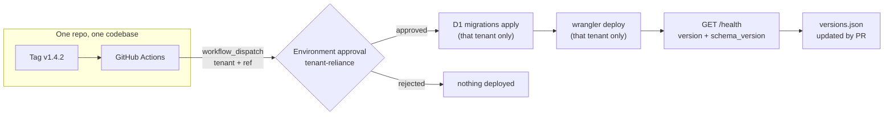

# Release management — one deployment per enterprise

Model: **one enterprise = one Worker + one D1 + one KV.** Reliance and Coles are separate deployments with
separate databases. They do not share code paths at runtime, and they do not share a release schedule — each
tenant is pinned to a version and promoted by hand.



## The registry is the source of truth

Two files, both in the repo, both reviewed by PR:

`infra/tenants/reliance.json`

```json
{
  "slug": "reliance",
  "tenant_id": "tnt_reliance",
  "app_id": "pos-prod",
  "worker": "pos-api-reliance",
  "d1_id": "8f2c…",
  "kv_id": "a91b…",
  "stores_expected": 10,
  "support_contact": "ops@reliance.example"
}
```

`infra/versions.json`

```json
{
  "reliance": { "tag": "v1.4.2", "schema": 7, "deployed_at": "2026-11-20T09:14:00Z", "by": "chandra" },
  "coles":    { "tag": "v1.3.0", "schema": 6, "deployed_at": "2026-11-11T16:02:00Z", "by": "chandra" }
}
```

Deploying is a **tag**, never a branch. `versions.json` is written by the pipeline after a successful smoke
test, so the file always describes what is actually running. A tenant missing from the file is a tenant nobody
has deployed — which is a state worth being able to see.

## Manual promotion, per tenant

```yaml
name: deploy-tenant
on:
  workflow_dispatch:
    inputs:
      tenant: { required: true, type: choice, options: [reliance, coles, staging] }
      ref:    { required: true, type: string, description: "tag, e.g. v1.4.2" }
      apply_migrations: { required: true, type: boolean, default: false }

jobs:
  deploy:
    environment: "tenant-${{ inputs.tenant }}"   # GitHub holds the approval here
    concurrency: "deploy-${{ inputs.tenant }}"   # one deploy per tenant at a time
    runs-on: ubuntu-latest
    steps:
      - uses: actions/checkout@v4
        with: { ref: "${{ inputs.ref }}" }
      - run: node infra/check-compat.mjs --tenant "${{ inputs.tenant }}" --ref "${{ inputs.ref }}"
      - if: inputs.apply_migrations
        run: npx wrangler d1 migrations apply "${{ inputs.tenant }}" --remote
      - run: npx wrangler deploy --config "infra/generated/${{ inputs.tenant }}.toml"
      - run: node infra/smoke.mjs --tenant "${{ inputs.tenant }}" --expect "${{ inputs.ref }}"
      - run: node infra/record-version.mjs --tenant "${{ inputs.tenant }}" --ref "${{ inputs.ref }}"
```

Three properties matter here:

- **`environment:`** is the approval gate. Each tenant gets its own GitHub environment with its own reviewers,
  so promoting Reliance cannot promote Coles.
- **`concurrency:`** stops two deploys landing on the same tenant at once.
- **`apply_migrations` is a separate, explicit boolean.** A code-only release must be possible without touching
  the schema, or every hotfix becomes a migration risk.

## Migrations are the hard part

Workers and D1 do not roll back together. Code rolls back in seconds; a migration does not roll back at all.
So the rule is **expand → migrate → contract**, one release apart:

| Release | Schema | Code |
|---|---|---|
| N | add `bills.customer_phone` (nullable) | writes both old and new shapes |
| N+1 | nothing | reads the new column, stops writing the old shape |
| N+2 | drop the old column | — |

This is what makes it safe for Reliance to sit on `v1.3.0` while Coles runs `v1.4.2` against the same
migration history. A migration that the previous release cannot run against is a bug, not a rollout detail.

`infra/check-compat.mjs` enforces the mechanical half: it reads the tag's declared `schema_version` and refuses
to deploy if the tenant's `schema_meta.schema_version` is ahead of it.

## Drift is the thing that will bite

Twenty tenants on twenty versions is twenty code paths to reason about. Two guards:

1. **Support window of two minor versions.** A tenant more than two minors behind is out of support; the
   pipeline warns, and after the third it refuses a migration until the tenant is brought forward.
2. **A nightly drift job** that calls `/health` on every tenant and opens one issue listing tenants whose
   `build` differs from `versions.json`. Not an alert per tenant — one issue, edited in place.

## Rollback

- **Code:** redeploy the previous tag through the same workflow. Minutes.
- **Schema:** forward only. If a migration is wrong, ship a new migration that repairs it. This is why the
  expand/contract rule exists — it keeps the previous Worker runnable against the current schema.
- **Data:** D1 Time Travel, 30 days, per database. Restoring bumps `sync_epoch`, and every terminal
  full-resyncs. Rehearse this on staging before Reliance needs it.

## What each tenant owns

| Thing | Per tenant | Consequence |
|---|---|---|
| Worker | yes | a bad deploy breaks one enterprise, not all |
| D1 | yes | 10 GB each; measured at ~1,067 bytes/bill (`capacity.md`) |
| KV | yes | revocation and rate-limit counters |
| JWT signing key | yes | a token minted for Reliance is invalid at Coles |
| Google OAuth client | yes | separate redirect URI per tenant |
| Release cadence | yes | pinned in `versions.json` |

Shared: DNS, the pipeline, monitoring. A DNS mistake takes down every tenant at once; a deploy mistake takes
down one.

## First three tenants, concretely

1. **staging** — your own, deployed on every merge to `main`. No approval gate. This is where migrations are
   rehearsed.
2. **canary** — one real shop you control. Gets a release a week before anyone else.
3. **reliance** — first customer, pinned to whatever canary has survived for a week.

Coles is the same procedure as Reliance with a different JSON file. If onboarding a tenant needs a code change,
the model is wrong.
