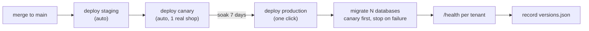

# Release management — one Worker, one database per enterprise

Compute is pooled; data is sharded. One Worker serves every tenant, routed by hostname. Each enterprise gets
its own D1 because the 10 GB cap is per database and cannot be raised (`DECISIONS.md` D19, D20).

The result is one deploy, one secret set, one cron, one rollback — and N databases that a script migrates.



## The registry, and the control plane

`infra/tenants.json` is authoritative for routing: it is reviewed in a PR, and the build compiles it into the
host → binding map. A **control-plane D1** (`env.META`) mirrors it for things that must change without a
deploy — suspension, store limits, feature flags — and records the schema version each tenant actually reached.
Routing never depends on META; `DECISIONS.md` D21 explains why.

## Files

`infra/tenants.json` — the only file that changes when a customer signs:

```json
[
  { "slug": "reliance", "host": "reliance.pos.app", "tenant_id": "tnt_reliance",
    "d1_id": "8f2c…", "stores_expected": 10 },
  { "slug": "coles", "host": "coles.pos.app", "tenant_id": "tnt_coles",
    "d1_id": "a91b…", "stores_expected": 10 }
]
```

`infra/versions.json` — written by the pipeline after a green smoke test:

```json
{ "worker": "v1.4.2", "schema": 7, "deployed_at": "2026-11-20T09:14:00Z",
  "tenants": { "reliance": { "schema": 7 }, "coles": { "schema": 7 } } }
```

One version for everyone, because everyone moves together. The per-tenant entry records only what the
migration loop actually reached, which is what you need when it stops halfway.

## Deploy

```yaml
name: deploy
on:
  push: { branches: [main] }
  workflow_dispatch:
    inputs:
      stage: { type: choice, options: [staging, canary, production], default: staging }

jobs:
  deploy:
    environment: ${{ inputs.stage || 'staging' }}
    concurrency: deploy-${{ inputs.stage || 'staging' }}
    runs-on: ubuntu-latest
    steps:
      - uses: actions/checkout@v4
      - run: npx wrangler deploy
      - run: node infra/smoke.mjs --stage "${{ inputs.stage || 'staging' }}"
```

One job. No matrix, no per-tenant environment, no per-tenant secret. Rollback is `wrangler rollback` — seconds,
because it is one deployment.

## Migrate

Migrations are the only per-tenant operation, so they get their own workflow and their own approval:

```yaml
name: migrate
on:
  workflow_dispatch:
    inputs:
      stage: { type: choice, options: [staging, canary, production], default: staging }

jobs:
  migrate:
    environment: migrate-${{ inputs.stage }}
    runs-on: ubuntu-latest
    steps:
      - uses: actions/checkout@v4
      - run: node infra/migrate.mjs --stage "${{ inputs.stage }}"
```

`infra/migrate.mjs` reads `tenants.json`, orders canary first, runs
`wrangler d1 migrations apply <db> --remote` per tenant, records each result in `versions.json`, and **stops on
the first failure** rather than continuing to the rest. A half-migrated fleet is recoverable; a fleet migrated
past a broken step is not.

## Onboarding a customer

Four commands, one PR:

```sh
node infra/onboard.mjs --slug reliance --stores 10   # creates D1, appends tenants.json
npx wrangler d1 migrations apply pos-reliance --remote
git commit -am "add reliance" && git push            # pipeline deploys the Worker with the new binding
```

The Worker picks up the new tenant on deploy because routing is generated from `tenants.json` at build time.
No code change, no new workflow, no new environment.

## Migrations still follow expand → contract

One Worker means every tenant runs the same code, which makes schema changes *easier*, not harder: there is no
version skew between code and schema across tenants. The rule stays because a migration is still irreversible:

| Release | Schema | Code |
|---|---|---|
| N | add nullable column | writes old and new shapes |
| N+1 | — | reads new, stops writing old |
| N+2 | drop old column | — |

The one skew that remains is **tenant against tenant**: Reliance may be at schema 7 while Coles is at 6 if the
loop stopped. The Worker must therefore read only columns that exist in the oldest supported schema. That is
what expand/contract guarantees.

## What replaces per-tenant pinning

Nothing, and that is deliberate. If a customer contracts for version isolation, give that tenant its own
Worker and its own workflow — a per-tenant exception, not the default. The code is identical; only the
deployment differs.

## Failure modes

| Event | Blast radius | Response |
|---|---|---|
| Bad Worker deploy | every tenant | `wrangler rollback`, seconds |
| Bad migration, canary first | canary only | fix forward; other tenants untouched |
| Bad migration reaching production | every tenant | restore from Time Travel, bump `sync_epoch`, terminals full-resync |
| One tenant's traffic spike | none | Workers scale per request; its D1 is its own |
| D1 binding limit | — | thousands per Worker; irrelevant at this scale |
| Secret rotation | every tenant | one secret, HKDF derives per-tenant keys |
