# Release management: one Worker, one database per enterprise

Compute is pooled; data is sharded. One Worker serves every tenant, routed by hostname. Each enterprise gets
its own D1 because the 10 GB cap is per database and cannot be raised (`DECISIONS.md` D19, D20).

The result is one deploy, one secret set, one cron, one rollback, and N databases that a script migrates
**before** the deploy, not after.

```mermaid
flowchart LR
    Merge["merge to main"] --> MigS["migrate staging<br/>(N D1s)"]
    MigS --> DepS["deploy staging<br/>(auto)"]
    DepS --> S1["smoke staging"]
    S1 --> MigC["migrate canary D1"]
    MigC --> DepC["deploy canary<br/>(auto, 1 real shop)"]
    DepC --> Soak["soak 7 days"]
    Soak -->|"promote"| MigP["migrate N databases<br/>canary first, stop on failure"]
    MigP -->|"all green"| DepP["deploy the Worker<br/>(one click, declares min_schema)"]
    DepP --> Smoke["/health per tenant"]
    Smoke --> Reg["record versions.json<br/>(a cache)"]
```



Staging is a second Worker with its own D1s. Everything after `DepS` runs against the real fleet.

## Schema truth, and the caches

A tenant's schema level is recorded in the only place that cannot lie about it: that database. D1 keeps
its own `d1_migrations` table (what ran, when, with what checksum), and every migration sets
`schema_meta.schema_version` in the same file. Those two are truth.

`META.tenant_schema` and `infra/versions.json` are caches the migrate workflow writes after reading both.
They exist so a dashboard and the next run do not have to enumerate N databases, and they are safe to
delete and rebuild. When a cache and a database disagree, the database wins, the cache is rewritten, and
the run logs it.

## The registry, and the control plane

`infra/tenants.json` is authoritative for routing: it is reviewed in a PR, and the build compiles it into the
host → binding map and the Worker's D1 and route blocks. A **control-plane D1** (`env.META`) mirrors it for
things that must change without a deploy: suspension, store limits, feature flags (`archival_enabled`), and
the schema level each tenant actually reached. Routing never depends on META; `DECISIONS.md` D21 explains why.

## Files

`infra/tenants.json` is the only file that changes when a customer signs:

```json
[
  { "slug": "reliance", "host": "reliance.pos.app", "tenant_id": "tnt_reliance",
    "app_id": "pos-prod-reliance", "binding": "DB_RELIANCE", "d1_id": "8f2c…",
    "stores_expected": 10, "canary": true },
  { "slug": "coles", "host": "coles.pos.app", "tenant_id": "tnt_coles",
    "app_id": "pos-prod-coles", "binding": "DB_COLES", "d1_id": "a91b…",
    "stores_expected": 10 }
]
```

`infra/versions.json` is written by the pipeline after a green smoke test, and is only ever a cache:

```json
{ "worker": "v1.5.0", "min_schema": 8, "schema": 8, "deployed_at": "2026-11-20T09:14:00Z",
  "tenants": { "reliance": { "schema": 8, "migrations": 8 },
               "coles":    { "schema": 7, "migrations": 7 } } }
```

One version for everyone, because everyone moves together. The per-tenant entry records only what the
migration loop actually reached, which is what you need when it stops halfway. A tenant at 7 under a
Worker that declares `min_schema: 7` is a normal, healthy state; it is not a failure.

## `min_schema`, and the N-1 rule

A release declares `min_schema`: the oldest schema it can run against. The Worker MUST work against
`min_schema` and against every newer schema, because a tenant can be ahead of the code that is serving it
for as long as the migration loop takes, and behind it forever if it opts out of a release.

Two consequences, both enforced in CI:

- The test suite runs the Worker at release N against a database migrated to N-1. A schema that only
  works when the database matches the code fails the build, not the fleet.
- `DROP` and rename steps are refused in review unless every tenant already reports the version that
  stopped using the column. That is the only condition under which contract (not expand) is allowed.

`min_schema` is a build constant, exported on `/health`, and it is what makes a rollback safe: the
previous release may only be restored if its own `min_schema` is at or below every tenant's current
schema.

## Deploy

Migrate and deploy are jobs in one workflow, because the second must not start when the first fails.
Separate workflows cannot express that ordering: whoever clicks the deploy button is not a dependency.

```yaml
name: release
on:
  push: { branches: [main] }
  workflow_dispatch:
    inputs:
      stage: { type: choice, options: [staging, canary, production], default: staging }

jobs:
  migrate:
    environment: migrate-${{ inputs.stage || 'staging' }}
    runs-on: ubuntu-latest
    steps:
      - uses: actions/checkout@v4
      - run: python3 docs/check-schema.py
      - run: python3 docs/check-invariants.py
      - run: python3 docs/explain-queries.py
      - run: node infra/migrate.mjs --stage "${{ inputs.stage || 'staging' }}"

  deploy:
    needs: migrate
    environment: ${{ inputs.stage || 'staging' }}
    concurrency: deploy-${{ inputs.stage || 'staging' }}
    runs-on: ubuntu-latest
    steps:
      - uses: actions/checkout@v4
      - run: node infra/gen-bindings.mjs --check
      - run: npx wrangler deploy
      - run: node infra/smoke.mjs --stage "${{ inputs.stage || 'staging' }}"
```

One deploy job. No matrix, no per-tenant environment, no per-tenant secret. Rollback is `wrangler rollback`,
seconds, because it is one deployment. The `environment` approval gate is what stops a hand-pushed deploy
from skipping a migration.

## Migrate

Migrations are the only per-tenant operation, so they get their own job, their own approval and their own
report.

Before any database is touched, the job runs the three repository checks against the migration set:
`docs/check-schema.py` (DDL and index shape), `docs/check-invariants.py` (29 cases: money identities, the
delete guards, the archive watermark, trigger coverage), and `docs/explain-queries.py` (the hot queries
still use an index). A check failure stops the run with nothing applied.

`infra/migrate.mjs` then reads `tenants.json`, orders the canary first, runs
`wrangler d1 migrations apply <db> --remote` per tenant, reads back both

```sql
SELECT schema_version FROM schema_meta;
SELECT COUNT(*) FROM d1_migrations;
```

and records each result in `META.tenant_schema` and `versions.json`. It **stops on the first failure**
rather than continuing to the rest. A half-migrated fleet is recoverable; a fleet migrated past a broken
step, then deployed, is not.

Migration files are expand-only for the rollout window: add tables and columns, backfill idempotently,
never remove or rename. Every migration carries its own `schema_meta.schema_version`, so a database can
never sit at a number that its tables do not match. A failed migration leaves the tenant at the previous
number and the previous tables, and the deploy job never runs.

## Onboarding a customer

Four commands, one PR:

```sh
bun run provision --slug reliance --stores 10   # creates D1, appends tenants.json
bun run gen:bindings                            # D1 block + route, committed
node infra/migrate.mjs --tenant reliance        # applies 0001..0008 before any deploy
git commit -am "add reliance" && git push       # pipeline migrates, deploys, smokes
```

The Worker picks up the new tenant on deploy because routing and bindings are generated from `tenants.json`
at build time. No code change, no new workflow, no new environment. The D1 is migrated before the binding
that can reach it ships, so the first request that resolves to it already finds the current schema.

Keep the R2 archive prefix (`archive/reliance/`) when decommissioning: it outlives the D1 by the GST
retention period.

## Migrations still follow expand → contract

One Worker means every tenant runs the same code, which makes schema changes easier, not harder: there is
no code version skew between tenants. The rule stays because a migration is still irreversible:

| Release | Schema | Code |
|---|---|---|
| N | add nullable column | writes the old and the new shape |
| N+1 | none | reads the new shape, stops writing the old one |
| N+2 | drop the old column | ships only after every tenant reports N+1 |

The skew that remains is **tenant against tenant**: reliance may be at 8 while coles is at 7 if the loop
stopped. The Worker reads only columns that exist at `min_schema`, which is what the CI run at N against
N-1 proves.

## What replaces per-tenant pinning

Nothing, and that is deliberate. If a customer contracts for version isolation, give that tenant its own
Worker and its own release path: the D20 exception. The code is identical; only the deployment differs.

## Failure modes

| Event | Blast radius | Response |
|---|---|---|
| Bad Worker deploy | every tenant | `wrangler rollback`, seconds. Only valid if the previous release's `min_schema` is at or below every tenant's schema |
| Worker needs a column only present in the new schema | none | the deploy job never runs, because `needs: migrate` and the loop stopped. Fix forward, then release |
| Bad migration, caught at the canary | canary only | fix forward with a compensating migration; the rest of the fleet was never touched |
| Migrate loop stops halfway | the tenants not yet migrated | they keep the previous schema, and the old Worker keeps serving them because `min_schema` is met. The new Worker never deploys, so no tenant is running code that needs a column it does not have |
| Bad migration reaching every tenant | every tenant | Time Travel restore, bump `sync_epoch`, terminals snapshot and re-push the last hour of bills |
| One tenant's traffic spike | none | Workers scale per request; its D1 is its own |
| D1 binding limit | none | one binding per tenant; a Worker holds thousands, so this is irrelevant at fleet sizes here |
| Secret rotation, planned | every tenant | by `kid`: add `MASTER_KEY_<newkid>`, sign with the new key, verify with both for 12 h (the longest-lived token is a grant or an assertion), remove the old key. Device JWTs live 5 min and converge on their own |
| Secret leak, suspected | every tenant | skip the window: add the new key, sign with it, remove the old immediately. Grants and assertions minted under the old key fail and are reissued; audit `audit_events` for tokens the holder minted |
