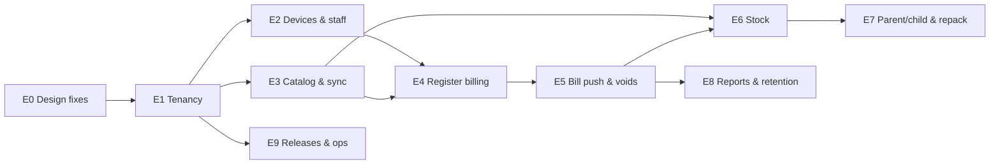

# Roadmap — Traasu v1

Planning file, not an OpenSpec change. One story = one change folder `openspec/changes/<story-id-lower>-<slug>/`
(e.g. `e4-s02-price-a-line`). The story names the capability requirements it implements; the spec is the
contract, this file is only status and order. Do not copy proposal/design/tasks content here.

**Status:** `Ready` → `Spec Proposed` → `Applying` → `Applied` → `Archived`; or `Blocked` (say why).
**Deliverables:** `DDL` (docs/ migrations), `W` (Worker), `R` (register), `A` (admin web).
**Size rule:** a story over ~15 tasks or ~5 requirements is split before it is proposed.

## Build order

E0 comes first: each item there changes DDL or a contract that later stories build on. E9's migrate/deploy
pipeline is needed before the first tenant, not before the first story.

## E0 — Design fixes before code (from `docs/gofrugal-parity.md`)

Each fix lands as one OpenSpec change with a MODIFIED/ADDED delta to the capabilities listed; the problem,
evidence and smallest fix are in `docs/gofrugal-parity.md`. Critical first; Decisions wait for the owner.

| ID | Story | Capabilities | Deliv. | Sev. | Status |
|---|---|---|---|---|---|
| E0-S01 | Books and batches in catalog sync; one apply order; books as one document per store | catalog-sync, books, batches | W, R | C | Ready |
| E0-S02 | One sale movement per bill line; deterministic movement ids | stock-ledger, bill-push, voids | DDL, W | C | Ready |
| E0-S03 | Register-allocated invoice series for offline bills | numbering | DDL, R, W | C | Ready |
| E0-S04 | One MRP owner, one change-selling route, price-above-MRP flag | batches, pricing, sale | DDL, W, R | H | Ready |
| E0-S05 | Units tied to dimension, frozen after use, UQC on the line | catalog, money-gst | DDL | H | Ready |
| E0-S06 | GST registration per store; rate-wise and HSN summary reports | tenancy, reports | DDL, W | H | Ready |
| E0-S07 | Tax-exclusive items billable; tax tied to the line's rate | money-gst | DDL | H | Ready |
| E0-S08 | Whole-set price precedence, store check, no holes, defined pricing modes | pricing, bill-push | DDL, W | H | Ready |
| E0-S09 | A discount cannot pass as a list sale | money-gst, overrides | DDL | H | Ready |
| E0-S10 | Atomic migrations and a safe re-run | releases | W | H | Ready |
| E0-S11 | Archival keeps tax summaries, parks archived voids, lawful retention floor | archival, voids, reports | DDL, W | H | Ready |
| E0-S12 | Stock link required on stock-bearing lines; no-live-batch fallback; expiry on the line | sale, parent-child, batches | DDL, R, W | H | Ready |
| E0-S13 | Repack idempotency, unpack cap, active book, mapping no-delete, frozen `uses_batches` | repack | DDL, W | H | Ready |
| E0-S14 | Admin routes for parent link, content and bulk mapping | parent-child, repack | W | H | Ready |
| E0-S15 | Scheduled (date-wise) price windows | pricing | W, R | H | Ready |
| E0-S16 | Import source key and edge-case rules | item-import | DDL, W | H | Ready |
| E0-S17 | Void approval and manager rights | voids, admin-auth | W, A | M | Ready |
| E0-S18 | Store the counted quantity with the adjustment | stock-ledger | DDL, W | M | Ready |
| E0-S19 | Batch order setting: latest, FIFO or short expiry | batches | DDL, R | M | Ready |
| E0-S20 | Pin the register on-hand estimate | stock-sync | R | M | Ready |
| E0-S21 | Catalog hygiene (cursor table, identifiers, tax rate history, names) | catalog, catalog-sync | DDL, W | M | Ready |
| E0-S22 | Receipt line and expiry validation | stock-receipts, batches | DDL, W | M | Ready |
| E0-S23 | Lease, clock skew, closed periods, `local_seq` after reinstall | offline-lease, numbering | R, W | M | Ready |
| E0-S24 | Weighing-scale barcodes | catalog, sale | — | Decision | Blocked: owner to choose scale and format |
| E0-S25 | Practice/training mode | cashier-sessions | — | Decision | Blocked: owner to confirm separate training.db |
| E0-S26 | Pack labels, repack report, transfer, opening stock, rounding in reports, offers rule, category | several | — | Decision | Blocked: owner to prioritise |

## E1 — Tenancy & provisioning

| ID | Story | Capabilities | Deliv. | Depends | Status |
|---|---|---|---|---|---|
| E1-S01 | Route a request by Host to its tenant D1 and check `schema_meta.tenant_id` | tenancy | W | E0 | Ready |
| E1-S02 | Derive per-tenant signing keys by `kid` (HKDF) and rotate | tenancy | W | E1-S01 | Ready |
| E1-S03 | Provision a tenant: D1, migrations, seed store, Main book, terminal, owner one-time password | provisioning | W, DDL | E1-S01 | Ready |

## E2 — Devices & staff identity

| ID | Story | Capabilities | Deliv. | Depends | Status |
|---|---|---|---|---|---|
| E2-S01 | Enrol a register in two steps; owner approves | device-enrolment | W, R, A | E1-S02 | Ready |
| E2-S02 | Exchange the device credential for a 5-minute token; revoke | device-enrolment | W, R | E2-S01 | Ready |
| E2-S03 | Offline lease: bill offline until the lease ends | offline-lease, device-enrolment | R, W | E2-S02 | Ready |
| E2-S04 | Cashier PIN login, switch-user, local-first logout, session push | cashier-sessions | R, W | E2-S02 | Ready |
| E2-S05 | Owner/manager sign-in with Better Auth (password, Google, TOTP), roles and store scope | admin-auth | W, A | E1-S01 | Ready |

## E3 — Catalog & sync

| ID | Story | Capabilities | Deliv. | Depends | Status |
|---|---|---|---|---|---|
| E3-S01 | Item master CRUD with versions; units and tax rates | catalog | W, A, DDL | E2-S05 | Ready |
| E3-S02 | Price sets: franchise default, store override, tiers, versions | pricing | W, A | E3-S01 | Ready |
| E3-S03 | Barcodes and aliases per store with pack quantity | catalog | W, A | E3-S01 | Ready |
| E3-S04 | Catalog delta pull by change-log cursor; register applies by version | catalog-sync | W, R | E3-S01 | Ready |
| E3-S05 | Catalog snapshot paging, epoch, `410 stale_cursor` recovery | catalog-sync | W, R | E3-S04 | Ready |
| E3-S06 | Import items and prices from the owner's GoFrugal export | item-import | W, A | E3-S02, E7-S01 | Ready |

## E4 — Register billing (offline)

| ID | Story | Capabilities | Deliv. | Depends | Status |
|---|---|---|---|---|---|
| E4-S01 | Scan or type an alias to a cart line; open cart never repriced | sale | R | E3-S04 | Ready |
| E4-S02 | Price a line: tiers, pack prices, store override, MRP | sale, pricing | R | E4-S01 | Ready |
| E4-S03 | GST per line, CGST/SGST/IGST/cess split, bill totals and rounding | money-gst | R, DDL | E4-S02 | Ready |
| E4-S04 | Discounts, manual price, override reasons, ceilings, approval grants | overrides | R, W | E4-S03 | Ready |
| E4-S05 | Save a bill durably (synchronous=FULL), display number | sale, numbering | R | E4-S03 | Ready |

## E5 — Bill push & voids

| ID | Story | Capabilities | Deliv. | Depends | Status |
|---|---|---|---|---|---|
| E5-S01 | Push ≤100 bills, one `db.batch()` each, per-bill accepted/rejected, replay-safe | bill-push | W, R | E4-S05 | Ready |
| E5-S02 | Server checks on push: stale price, price mismatch, business date, staff session | bill-push | W | E5-S01 | Ready |
| E5-S03 | Invoice numbers | numbering | W, R | E5-S01 | Ready |
| E5-S04 | Void a bill once, with actor and reason; rollup and restock follow | voids | W, R, A | E5-S01 | Ready |

## E6 — Stock

| ID | Story | Capabilities | Deliv. | Depends | Status |
|---|---|---|---|---|---|
| E6-S01 | Books: Main book, add, rename, reorder, deactivate | books | W, A | E3-S01 | Ready |
| E6-S02 | Purchase entry into one book; every line a new batch | stock-receipts, batches | W, A | E6-S01 | Ready |
| E6-S03 | Batch pick and the other-MRP prompt at scan | batches, sale | R | E6-S02, E4-S02 | Ready |
| E6-S04 | Sale and void movements; batch balances | stock-ledger | W, DDL | E5-S01 | Ready |
| E6-S05 | Adjustments and physical counts | stock-ledger | W, A | E6-S04 | Ready |
| E6-S06 | Stock pull by cursor; register on-hand estimate | stock-sync | W, R | E6-S04 | Ready |

## E7 — Parent/child & repack

| ID | Story | Capabilities | Deliv. | Depends | Status |
|---|---|---|---|---|---|
| E7-S01 | Parent/child items in the item master | parent-child, catalog | W, A | E3-S01 | Ready |
| E7-S02 | Sell a child from a parent batch; void it | parent-child, sale | R, W | E7-S01, E6-S03 | Ready |
| E7-S03 | Map repack items to bulk items | repack | W, A | E7-S01 | Ready |
| E7-S04 | Repack entry with loss; unpack | repack | W, A | E7-S03, E6-S02 | Ready |

## E8 — Reports & retention

| ID | Story | Capabilities | Deliv. | Depends | Status |
|---|---|---|---|---|---|
| E8-S01 | Day report from bill lines; month report from the daily rollup | reports | W, A | E5-S01 | Ready |
| E8-S02 | Override list and CSV export | reports | W, A | E8-S01 | Ready |
| E8-S03 | Archive store-months to R2 behind the per-tenant flag | archival | W | E8-S01 | Ready |

## E9 — Releases & ops

| ID | Story | Capabilities | Deliv. | Depends | Status |
|---|---|---|---|---|---|
| E9-S01 | Migrate → deploy → smoke pipeline with `min_schema` | releases | W | E1-S03 | Ready |
| E9-S02 | Canary stage and rollback | releases | W | E9-S01 | Ready |

## Spec gaps (design silent; decide before the story that needs it)

Found while writing the specs; nothing was invented for them. `<!-- OPEN parity-… -->` comments in the specs
mark rules written as decided that a parity finding says are wrong; those are the E0 stories.

| Gap | Needed by |
|---|---|
| Behavior and error code for a suspended tenant (D21 only says "within 60 s") | E1-S01 |
| One-time password delivery and re-print at provisioning; D1 export format; device revocation at decommission | E1-S03 |
| Error code for a superseded device credential; server-side record of a lease lapse | E2-S02, E2-S03 |
| Outcome of a staff assertion that fails verification, and of a session time outside the 5 min / 24 h bound (specs say: store and flag) | E2-S04 |
| Meaning of `pricing_mode` `fixed_only` / `tiered` / `linear` at pricing time | E3-S02 (E0-S08) |
| Rounding of decimal rupees to paise on import; import idempotency | E3-S06 (E0-S16) |
| MRP precedence for unbatched items; barcode format checks (GTIN check digit, PLU length) | E3-S03, E4-S02 |
| Forbid deactivating a store's last active book | E6-S01 |
| Source of the stock cursor epoch (specs say: the database epoch) | E6-S06 |
| A route that lists overrides (only `audit-events` exists) | E8-S02 |
| What `allow_discount_pct` and `restrict_price_edit` enforce; `prompt_qty` / `scale_qty` behavior | E4-S01, E4-S04 |
| Cess computation rule (today it only takes part in the identities); bill-level discounts and offers | E4-S03 |
| Clock-skew flag; closed-period lock for voids; `approval_grants.revoked_by` | E5-S02, E5-S04, E4-S04 |
| Shift shape (one open per terminal, bill's shift must match); numbering `reset_cadence` boundary and owner | E4-S05, E5-S03 |

## Not in v1 (DESIGN-BRIEF non-goals), kept for later epics

Tenders/payments, customers and credit, loyalty, returns, e-invoice, supplier purchases and cost, transfers
between books, offers/coupons/price levels, weighing-scale barcode export. `docs/gofrugal-parity.md` records
how GoFrugal does each, for when they are picked up.

## Progress log

- 2026-11-15 — Roadmap created from DECISIONS D1–D30 and the capability specs.
